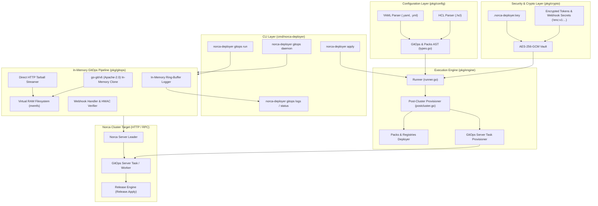

# Norca Deployer – Git Operations & In-Memory GitOps Architecture

> **Status:** Design; see [Implementation status](#11-implementation-status) for what exists  
> **Version:** 1.7.0 (GitOps Subsystem)  
> **Component:** `norca-deployer` (CLI, Engine, Config & Post-Cluster Lifecycle)  
> **Author:** Norca Core Team  
> **Language:** English  

---

## 1. Executive Summary and Goals

This specification defines the **Git Operations (GitOps)** subsystem integrated directly into **Norca Deployer** (`norca-deployer`). Norca Deployer is the single-binary lifecycle manager for Norca clusters, handling everything from node provisioning, PKI, firewall, and ACL bootstrapping to post-cluster pack deployments.

This design introduces two foundational GitOps capabilities into `norca-deployer`:

1. **On-Demand Git Fetch & Deploy (`norca-deployer gitops run`)**:
   - An authenticated, parameter-driven deployment engine that pulls pack definitions directly from remote Git repositories without saving repository clones or secrets to disk.
   - Full support for authentication (token, username/password, SSH deploy keys), flexible TLS configuration (strict HTTPS, custom private CA bundles, and `--insecure-skip-tls-verify`), branch/tag/commit targeting, monorepo subpaths, and pack value overrides.
2. **Continuous GitOps Daemon & Webhook Reconciler (`norca-deployer gitops daemon` / Server Task)**:
   - A persistent, event-driven reconciliation engine that listens for Git provider callback webhooks (`POST /v1/gitops/webhook`), verifies cryptographic HMAC signatures, filters events, applies debouncing, and triggers atomic pack releases.
   - Can be run as a standalone service by the deployer or provisioned automatically into the Norca server/cluster during `norca-deployer apply` as a dedicated server task.

### Core Architecture Pillars

- **Pure In-Memory Execution (Zero Disk Footprint)**: All Git fetches, tree inspections, template rendering, and release generation occur strictly in RAM using `github.com/go-git/go-git/v6` (Apache-2.0) with in-memory storage (`storage/memory`, `billy/memfs`) and direct HTTP tarball streaming. No repository clones, credentials, or intermediate files touch physical storage on the deployer machine or target nodes.
- **Multi-Provider Support with Forgejo Default**: Out-of-the-box integration for:
  - **Forgejo** (default, the native Git service packaged in `norca-registry`): native `X-Forgejo-Signature` HMAC-SHA256 verification and fast tarball archive streaming.
  - **Gitea**: native `X-Gitea-Signature` HMAC-SHA256 verification, REST API tokens, and direct archive streaming.
  - **GitHub** (Cloud & GitHub Enterprise Server): `X-Hub-Signature-256` HMAC-SHA256 verification, GitHub App and Personal Access Token auth, pre-signed S3 redirect-safe archive streaming.
  - **GitLab** (Cloud & GitLab Self-Managed): `X-Gitlab-Token` constant-time secret comparison, Project/Group/Deploy tokens, nested sub-group path encoding.
- **Dual Configuration Support (HCL & YAML)**: 1:1 syntactic and functional parity between HashiCorp Configuration Language (HCL) and YAML in `norca-deployer`'s configuration model (`pkg/config`).
- **In-Memory Ring-Buffer Audit Logging**: High-resolution execution and audit logs stored in an in-memory ring-buffer accessible via CLI (`norca-deployer gitops logs`) and HTTP API, paired with permanent revision provenance in the Raft-backed Release object.

---

## 2. Integration into Norca Deployer Architecture

The GitOps subsystem plugs seamlessly into `norca-deployer`'s modular layers:



---

## 3. Configuration Specification: HCL and YAML Parity

GitOps bindings in `norca-deployer` can be configured as part of the unified `cluster-deploy.yaml` / `cluster-deploy.hcl` plan under the `packs.gitops` section, or maintained in standalone GitOps manifest files.

### 3.1 HCL Configuration (`cluster-deploy.hcl`)

```hcl
metadata {
  name       = "production-cluster"
  region     = "global"
  datacenter = "dc1"
}

# Packs and GitOps Configuration
packs {
  # Standard registries
  registries = [
    { name = "builtin", type = "dir", url = "builtin" },
    { name = "norca", type = "git", url = "https://github.com/bacanoo-io/norca-registry", ref = "v0.1.0" }
  ]

  # GitOps Subsystem Configuration
  gitops {
    enabled           = true
    log_buffer_size   = 500
    debounce_duration = "5s"

    # 1. Forgejo Binding (Default Self-Hosted Git Platform)
    binding "payment-api-forgejo" {
      release_name = "payment-api"
      namespace    = "production"
      atomic       = true
      max_history  = 10

      forgejo {
        url                  = "https://forgejo.infra.internal/bacanoo/payment-pack.git"
        branch               = "main"
        subpath              = "packs/payment"
        auth_secret          = "!enc:v1:aes-gcm:a1b2c3d4..." # Encrypted Forgejo token or Norca Variable
        insecure_skip_verify = false
        ca_cert_pem          = "!file:certs/internal-ca.pem"
      }

      webhook {
        secret_key      = "!enc:v1:aes-gcm:e5f6g7h8..." # Encrypted HMAC secret
        events          = ["push"]
        filter_branches = ["main"]
      }

      values = {
        replicas = 5
        port     = 8080
      }
    }

    # 2. Gitea Binding
    binding "orders-api-gitea" {
      release_name = "orders-api"
      namespace    = "production"
      atomic       = true

      gitea {
        url                  = "https://gitea.corp.internal/services/orders-pack.git"
        branch               = "main"
        subpath              = "packs/orders"
        auth_secret          = "!enc:v1:aes-gcm:..."
        insecure_skip_verify = false
      }

      webhook {
        secret_key      = "!enc:v1:aes-gcm:..."
        events          = ["push"]
        filter_branches = ["main"]
      }

      values = {
        replicas = 3
      }
    }

    # 3. GitHub Binding (Cloud or GitHub Enterprise Server)
    binding "frontend-github" {
      release_name = "frontend-web"
      namespace    = "production"
      atomic       = true

      github {
        url         = "https://github.com/my-org/frontend-pack.git"
        branch      = "release/v2"
        subpath     = "pack"
        auth_secret = "!enc:v1:aes-gcm:..." # GitHub Personal Access Token or App Installation Token
        api_url     = "https://api.github.com"
      }

      webhook {
        secret_key      = "!enc:v1:aes-gcm:..."
        events          = ["push", "release"]
        filter_branches = ["release/*"]
        filter_tags     = ["v*"]
      }

      values = {
        domain = "frontend.company.com"
        env    = "prod"
      }
    }

    # 4. GitLab Binding (Sub-group Pathing)
    binding "billing-gitlab" {
      release_name = "billing-worker"
      namespace    = "billing"
      atomic       = true

      gitlab {
        url          = "https://gitlab.company.com/finance/services/billing-pack.git"
        branch       = "main"
        project_path = "finance/services/billing-pack" # Encoded automatically as finance%2Fservices%2Fbilling-pack
        auth_secret  = "!enc:v1:aes-gcm:..."         # Deploy Token or Project Token
      }

      webhook {
        secret_key      = "!enc:v1:aes-gcm:..." # Plaintext token matched against X-Gitlab-Token
        events          = ["push"]
        filter_branches = ["main"]
      }

      values = {
        concurrency = 16
      }
    }
  }
}
```

---

### 3.2 YAML Configuration (`cluster-deploy.yaml`)

```yaml
metadata:
  name: "production-cluster"
  region: "global"
  datacenter: "dc1"

packs:
  registries:
    - { name: "builtin", type: "dir", url: "builtin" }
    - { name: "norca", type: "git", url: "https://github.com/bacanoo-io/norca-registry", ref: "v0.1.0" }

  gitops:
    enabled: true
    log_buffer_size: 500
    debounce_duration: 5s
    bindings:
      # 1. Forgejo Binding
      - name: payment-api-forgejo
        release_name: payment-api
        namespace: production
        atomic: true
        max_history: 10
        forgejo:
          url: "https://forgejo.infra.internal/bacanoo/payment-pack.git"
          branch: "main"
          subpath: "packs/payment"
          auth_secret: "!enc:v1:aes-gcm:a1b2c3d4..."
          insecure_skip_verify: false
          ca_cert_pem: "!file:certs/internal-ca.pem"
        webhook:
          secret_key: "!enc:v1:aes-gcm:e5f6g7h8..."
          events: ["push"]
          filter_branches: ["main"]
        values:
          replicas: 5
          port: 8080

      # 2. Gitea Binding
      - name: orders-api-gitea
        release_name: orders-api
        namespace: production
        atomic: true
        gitea:
          url: "https://gitea.corp.internal/services/orders-pack.git"
          branch: "main"
          subpath: "packs/orders"
          auth_secret: "!enc:v1:aes-gcm:..."
          insecure_skip_verify: false
        webhook:
          secret_key: "!enc:v1:aes-gcm:..."
          events: ["push"]
          filter_branches: ["main"]
        values:
          replicas: 3

      # 3. GitHub Binding
      - name: frontend-github
        release_name: frontend-web
        namespace: production
        atomic: true
        github:
          url: "https://github.com/my-org/frontend-pack.git"
          branch: "release/v2"
          subpath: "pack"
          auth_secret: "!enc:v1:aes-gcm:..."
          api_url: "https://api.github.com"
        webhook:
          secret_key: "!enc:v1:aes-gcm:..."
          events: ["push", "release"]
          filter_branches: ["release/*"]
          filter_tags: ["v*"]
        values:
          domain: "frontend.company.com"
          env: "prod"

      # 4. GitLab Binding
      - name: billing-gitlab
        release_name: billing-worker
        namespace: billing
        atomic: true
        gitlab:
          url: "https://gitlab.company.com/finance/services/billing-pack.git"
          branch: "main"
          project_path: "finance/services/billing-pack"
          auth_secret: "!enc:v1:aes-gcm:..."
        webhook:
          secret_key: "!enc:v1:aes-gcm:..."
          events: ["push"]
          filter_branches: ["main"]
        values:
          concurrency: 16
```

---

## 4. Multi-Provider Feature Matrix

| Feature / Dimension | Forgejo (Default) | Gitea | GitHub | GitLab |
| :--- | :--- | :--- | :--- | :--- |
| **Provider Key** | `forgejo` | `gitea` | `github` | `gitlab` |
| **Default Host** | Self-hosted (`https://...`) | Self-hosted (`https://...`) | `https://github.com` | `https://gitlab.com` |
| **Webhook Event Header** | `X-Forgejo-Event` (fallback `X-Gitea-Event`) | `X-Gitea-Event` | `X-GitHub-Event` | `X-Gitlab-Event` |
| **Webhook Delivery ID** | `X-Forgejo-Delivery` | `X-Gitea-Delivery` | `X-GitHub-Delivery` | `X-Gitlab-Webhook-UUID` |
| **Signature / Auth Header** | `X-Forgejo-Signature` / `X-Gitea-Signature` | `X-Gitea-Signature` | `X-Hub-Signature-256` | `X-Gitlab-Token` |
| **Verification Algorithm** | HMAC-SHA256 (hex) | HMAC-SHA256 (hex) | HMAC-SHA256 (`sha256=<hex>`) | Plaintext Secret (Constant-time string match) |
| **Direct Archive API** | `/api/v1/repos/{owner}/{repo}/archive/{ref}.tar.gz` | `/api/v1/repos/{owner}/{repo}/archive/{ref}.tar.gz` | `/repos/{owner}/{repo}/tarball/{ref}` | `/api/v4/projects/{id_or_path}/repository/archive.tar.gz` |
| **Redirect Behavior** | Direct HTTP stream | Direct HTTP stream | 302 Found to AWS S3 (pre-signed, strips `Authorization`) | Direct stream or internal redirect |
| **Supported Credentials** | User + Token (PAT), User + Password, SSH Deploy Key | User + Token (PAT), User + Password, SSH Deploy Key | Personal Access Token (classic & fine-grained), GitHub App Token, SSH Key | Project/Group Access Token, Deploy Token (`username` + `password`), PAT, SSH Key |
| **Path / Sub-group Handling** | `{owner}/{repo}` | `{owner}/{repo}` | `{owner}/{repo}` | Supports nested namespaces via URL-encoding (`group%2Fsubgroup%2Fproject`) |
| **Custom CA / Insecure TLS** | Supported (`ca_cert_pem`, `insecure_skip_verify`) | Supported (`ca_cert_pem`, `insecure_skip_verify`) | Supported for GHES | Supported for Self-Managed |

---

## 5. In-Memory Git Engine (`github.com/go-git/go-git/v6`, Apache-2.0)

To guarantee zero disk residue and maintain an ephemeral footprint, `norca-deployer` implements two in-memory retrieval mechanisms:

### 5.1 Direct HTTP Archive Streaming (High-Performance Path)

When fetching packs from Forgejo, Gitea, GitHub, or GitLab, the deployer streams the remote tarball archive directly into memory:

```
HTTP Body Stream ──> [ gzip.NewReader ] ──> [ tar.NewReader ] ──> [ memfs Virtual Filesystem (RAM) ]
```

1. **Forgejo & Gitea**:
   - `GET {url}/api/v1/repos/{owner}/{repo}/archive/{ref}.tar.gz`
   - Header: `Authorization: token <token>`.
2. **GitHub (AWS S3 Pre-signed Redirect Handling)**:
   - `GET {api_url}/repos/{owner}/{repo}/tarball/{ref}` with `Authorization: Bearer <token>`.
   - **Critical Security Control**: When following the `302 Found` redirect to AWS S3, the HTTP client's `CheckRedirect` hook strips the `Authorization` and `PRIVATE-TOKEN` headers on a redirect to another host or from https to http, to prevent leaking tokens to Amazon S3 and avoid S3 `400 InvalidArgument` errors.
   - A GitHub Enterprise Server is reached at `api_url`, by default `https://<host>/api/v3`: the token of a repository never goes to `api.github.com` unless the repository is on `github.com`.
3. **GitLab (Subgroup URL-Encoding)**:
   - `GET {url}/api/v4/projects/{encoded_project_path}/repository/archive.tar.gz?sha={ref}`.
   - Slashes in subgroup project paths are escaped as `%2F`.

### 5.2 In-Memory Clone with `go-git/v6` (Generic Fallback)

For tracking arbitrary Git commits or when accessing private repositories over Git Smart HTTP or SSH without REST API access:

```go
package gitops

import (
	"context"
	"fmt"

	"github.com/go-git/go-billy/v6"
	"github.com/go-git/go-billy/v6/memfs"
	"github.com/go-git/go-git/v6"
	"github.com/go-git/go-git/v6/plumbing"
	githttp "github.com/go-git/go-git/v6/plumbing/transport/http"
	"github.com/go-git/go-git/v6/storage/memory"
)

// FetchPackInMemory performs a pure in-memory shallow clone.
func FetchPackInMemory(ctx context.Context, repoURL, branch string, auth *AuthCredentials, tlsCfg *TLSConfig) (billy.Filesystem, error) {
	storer := memory.NewStorage()
	fs := memfs.New()

	cloneOpts := &git.CloneOptions{
		URL:           repoURL,
		ReferenceName: plumbing.ReferenceName(fmt.Sprintf("refs/heads/%s", branch)),
		SingleBranch:  true,
		Depth:         1,
		Tags:          git.NoTags,
	}

	// 1. Credentials
	if auth != nil && auth.Token != "" {
		user := auth.Username
		if user == "" {
			user = "oauth2"
		}
		cloneOpts.Auth = &githttp.BasicAuth{
			Username: user,
			Password: auth.Token,
		}
	} else if auth != nil && auth.Password != "" {
		cloneOpts.Auth = &githttp.BasicAuth{
			Username: auth.Username,
			Password: auth.Password,
		}
	}

	// 2. TLS Setup: per clone, in cloneOpts.ClientOptions (client.WithCABundle,
	// client.WithInsecureSkipTLS). A global HTTP client would be shared by
	// concurrent fetches.

	// 3. Clone strictly into RAM
	_, err := git.CloneContext(ctx, storer, fs, cloneOpts)
	if err != nil {
		return nil, fmt.Errorf("in-memory clone failed: %w", err)
	}

	return fs, nil
}
```

---

### 5.3 From RAM to the cluster

The servers render packs from cluster registries, and rendering needs the pack engine of the Norca module. A fetched pack therefore goes to the cluster as an in-memory tar.gz:

1. `PUT /v1/pack-upload?registry=gitops-<hash>&filename=<pack>.tar.gz`, into a registry of the type `uploads` per release, which the upload creates. The leader stores the archive in Raft.
2. `DELETE /v1/pack-upload/<registry>/<digest>` for older uploads: a later upload of a pack version replaces an earlier one by their upload time, in seconds.
3. `POST /v1/release/<name>/deploy-pack?namespace=&region=` with `Registry`, `Pack` and `Version`.

`metadata.hcl` must be at the root of the subpath, with a name and a version in its `pack` block.

---

## 6. Post-Cluster Provisioning & Server Task Deployment (`postcluster.go`)

> **Not implemented.** `apply` fetches and deploys the bindings once (`deployGitOps`). The server task, the webhook endpoint on the Norca servers and the leader election below don't exist; webhooks are served by `gitops daemon`. Webhooks that arrive while the daemon is down are lost.

During `norca-deployer apply`, once the masters are healthy and Raft consensus is established, `pkg/engine/postcluster.go` provisions the GitOps server task into the cluster:

### 6.1 Server Task Deployment Steps

```
[ norca-deployer apply ]
       │
       ▼
1. Detect Raft Leader Node (HTTP API)
       │
       ▼
2. Provision Bootstrap Secrets & Webhook Tokens (AES-256-GCM decrypted)
       │
       ▼
3. Deploy GitOps Controller Task (System Job on Masters)
   - Binds to Norca Server HTTP API (/v1/gitops/webhook)
   - Runs with Leader Election Lock (active only on leader)
       │
       ▼
4. Register GitOps Bindings & Markers (.norca-deployer/gitops/<name>.sha256)
```

1. **Leader Detection**: Finds the active master node via `/v1/status/leader`.
2. **Secrets Decryption**: Decrypts `!enc:v1:...` webhook secrets and tokens using `.norca-deployer.key` and injects them into Norca Variables (`secrets.bootstrap`).
3. **Server Task Activation**:
   - Deploys the GitOps controller as a high-availability server task.
   - If the active leader server fails, Raft triggers election and the new leader assumes the GitOps worker without missed webhooks (followers forward RPCs).
4. **Digest Markers**: Every apply fetches the binding; a `.norca-deployer/gitops/<name>.sha256` marker over the pack content and the settings skips the deployment when neither changed.

---

## 7. Webhook Handler & Multi-Provider Ingestion

The webhook listener ingests events at `POST /v1/gitops/webhook`. Every binding has its own secret: a request is checked against the binding of `?binding=`, or against all of them, and the provider of the signature must fit the binding. The event type comes from the event header of the provider, and the repository of the payload must have the path of the binding; pings and deleted refs deploy nothing.

```go
package gitops

import (
	"crypto/hmac"
	"crypto/sha256"
	"crypto/subtle"
	"encoding/hex"
	"errors"
	"net/http"
	"strings"
)

// AuthenticateWebhook identifies provider and validates signature
func AuthenticateWebhook(r *http.Request, payload []byte, secret string) (string, error) {
	if secret == "" {
		return "", errors.New("empty webhook secret configured")
	}

	// 1. Forgejo
	if sig := r.Header.Get("X-Forgejo-Signature"); sig != "" {
		if !verifyHMACSHA256(payload, secret, sig) {
			return "", errors.New("invalid Forgejo HMAC signature")
		}
		return "forgejo", nil
	}

	// 2. Gitea
	if sig := r.Header.Get("X-Gitea-Signature"); sig != "" {
		if !verifyHMACSHA256(payload, secret, sig) {
			return "", errors.New("invalid Gitea HMAC signature")
		}
		return "gitea", nil
	}

	// 3. GitHub
	if sig := r.Header.Get("X-Hub-Signature-256"); sig != "" {
		sigHex := strings.TrimPrefix(sig, "sha256=")
		if !verifyHMACSHA256(payload, secret, sigHex) {
			return "", errors.New("invalid GitHub HMAC-SHA256 signature")
		}
		return "github", nil
	}

	// 4. GitLab (Plaintext Secret Token)
	if token := r.Header.Get("X-Gitlab-Token"); token != "" {
		if subtle.ConstantTimeCompare([]byte(token), []byte(secret)) != 1 {
			return "", errors.New("invalid GitLab secret token")
		}
		return "gitlab", nil
	}

	return "", errors.New("unrecognized webhook signature headers")
}

func verifyHMACSHA256(payload []byte, secret, expectedHex string) bool {
	mac := hmac.New(sha256.New, []byte(secret))
	mac.Write(payload)
	expectedMAC := hex.EncodeToString(mac.Sum(nil))
	return subtle.ConstantTimeCompare([]byte(expectedMAC), []byte(expectedHex)) == 1
}
```

### 7.2 Debouncing & Execution Lock

- **Debounce Window (`5s`)**: Coalesces rapid sequential push events into a single reconciliation run against the latest commit SHA.
- **Per-Release Mutex**: Serializes runs for the same release. A push during a run of its binding waits for it, and only the latest one runs.

---

## 8. In-Memory Ring-Buffer Logging & Audit Trail

### 8.1 RingLogger Architecture

The daemon keeps an in-memory circular buffer of recent runs (`RingLogger`), shared by its bindings:

```go
type LogEntry struct {
	ID          string            `json:"id"`
	Timestamp   time.Time         `json:"timestamp"`
	BindingName string            `json:"binding_name"`
	Provider    string            `json:"provider"`
	Trigger     string            `json:"trigger"` // "webhook" | "on-demand"
	CommitSHA   string            `json:"commit_sha"`
	Author      string            `json:"author"`
	Message     string            `json:"message"`
	Phase       string            `json:"phase"`   // "FETCH", "RENDER", "APPLY", "SUCCESS", "FAILED"
	Details     string            `json:"details"`
	DurationMs  int64             `json:"duration_ms"`
}
```

- Fixed size: `log_buffer_size` entries, 500 by default.
- All secrets, tokens, and authorization headers are sanitized with `[REDACTED]` prior to insertion.

### 8.2 Release Provenance

A release has no metadata of its own for the source, so the description of the revision holds it:

```
GitOps forgejo https://forgejo.infra.internal/bacanoo/payment-pack.git (main) commit 7f8b91a24d8c910283e5891d1209384bcdaef190
```

---

## 9. CLI Command Catalog (`norca-deployer gitops`)

The `norca-deployer` CLI provides a complete command suite for managing and running GitOps pipelines:

### 9.1 Commands Reference

| Command | Description |
| :--- | :--- |
| `norca-deployer gitops run [flags]` | Execute an immediate on-demand in-memory Git fetch and deploy. |
| `norca-deployer gitops daemon [flags]` | Run continuous webhook listener daemon locally or on a management node. |
| `norca-deployer gitops status` | Display the status of all registered GitOps bindings and last sync SHAs. |
| `norca-deployer gitops logs <binding>` | Print or stream in-memory execution and audit logs. |

### 9.2 Command Examples

#### On-Demand Deployment from Forgejo:
```shell
norca-deployer gitops run \
  --provider="forgejo" \
  --url="https://forgejo.infra.internal/bacanoo/payment-pack.git" \
  --branch="main" \
  --subpath="packs/payment" \
  --token-env="GIT_TOKEN" \
  --name="payment-api" \
  --namespace="production" \
  --var="replicas=5" \
  --atomic=true
```

#### On-Demand Deployment from GitHub:
```shell
norca-deployer gitops run \
  --provider="github" \
  --url="https://github.com/my-org/frontend-pack.git" \
  --branch="release/v2" \
  --token-env="GITHUB_TOKEN" \
  --name="frontend-web" \
  --var="env=prod"
```

#### Inspecting Logs:
```shell
# Show last 50 log entries for payment-api
norca-deployer gitops logs payment-api --tail=50

# Follow live deployment logs
norca-deployer gitops logs payment-api -f
```

---

## 10. Security & Hardening Guarantees

1. **No Clones on Disk**: Neither the Git repository clone nor decrypted secrets are written to the local disk of the deployer. The servers store the uploaded pack archive in Raft and their pack cache, and `apply` keeps digest markers; the CLI of a server gets the archive as a temporary file over SSH.
2. **Redirect Header Sanitization**: In-memory HTTP archive downloaders strip `Authorization` and `PRIVATE-TOKEN` headers when redirected to external hosts (such as AWS S3 pre-signed storage).
3. **Subpath Traversal Defense**: A `subpath` with a `..` element is refused; `path.Clean` alone keeps a leading `..`. Files are only matched against it in memory.
4. **Automated Atomic Rollbacks**: When `atomic: true`, any allocation failure or failed health check during deployment triggers an automatic rollback to the prior revision.
5. **Memory Limits**: A pack takes 64 MiB and 4096 files at most, the limits of the pack uploads of the servers; an archive 8 MiB.
6. **Protected Logs**: The logs and status of the daemon need a token, or a loopback client.

---

## 11. Implementation Status

| Area | Status |
| :--- | :--- |
| `gitops run`, `apply`, `gitops daemon`, `status`, `logs` | Implemented in `pkg/gitops` and `cmd/norca-deployer` |
| Forgejo, Gitea, GitHub, GitLab archives and webhooks | Implemented; only the Forgejo-compatible fake and a local repository were exercised in tests |
| SSH deploy keys | Implemented through `ssh_private_key`; not exercised against a server |
| GitHub App tokens, username and password in the plan | Not implemented; `gitops run` takes `--username` and `--password` |
| GitOps server task, webhook on the Norca servers | Not implemented (section 6) |
| `gitops.*` metadata on a release | Not possible; the description holds the source (section 8.2) |
| Pack signing | An uploaded archive has no signature, so the servers don't verify it |
| Signed commits and tags | Implemented in the deployer (`verify` block): PGP only, the deployed commit or tag only |

