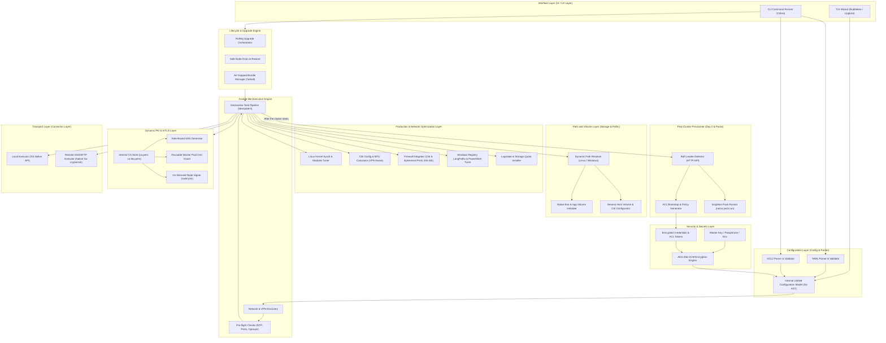
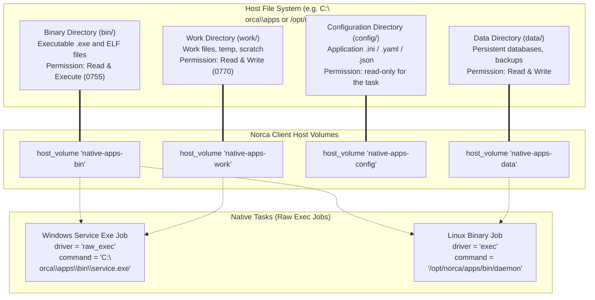

# Norca Deployer – System Design and Architecture Specification

> **Status:** Comprehensive Final Draft  
> **Version:** 1.6.0  
> **Date:** October 29, 2026  
> **Author:** Norca Core Team  
> **Language:** English (documentation and user communication)  

---

## 1. Executive Summary and Goals

The **Norca Deployer** is a modern, lightweight, self-contained (single-binary) installer and full lifecycle manager for **Norca** clusters. Norca is an independent, open source workload orchestrator compatible with HashiCorp Nomad v1.6.5, with built-in capabilities such as a native autoscaler, Consul-free service discovery, encrypted backup/restore to S3/RustFS, a NATS event bridge (natsbridge) and integrated package management (`norca pack`).

The installer builds and manages the complete production environment:
1. **Interactive TUI (Terminal User Interface) Wizard:** Guides the operator step by step from planning to execution, discovers the network and VPN interfaces, handles the path configuration and SSH authentication, validates the system and exports the finished plan.
2. **Declarative CLI Runner:** A tool that fits into CI/CD pipelines. Based on YAML and HCL configurations, it performs the installation in a declarative, **Ansible-like**, idempotent way: the customized directory layout, the preparation of native `.exe` volumes, zero-downtime version upgrades and offline (air-gapped) packaging.

### Main Design Principles:
- **Zero-Dependency (Agentless):** Written in Go and run as a single binary; the target machines need no preinstalled agent, Python or external package.
- **Configurable Path Layout:** Every default path (binaries, configuration, data, logs, certificates, CNI) can be reconfigured freely at the global, platform and node level.
- **Native Exe / Binary Execution and Predefined Volumes:** Dedicated directories and `host_volume` definitions for non-container, native Windows `.exe` and Linux binary applications (`raw_exec` / `exec` drivers), with automatic execute permissions (`chmod +x`, NTFS ACL).
- **Dynamic Node Scaling and IP-Independent PKI:** Role-based SAN model (`server.<region>.norca`, `client.<region>.norca`), reusable worker pool certificates for autoscaling.
- **Automatic ACL Bootstrap & Secrets Management:** Generation of the initial management token and its secure storage in the AES-256-GCM encrypted secrets store, with default policies.
- **Production Hardening, Sysctl & Firewall:** Automatic kernel parameters, file descriptors and memory limits, and opening of the CNI and dynamic application port range (`20000-32000`) in the firewall.
- **Zero-Downtime Version Upgrade (Rolling Upgrade & Drain):** Sequential upgrade of the master servers that preserves the Raft consensus, and migration of client workloads (`node drain`).
- **Air-Gapped / Offline Bundle Mode:** Creation of a complete installation archive for closed infrastructures without internet.

---

## 2. System Architecture

The modular structure of the Norca Deployer separates path handling, volume preparation, secrets storage, system tuning and the lifecycle engine.



---

## 3. Configurable Path Layout

In many organizations, security rules (e.g. a separate partition for binaries, mounted disks for data, an audited log partition) require that the installer does not use only hard-coded standard paths.

The deployer allows every base directory to be overridden:
- **Globally** (defaults for the whole cluster),
- **Per platform** (separate Linux and Windows paths),
- **Per node (host)** (overrides for individual servers).

### 3.1. Path Matrix and Defaults

| Directory Type | Description | Linux Default | Windows Default | Configuration Key |
| :--- | :--- | :--- | :--- | :--- |
| **Binary directory** | `norca` and helper tools | `/usr/local/bin` | `C:\Program Files\norca\bin` | `paths.bin_dir` |
| **Configuration directory**| `norca.hcl` and other configs | `/etc/norca.d` | `C:\ProgramData\norca\config` | `paths.config_dir` |
| **Data directory** | Raft log, allocation state | `/var/lib/norca` | `C:\ProgramData\norca\data` | `paths.data_dir` |
| **Log directory** | Service and runtime logs | `/var/log/norca` | `C:\ProgramData\norca\logs` | `paths.log_dir` |
| **Certificate directory** | mTLS CA, certificates and keys | `/etc/norca.d/tls` | `C:\ProgramData\norca\config\tls`| `paths.tls_dir` |
| **CNI binaries** | Network plugins (`bridge`) | `/opt/cni/bin` | `C:\Program Files\norca\cni` | `paths.cni_bin_dir` |
| **CNI configurations** | Network lists (`.conflist`) | `/opt/cni/config` | `C:\ProgramData\norca\cni\config` | `paths.cni_config_dir`|
| **Native apps root** | `.exe` and binary applications | `/opt/norca/apps` | `C:\norca\apps` | `paths.apps_dir` |

The deployer creates the given directories idempotently and sets the proper permissions (chmod 0750 / 0700, Windows NTFS ACL).

---

## 4. Native Exe and Binary Application Volumes (Native App Volumes)

One of Norca's strengths is that it schedules and supervises **not only OCI/Docker containers** but also executables at the operating system level (Windows `.exe`, `.bat`, `.ps1`, Linux ELF binaries and shell scripts) with the `raw_exec` or `exec` drivers.

So that these native applications run in a clean, predictable environment, the deployer creates predefined **Custom App Volumes** and registers them with Norca.



### 4.1. Predefined Volume Layout for Native Applications
On the client machines the deployer creates the following layout under the `apps_dir` root:
1. `bin/` (**Binary volume - `native-apps-bin`**):
   - Holds the `.exe` or binary files that are run directly.
   - Permission: `chmod 0755` on Linux, `Read & Execute` for the `norca` process on Windows.
2. `work/` (**Work directory volume - `native-apps-work`**):
   - Work directory for temporary files and buffering.
   - Permission: full read/write (`0770`).
3. `config/` (**Configuration volume - `native-apps-config`**):
   - Application-specific settings.
4. `data/` (**Persistent data volume - `native-apps-data`**):
   - For databases, backups or stateful files.

### 4.2. Driver Enablement and Environment Preparation
The deployer automatically enables the required driver options in the client's `norca.hcl`:
```hcl
client {
  enabled = true

  options = {
    "driver.raw_exec.enable" = "1"
    "driver.exec.enable"     = "1"
  }

  host_volume "native-apps-bin" {
    path      = "C:\\norca\\apps\\bin" # on Linux: "/opt/norca/apps/bin"
    read_only = false
  }

  host_volume "native-apps-work" {
    path      = "C:\\norca\\apps\\work"
    read_only = false
  }
}
```

---

## 5. Dynamic Node Management and Flexible PKI / mTLS

The number of cluster nodes and their IP addresses can change dynamically (autoscaling, DHCP, cloud IP changes):

### 5.1. Role- and Region-Based SAN Model
Norca's mTLS security engine (`verify_server_hostname = true`, `verify_https_client = true`) does not check the IP address of the connecting party, but the **Common Name (CN)** and **DNS Subject Alternative Name (SAN)** fields of the X.509 certificate:
- **Client / worker certificates (`client.<region>.norca`):**
  - **CN / DNS SAN:** `client.<region>.norca`, `*.client.<region>.norca`
  - **IP SANs:** **Not needed!**
  - The client certificate is **fully IP-independent and reusable** (`client-pool.pem`).
- **Server certificates (`server.<region>.norca`):**
  - **CN / DNS SAN:** `server.<region>.norca`, `*.server.<region>.norca`, `localhost`, `*.norca.internal`.
  - **IP SANs:** `127.0.0.1`, the physical and VPN IP addresses known at the start, and optionally a subnet wildcard.

### 5.2. Node Expansion Modes
1. **Reusable worker pool certificate:** The `client-pool.pem` certificate generated when the cluster is created can be given to any new worker machine (e.g. AWS Auto Scaling launch template, cloud-init), which can join immediately.
2. **On-demand node addition:** `norca-deployer node add --host=10.8.0.30 --role=client`.
3. **Zero-downtime certificate reload:** The certificates of the running process can be renewed without downtime with `systemctl reload norca` (`SIGHUP`).

---

## 6. ACL System and Initial Bootstrap Token Management

Access control is a critical line of defense:
1. If the configuration has `acl.enabled: true`, the deployer runs `norca acl bootstrap` right after the Raft leader is elected.
2. It encrypts the returned **management token** with an AES-256-GCM key and stores it in the `credentials.enc.yaml` file.
3. It creates the standard role policies (`devops-admin`, `worker-policy`, `anonymous-read`).
4. It exports the `NORCA_TOKEN` environment variable on the control machine.

---

## 7. Production Hardening, CNI and Firewall Optimization

### 7.1. Kernel Sysctl Parameters (`/etc/sysctl.d/99-norca-production.conf`)
- `net.ipv4.ip_forward = 1` and `net.ipv6.conf.all.forwarding = 1`
- `net.bridge.bridge-nf-call-iptables = 1`, `bridge-nf-call-ip6tables = 1`, `bridge-nf-call-arptables = 1`
- Modules: `bridge`, `br_netfilter` in `/etc/modules-load.d/norca-bridge.conf`.
- File descriptors: `fs.file-max = 2097152`, `fs.inotify.max_user_watches = 524288`.
- Memory: `vm.max_map_count = 262144`, `vm.overcommit_memory = 1`, `vm.swappiness = 1`.
- ARP table: `gc_thresh1 = 1024`, `gc_thresh2 = 2048`, `gc_thresh3 = 4096`.

### 7.2. CNI MTU, IPAM and Custom Interface Matching (Prefix & Suffix)
- **Custom interface lookup by prefix and suffix:**
  VPN or cloud interfaces are often numbered or labeled dynamically. The deployer supports:
  - `interface_prefix`: e.g. `"wg"` (matches `wg0`, `wg_norca`), `"tun"` (`tun0`), `"tailscale"` (`tailscale0`).
  - `interface_suffix`: e.g. `"vpn"` (matches `office-vpn`, `priv-vpn`), `"cluster"`.
  - The dynamic addressing in the generated Nomad/Norca configuration follows it: `advertise { http = "{{ GetInterfaceIP \"wg*\" }}" }`.
- **Dynamic MTU calculation:** When a WireGuard/Tailscale VPN is detected, the deployer sets an MTU matching the VPN (e.g. `1420`) in the CNI bridge configuration, which eliminates packet loss from Path MTU black holes.
- **Non-overlapping IPAM subnets:** Every worker machine gets a dedicated `/20` or `/24` subnet for the internal container network.

### 7.3. Firewall Matrix and Dynamic Application Port Range (20000 - 32000)
The deployer's `FwTuner` module opens the following ports on the target machines:

| Port / Range | Protocol | Role | Purpose and Notes |
| :--- | :--- | :--- | :--- |
| **4646** | TCP | Master / All | HTTP API and web UI |
| **4647** | TCP | Master | Internal RPC traffic (server-client and server-server) |
| **4648** | TCP / UDP | Master | Serf WAN/LAN gossip cluster membership |
| **20000 - 32000** | TCP / UDP | **Client (Worker)** | **Dynamic application ports (containers and tasks)** |

- **UFW (Ubuntu):** `ufw allow 20000:32000/tcp`, `DEFAULT_FORWARD_POLICY="ACCEPT"`.
- **Firewalld (RHEL/Rocky):** `firewall-cmd --add-port=20000-32000/tcp --permanent`, adding `cni0` to the trusted zone, enabling masquerading.
- **Windows Firewall:** `New-NetFirewallRule -Name "Norca-Dynamic-Ports" -Protocol TCP -LocalPort 20000-32000 -Action Allow`.

---

## 8. Zero-Downtime Version Upgrade and Lifecycle (Rolling Upgrade & Safe Drain)

1. **Sequential upgrade of the masters:** Only one master is upgraded at a time. Before the next server the deployer checks the Raft consensus; if the quorum is not stable, the process stops (fail-safe).
2. **Safe node drain of the clients:**
   - Before the upgrade it enables drain mode on the worker node (`norca node drain -enable <node-id>`).
   - The scheduler migrates the running applications to other worker nodes.
   - Once the node is empty, the binary is replaced and the service restarted.
   - Finally it puts the node back (`norca node drain -disable <node-id>`).

---

## 9. Log Rotation and Protection Against Full Disks

- **Linux (`/etc/logrotate.d/norca`):** daily rotation, compression, 7 days of retention, `copytruncate`.
- **Prometheus telemetry:** enabling the `telemetry { prometheus_metrics = true }` block for production observability (`/v1/metrics?format=prometheus`).

---

## 10. Air-Gapped / Offline Installation Packaging (Bundle Mode)

- Packaging on an online machine:
  `norca-deployer bundle create --version=v0.1.0 --output=norca-v0.1.0-airgap.tar.gz`
- Installation in the closed target environment:
  `norca-deployer apply -c cluster-deploy.yaml --bundle=norca-v0.1.0-airgap.tar.gz`

---

## 11. Windows-Specific System Settings

1. **Enabling long paths (LongPathsEnabled):**
   `Set-ItemProperty -Path 'HKLM:\SYSTEM\CurrentControlSet\Control\FileSystem' -Name 'LongPathsEnabled' -Value 1`
2. **PowerShell execution policy:**
   `Set-ExecutionPolicy -ExecutionPolicy RemoteSigned -Scope LocalMachine -Force`
3. **LocalSystem service account:**
   The Windows service runs under the `LocalSystem` account because of network namespaces and permissions.

---

## 12. Extended Configuration Specification (YAML and HCL2)

### 12.1. Complete YAML Example (`cluster-deploy.yaml`)

```yaml
version: "norca.io/v1alpha1"
kind: DeploymentPlan

metadata:
  name: "norca-production-cluster"
  datacenter: "dc1"
  region: "eu-central"

credentials_file: "./secrets/credentials.enc.yaml"

release:
  version: "v0.1.0"
  source: "official"
  checksum_sha256: "e3b0c44298fc1c149afbf4c8996fb92427ae41e4649b934ca495991b7852b855"

# Configurable base directories (global path overrides)
paths:
  # Linux defaults
  linux:
    bin_dir: "/usr/local/bin"
    config_dir: "/etc/norca.d"
    data_dir: "/var/lib/norca"
    log_dir: "/var/log/norca"
    tls_dir: "/etc/norca.d/tls"
    cni_bin_dir: "/opt/cni/bin"
    cni_config_dir: "/opt/cni/config"
    apps_dir: "/opt/norca/apps" # root of native binary applications
  # Windows defaults
  windows:
    bin_dir: "C:\\Program Files\\norca\\bin"
    config_dir: "C:\\ProgramData\\norca\\config"
    data_dir: "D:\\norca\\data" # example: data directory moved to drive D:
    log_dir: "D:\\norca\\logs"
    tls_dir: "C:\\ProgramData\\norca\\config\\tls"
    cni_bin_dir: "C:\\Program Files\\norca\\cni"
    cni_config_dir: "C:\\ProgramData\\norca\\cni\\config"
    apps_dir: "C:\\norca\\apps" # root of native exe applications

# System-level production tuning
tuning:
  apply_sysctl: true
  apply_firewall_rules: true
  open_ephemeral_ports: true # opens 20000-32000 for the tasks
  cni_mtu_mode: "auto"
  setup_logrotate: true
  windows_long_paths: true

# Global network and VPN settings
network:
  vpn:
    enabled: true
    interface_name: "wg0"
    cidr_filter: "10.8.0.0/24"
  bind_address: "0.0.0.0"
  advertise_mode: "vpn_interface"
  ports:
    http: 4646
    rpc: 4647
    serf: 4648

# Security, dynamic PKI and ACL settings
security:
  tls_enabled: true
  auto_generate_certificates: true
  verify_server_hostname: true
  gossip_encryption_key: "AUTO_GENERATE"
  pki:
    generate_worker_pool_cert: true
    server_additional_dns_sans:
      - "*.norca.internal"
      - "*.server.eu-central.norca"
  acl:
    enabled: true
    auto_bootstrap: true

# Built-in backup configuration (RustFS / S3)
backup:
  enabled: true
  schedule: "0 */2 * * *"
  destination:
    name: "rustfs-primary"
    type: "s3"
    endpoint: "https://s3.internal.norca.local:9000"
    bucket: "norca-backups"
    prefix: "clusters/eu-central"
  encryption:
    auto_generate_age_key: true

# Singleton packs run through the leader node
packs:
  registry:
    name: "norca"
    url: "https://github.com/bacanoo-io/norca-registry"
    ref: "v0.1.0"
  deploy:
    - name: "nats-stream"
      pack: "norca/nats"
      enabled: true
      values:
        jetstream: true
        bridge_enabled: true

# List of nodes (inventory)
inventory:
  masters:
    - host: "10.8.0.10"
      hostname: "norca-master-01"
      platform: "linux"
      arch: "amd64"
      connection:
        mode: "ssh"
        ssh_user: "devops"
        ssh_password: "!enc:v1:aes-gcm:dGhpc0lzQW5FeGFtcGxlRW5jcnlwdGVkU3RyaW5n..."
        become: true
      server_settings:
        bootstrap_expect: 3

    - host: "10.8.0.11"
      hostname: "norca-master-02"
      platform: "linux"
      arch: "amd64"
      connection:
        mode: "ssh"
        ssh_user: "devops"
        ssh_key_path: "~/.ssh/norca_deployer"
        become: true
      server_settings:
        bootstrap_expect: 3

    - host: "10.8.0.12"
      hostname: "norca-master-03"
      platform: "linux"
      arch: "arm64"
      connection:
        mode: "ssh"
        ssh_user: "pi"
        ssh_key_path: "~/.ssh/norca_deployer"
        become: true
      server_settings:
        bootstrap_expect: 3

  clients:
    # Linux worker with custom paths and native app volumes
    - host: "10.8.0.20"
      hostname: "norca-linux-worker-01"
      platform: "linux"
      arch: "amd64"
      connection:
        mode: "ssh"
        ssh_user: "devops"
        ssh_key_path: "~/.ssh/norca_deployer"
        become: true
      client_settings:
        cni_subnet: "172.26.16.0/20"
        drivers: ["docker", "exec", "raw_exec"]
        enable_raw_exec: true
        # Native application volumes
        native_app_volumes:
          enable_defaults: true # creates the bin, work and data subdirectories
        custom_host_volumes:
          - name: "legacy-storage"
            path: "/data/legacy"
            read_only: false

    # Windows worker prepared for native .exe execution
    - host: "10.8.0.21"
      hostname: "norca-win-worker-01"
      platform: "windows"
      arch: "amd64"
      connection:
        mode: "ssh"
        ssh_user: "Administrator"
        ssh_password: "!enc:v1:aes-gcm:V2luZG93c1Bhc3N3b3JkRXhhbXBsZQ==..."
      client_settings:
        drivers: ["raw_exec", "docker"]
        enable_raw_exec: true
        # Preparation of native Windows .exe volumes
        native_app_volumes:
          enable_defaults: true # creates the C:\norca\apps\bin, work and data folders
        custom_host_volumes:
          - name: "windows-app-share"
            path: "D:\\shares\\appdata"
            read_only: false
```

---

### 12.2. Complete HCL2 Example (`cluster-deploy.hcl`)

```hcl
version = "norca.io/v1alpha1"
kind    = "DeploymentPlan"

metadata {
  name       = "norca-production-cluster"
  datacenter = "dc1"
  region     = "eu-central"
}

credentials_file = "./secrets/credentials.enc.hcl"

release {
  version         = "v0.1.0"
  source          = "official"
  checksum_sha256 = "e3b0c44298fc1c149afbf4c8996fb92427ae41e4649b934ca495991b7852b855"
}

paths {
  windows {
    data_dir = "D:\\norca\\data"
    apps_dir = "C:\\norca\\apps"
  }
  linux {
    apps_dir = "/opt/norca/apps"
  }
}

tuning {
  apply_sysctl         = true
  apply_firewall_rules = true
  open_ephemeral_ports = true
  cni_mtu_mode         = "auto"
  setup_logrotate      = true
  windows_long_paths   = true
}

security {
  tls_enabled                = true
  auto_generate_certificates = true
  verify_server_hostname     = true
  gossip_encryption_key      = "AUTO_GENERATE"

  pki {
    generate_worker_pool_cert = true
  }

  acl {
    enabled        = true
    auto_bootstrap = true
  }
}

client "norca-win-worker-01" {
  host     = "10.8.0.21"
  platform = "windows"
  arch     = "amd64"

  connection {
    mode         = "ssh"
    ssh_user     = "Administrator"
    ssh_password = "!enc:v1:aes-gcm:V2luZG93c1Bhc3N3b3JkRXhhbXBsZQ==..."
  }

  client_settings {
    drivers         = ["raw_exec", "docker"]
    enable_raw_exec = true

    native_app_volumes {
      enable_defaults = true
    }

    host_volume "windows-app-share" {
      path      = "D:\\shares\\appdata"
      read_only = false
    }
  }
}
```

---

## 13. CLI Command Catalog

```text
USAGE:
  norca-deployer [command] [flags]

PATHS & VOLUMES (NEW):
  volumes list           List the configured and mounted host/native volumes
  volumes prepare        Only create the directories and set the permissions

LIFECYCLE & UPGRADE COMMANDS:
  upgrade                Zero-downtime rolling upgrade (master sequence & node drain)
  node drain <node-id>   Drain a node, safely migrating its workloads
  node resume <node-id>  Put a node back into scheduling (drain disable)

AIR-GAPPED & BUNDLE:
  bundle create          Build a self-contained offline installation bundle (binaries + CNI + packs)
  apply --bundle <file>  Install in a closed network without external downloads

NODES & ACL:
  node add               Add a new node to an existing cluster
  node remove            Remove a node from the cluster permanently
  acl bootstrap          Initialize ACLs manually and export the token
  pki issue-client       Generate a new IP-independent client pool certificate

TUNING & PREFLIGHT:
  preflight              Check hardware, NTP, cgroups, ports and sysctl on the target machines
  tuning apply           Run only the kernel, firewall (ports 20k-32k) and CNI optimizations

MAIN COMMANDS:
  tui           Start the interactive terminal wizard
  plan          Show the installation plan (dry run)
  apply         Build and start the cluster declaratively
  destroy       Remove the cluster or a given node
```

---

## 13b. Debian Packages and Executable Bash Scripts

Before Norca is configured, `apply` can install Debian packages from given APT repositories and run bash scripts in fixed phases. Both run only on Linux nodes; on Windows nodes they are skipped with a warning.

### 13b.1. Order of Execution per Node

1. `pre_install` scripts (after connecting, before everything else)
2. APT repositories (deb822 source + own keyring) and package installation in one transaction
3. `post_packages` scripts
4. Tuning, directories, certificates, `norca.hcl`, firewall, service (re)start
5. `post_install` scripts

An error in any step stops the installation of that node.

### 13b.2. Configuration

```yaml
host_packages:
  update_cache: true          # apt-get update before installing (default: true)
  lock_timeout: 300           # dpkg lock wait in seconds
  repositories:
    - name: internal          # -> /etc/apt/sources.list.d/norca-internal.sources
      uri: https://apt.example.com/debian
      suite: bookworm         # flat repository: "./" (without components)
      components: [main]
      architectures: [amd64]
      key_file: keys/internal.gpg   # ASCII-armored (.asc) or binary (.gpg); or key: |; required
      roles: [client]         # master | client; empty = all nodes
      pin_priority: 990       # /etc/apt/preferences.d/norca-internal.pref; >1000 also allows downgrades
      pin_packages: ["norca-*"]     # default: "*"
      pin_release: n=bookworm       # optional; without it the pin applies to the origin host
      auth:                         # /etc/apt/auth.conf.d/norca-internal.conf (0600)
        username: deploy
        password: "!enc:v1:aes-gcm:..."
  install:
    - name: norca-redis
      version: "8.0.2-1norca1"     # exact Debian version; empty = candidate
      hold: true                   # apt-mark hold
      roles: [client]
      hosts: [norca-worker-03]     # host or hostname; empty = all nodes of the roles
    - name: jq
    - name: norca-tools            # without a repository: local .deb from the deployer machine
      file: debs/norca-tools_1.4-1_{arch}.deb   # {arch} -> amd64 | arm64 | armhf | i386
      sha256: ""                   # optional (only for a file without {arch})

scripts:
  - name: prepare-disk
    phase: pre_install        # pre_install | post_packages | post_install
    path: scripts/prepare-disk.sh  # relative to the configuration file; or inline: |
    roles: [client]
    env:
      DATA_DEVICE: /dev/sdb
      API_TOKEN: "!enc:v1:aes-gcm:..."   # may be an encrypted value
    timeout: 600              # seconds
    always: false             # true: runs on every apply
```

### 13b.3. Behavior

- **Repositories:** `/etc/apt/keyrings/norca-<name>.asc` (armored) or `.gpg` (binary) keyring with a `Signed-By` reference; the key is uploaded from the deployer machine, the node does not need to download it. Credentials can only be given in the `auth` block (not in the URI, because the source file is world-readable).
- **Pin:** without `pin_release` the pin is `Pin: origin "<host>"`, which applies to **every** repository on that host (e.g. all suites of `deb.debian.org`); exact targeting needs `pin_release`.
- **Local `.deb` (environments without a repository):** the file goes to `/var/lib/norca-deployer/debs/` and is copied again only when its SHA-256 digest differs. On the node, `dpkg-deb -f` checks the package name and version. If a node gets only local `.deb` files and no repository, `apt-get update` is skipped (offline node). Dependencies come from the node's existing sources or from further `file:` entries.
- **Installation:** `apt-get install -y --no-install-recommends --allow-change-held-packages -o DPkg::Lock::Timeout=…`, `--force-confdef --force-confold` (local configuration files are kept). After the installation `dpkg-query` checks the requested version; a mismatch is an error.
- **Hold:** with `hold: true`, `apt-mark hold`; when the plan no longer asks for it, the deployer releases it (`unhold`).
- **Script idempotency:** after a successful run, the SHA-256 digest of the script and its environment is written to `/var/lib/norca-deployer/scripts/<name>.sha256`. The script runs again only when its content or environment changed, or with `always: true`.
- **Secrets:** the environment variables go into a 0600 `.env` file (not onto the command line), which is deleted after the run.
- **Validation:** package names, Debian versions, repository names, URIs (`http`/`https`), suites/components and environment variable names are checked by `validate` and `plan`; this also rules out shell injection.
- **Privileges:** a non-root SSH user needs `connection.become: true` (sudo; `become_password` or NOPASSWD).

---

## 13c. How `apply` Works (v1.7)

### 13c.1. Stages

1. **Preparation:** CA (an existing one is reused: `pki.ca_cert_path` or `certs/norca-ca.pem`), gossip key, artifacts.
2. **Masters prepared in parallel, without restarts:** scripts, packages, tuning, directories, Norca binary, CNI plugins, certificates, `norca.hcl`, firewall, service. For every node it records whether the binary, the certificate, the configuration or the unit changed. If the preparation of any master fails, no agent is restarted.
3. **Rolling restart of the masters:** in a new cluster (no server running yet) all servers start at once, because there is no leader before `bootstrap_expect` is reached. In an existing cluster one server at a time is restarted, and only when something changed; then the deployer waits until the agent is healthy (`/v1/agent/health`), there is a leader and all Raft peers are visible. On an error the rollout stops.
4. **Clients:** prepared in parallel, restarted in batches of `upgrade.max_parallel_clients` with health checks. Allocations keep running while the agent restarts. After a failed batch the rollout stops. Each client reports `restarting...` / `healthy` or `unchanged, not restarted`.
5. **Post-cluster:** ACL bootstrap and packs.

`apply --force-restart` restarts every agent (rolling) even when nothing changed.

### 13c.2. Binary and CNI

```yaml
release:
  version: v0.2.0
  source: official            # official | custom-url | local-path | host-package
  # local_binary_path: dist/norca_{os}_{arch}.tar.gz   # binary or release archive
  # package: norca            # host-package: installed by host_packages
cni:
  install: true               # on Linux clients
  version: v1.9.1
  source: official            # official | custom-url | local-path
  # local_archive_path: dist/cni-plugins-linux-{arch}-v1.9.1.tgz
upgrade:
  max_parallel_clients: 2
  health_timeout: 180
```

- Downloads happen **on the deployer machine** (the nodes need no internet), with SHA-256 verification (`norca_<v>_SHA256SUMS`, or the `.sha256` file of CNI), and are cached under `.norca-deployer/cache/`.
- On Linux the binary arrives as `<bin>.new` and is replaced by an atomic rename; on Windows the running `.exe` cannot be overwritten, so `norca.exe.new` waits and the service restart replaces it.
- The CNI plugins are unpacked again only when the digest of the archive changed; this needs no agent restart.

### 13c.3. Security

- **TLS names:** `server.<region>.nomad`, `client.<region>.nomad` (Norca checks these). The client certificate also gets a `localhost`/`127.0.0.1` SAN for the local CLI. An existing certificate is kept as long as it matches the CA and the names and is valid for more than 30 days.
- **`security.verify_https_client`:** off by default; when on, the deployer also issues a `certs/cli.pem` operator certificate.
- **Gossip:** with `AUTO_GENERATE`, a 32-byte key generated once into `.norca-deployer/gossip.key` (encrypted with the master key if there is one), and `server { encrypt = … }`.
- **ACL bootstrap:** `norca acl bootstrap` on the first master; the management token is written to the `security.acl.management_token_output` file (by default `.norca-deployer/management-token`, encrypted if there is a master key). Later applies use the stored token.
- **Packs:** the registry is created with `POST /v1/pack-registry` and synced, and the packs are installed with the server-side `deploy-pack` using the management token; a pack is deployed again only when its settings changed.
- **SSH host key:** `connection.host_key_checking: tofu` (default; on the first connection the key is stored in `.norca-deployer/known_hosts`, a changed key is an error), `strict` (known keys only; `known_hosts_file`) or `off`.
- **Secrets:** an `!enc:` value that cannot be decrypted is an error (previously it was silently sent as the password in its encrypted form). Can be encrypted: SSH password, key, passphrase, `become_password`, repository `auth.password`, script `env`, gossip key.
- **File protection:** the saved configuration is 0600; `init`/`tui` overwrite an existing file only with `--force`; `secret create-key` does not overwrite an existing key.

### 13c.4. Windows Nodes

Over SSH the commands run as `powershell.exe -EncodedCommand` (the default shell of OpenSSH is `cmd.exe`), and SFTP paths have the form `/C:/…`. The service is created with `New-Service` and a quoted `ImagePath` (the `C:\Program Files` path contains a space). Packages and bash scripts are skipped on Windows nodes.

---

## 14. Summary and Maturity Level

Norca Deployer v1.6.0 forms a comprehensive, robust system:
1. **Complete path freedom:** Data, logs, binaries and configuration can be moved to any partition and path, as organizational standards require.
2. **Native exe & app volume support:** A predefined layout (`bin`, `work`, `config`, `data`) and permission handling for directly executed Windows `.exe` and Linux binary applications.
3. **Complete security and networking:** Dynamic IP-independent PKI, ACL bootstrap, AES-256-GCM credentials, MTU alignment with VPNs and handling of the 20000-32000 application ports.
