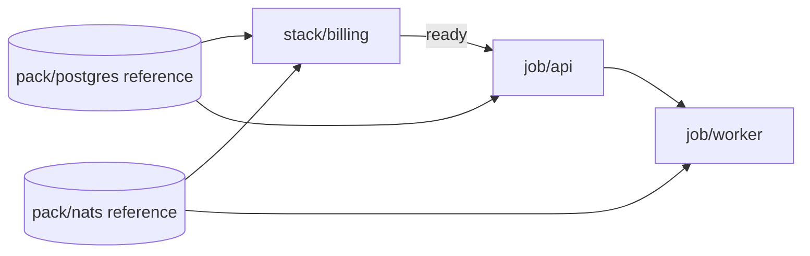

# Norca Deployer – Platform Management (Directory-Based GitOps for Norca Objects)

> **Status:** Design proposal (nothing implemented yet)
> **Component:** `norca-deployer` – new `platform` command group
> **Language:** English
> **Related:** [git-operations-design.md](git-operations-design.md) (in-memory Git engine, webhook daemon), [norca-deployer-design.md](norca-deployer-design.md) (node provisioning)

---

## 1. Goal and Non-Goals

### Goal

Manage the **objects of a running Norca platform** – namespaces, quotas, ACL policies, jobs, secrets, Variables, network rules, custom objects and so on – from **a directory tree** (usually a Git repository), for now into **one region, the authoritative region of the federation** (scope decision below; several regions come later), with one small command set: `validate`, `plan`, `apply`.

The tree is the source of truth. The tool makes the live platform match it and shows what it would change first. It keeps no authoritative state of its own: live state is always read from the cluster; the optional local state directory (§7.9) holds only the journal, before-images and history.

### Non-goals

- **Node and cluster installation.** Installing agents, TLS, gossip keys, firewall, host packages and rolling restarts is `norca-deployer apply` and stays there. `platform` starts where it ends: a reachable cluster API.
- **Pack installation.** Pack registries and pack releases stay with the existing `packs` section and the GitOps pack bindings of the deployer (§3). `platform` only **references** them as dependencies (`reference`, §7.10): it reads their version and health, it never installs, upgrades, prunes or rolls them back. This keeps the migration cost at zero; see open question 18.
- **No Terraform clone.** No provider model, no resource graph, no state file with a lock backend, no expression language, no modules, no `count`/`for_each`. Ordering is a fixed list of object kinds (§7.5) plus an **optional, package-level dependency graph** (units, §7.10): one edge type, no solver, no attribute-level references.
- **No new object schema where Norca already has one.** Files are the native Norca files (`.norca.hcl` jobs, the HCL of `norca namespace apply`, `norca quota apply`, `norca acl policy apply`, …). A file in the tree can always be applied by hand with the `norca` CLI. The deployer adds only a thin envelope (directory layout, a few small manifests, secret value forms).
- **Not one big platform.** One tree describes one platform: for now the **authoritative region** of one federation (scope decision below). Several platforms are several trees.

### Scope decision: the authoritative region is the target (for now)

**Decision.** For now the tool deploys to **one region: the authoritative region of the federation, the primary deployment target.** Sending objects separately to the other regions is **deferred**. The multi-region parts of this document (the `shared/` fan-out, `rollout_order`, per-region overlays across regions, per-region watchers, promotion gating, rollback scope across regions) are kept as the intended later extension and are marked *deferred*, but nothing in the first phases depends on them.

**Why.** Which objects Norca replicates is documented only partly (see the draft ticket [issue-norca-replication-scope.md](issue-norca-replication-scope.md) and §2). Fanning out to every region before that is settled would build on assumptions that can change with a Norca release.

**What this means:**

- **One `region` block** in the startup configuration (§5.2), the authoritative region (`authoritative = true`). A second `region` block and `rollout_order` are rejected by `validate` as reserved.
- **Replicated kinds** (ACL policies, roles, auth methods, binding rules, tokens, namespaces, node pools, quota specs, secrets marked `replicate`) are written to the authoritative region and **Norca replicates them**; the tool does not check or wait for the replica regions.
- **Per-region kinds** (admission policies, network policies, object kinds) and everything else (jobs, Variables, secrets, KV, intentions, volumes, custom objects) are applied **to the authoritative region only**. The other regions do not receive them from this tool; if they need them, that is a manual or later step. This is a known gap, not a bug.
- **Multi-region applications still work through Norca:** a job with a `multiregion` block is submitted once, to the authoritative region, and Norca rolls it out to its regions itself (§6.4).
- **Directories:** `global/`, `shared/`, `namespaces/`, `kv/` and `regions/<r>/` of the target region all apply to that one region (`shared/` is simply applied there like `global/`); file-level overlays and `${region}` still work for it.
- **Reaching it:** the authoritative region is reached directly or through any placement of §11b; reaching it through another region's API with `?region=` forwarding is a spike (§13, question 24), not a requirement.
- **Lifting the decision** later needs: the replication capability answers (§13, question 1), the forwarding spike, and the per-region state and ledger design. Until then the deferred sections describe intent only.

### Design principles

1. **Directory = object kind × scope.** Where a file lives says what it is and where it applies; the file content is native.
2. **Idempotent and boring.** `apply` twice changes nothing the second time. Re-using the proven mechanisms of `postcluster.go` (digest markers, check-and-set, skip when unchanged).
3. **Everything shown before it happens.** `plan` is read-only and exact; `apply` re-checks.
4. **Deletion is opt-in.** Nothing is ever removed without `--prune`, and only objects the tool created (tracked in a ledger, §7).
5. **Secrets never in plaintext in Git.** Same value forms as the existing plan (`!enc:`, `!generate:`, `@file`).
6. **One binary, same configuration style.** Reuses the master key, the token handling, the Git fetcher and the webhook daemon of `norca-deployer`.
7. **HCL first, YAML second.** Every file the deployer defines is written, documented and generated in HCL, like the Norca objects themselves (§4 *File formats*). YAML is an equivalent secondary form with the same keys, for teams that want it; nothing is YAML-only.

---

## 2. What Norca Offers (Object Inventory)

Derived from the `norca` CLI (`norca/norca/command`), the example policies and the Norca documentation. **Scope** says where the object lives: `region` = stored in one region's Raft; `global` = written to the authoritative region and replicated by Norca to the other regions of the federation. **Verified in the Norca source (`norca/norca/leader.go`, `leader_quota.go`):** only ACL policies, roles, auth methods, binding rules and tokens, namespaces, node pools and quota specs replicate (plus built-in secrets that are marked `replicate`). Admission policies, network policies, object kinds and everything else are **per region**: the tool writes them to the target region (to every region once the multi-region fan-out is no longer deferred, §1). *Why* differs per kind: for admission policies it is a **documented limitation** ("stored per region; apply them in every region of a federation", `features/admission-control.md`); for object kinds replication is **reserved but not implemented** (`replicated = true` is rejected by the servers, `features/operator-framework`); for network policies nothing is documented, the endpoints simply never forward to the authoritative region (`network_policy_endpoint.go`). The tool therefore keeps this as a per-kind capability, not as a fixed rule (§13, question 1).

| # | Object | Norca CLI / API | Native file | Scope | Notes |
|---|---|---|---|---|---|
| 1 | **ACL policy** | `acl policy apply` | `.hcl` rules | global | optional job binding (workload identity: `job_id`, `group`, `task`) |
| 2 | **ACL role** | `acl role create` | flags → policy list | global | no file format in the CLI; deployer needs a tiny manifest |
| 3 | **ACL auth method / binding rule** | `acl auth-method create`, `acl binding-rule create` | flags / JSON | global | OIDC/JWT SSO |
| 4 | **ACL token** | `acl token create` | – | global/region | **not managed** as files: secrets by nature (§9, rule 3) |
| 5 | **Namespace** | `namespace apply` | `.hcl` (`name`, `quota`, `meta`, capabilities) | global | `meta.environment=production` makes pack releases atomic |
| 6 | **Quota** | `quota apply` | `.hcl` with `limit { region }` per region, `task_defaults` | global | one `limit` block per region |
| 7 | **Node pool** | `node pool apply` | `.hcl` | global | scheduler config, meta |
| 8 | **Scheduler config** | `operator scheduler set-config` | JSON | region | preemption, algorithm |
| 9 | **Autopilot config** | `operator autopilot set` | flags | region | server health thresholds |
| 10 | **Admission policy (CEL)** | `admission-policy apply` | `.hcl` (`match`, `rule`) | region (not replicated) | `action = deny / warn` |
| 11 | **Network policy** | `network-policy apply` | `.hcl` (`selector`, `egress`, `ingress`) | region, namespaced | level A/B |
| 12 | **Admin network policy** | `network-policy apply -admin` | `.hcl` (`priority`, `namespaces`) | region (not replicated) | evaluated before namespace policies, `deny` is final |
| 13 | **Object kind** (CRD equivalent) | `object-kind apply` | `.hcl` (schema, CEL, webhooks, limits) | region (not replicated) | defines custom types |
| 14 | **Custom object** | `object apply` | `.hcl` (`<group>/<Kind>`) | region | spec written by users, status by controllers |
| 15 | **Job** | `job run`, `job plan` | `.norca.hcl` + vars | region (or multiregion) | the largest group; periodic, parameterized, system, batch |
| 16 | **Job scaling policy** | inside the job (`scaling` block) | in the job | region | typed, validated; autoscaler is built in |
| 17 | **Variables** | `var put` | HCL/JSON spec (`var init`) | region, namespaced | also Consul-KV replacement |
| 18 | **Secrets (built-in store)** | `secret put`, `secret import` | items (`k=v`, `k=@file`) | region, namespaced | versioned, audited; `secret` block in jobs |
| 19 | **Volumes** | `volume create/register` (**CSI**; dynamic host volumes have no API, 13.2) | `.hcl` | region, namespaced | CSI plugins are jobs; static host volumes are node configuration (`apply`); snapshots are runtime, not managed |
| 20 | **Service intention** | `service intention create` | flags: source, destination, action | region | native mTLS allow/deny |
| 21 | **External service** | `service register` | flags / HCL | region | address or DNS alias with checks |
| 22 | **Pack registry** | `pack registry add` (server-side `pack-registry`) | name + URL + ref | region | **not managed by `platform`**: owned by the existing `packs.registries` |
| 23 | **Pack release** | `pack run` / `deploy-pack` | pack + values | region (`--regions` multi) | **not managed by `platform`**: owned by `packs.deploy` / GitOps; referenced as a `reference` (read-only) |
| 24 | **Backup schedule / S3 target** | agent config, `operator backup` | agent HCL | region | **node config → stays in `apply`** (§3) |
| 25 | **Multiregion deployment** | `deployment run` | in the job (`multiregion`) | spans regions | staged rollout, `on_failure` |
| 26 | **Keyring, snapshots, Raft ops, gossip keys, seal** | `operator …` | – | region | **operations, not objects – never managed** |
| 27 | **Consul KV entry** | Consul-compatible `/v1/kv` of a client (`consul_compat`) or a real Consul (`consul` pack) | file per key | region (not replicated; per endpoint) | value = file content; written with CAS (`ModifyIndex`), §7.12 |

**Edges of the inventory** *(review item G14)*. So a reader can tell what was left out on purpose from what was forgotten, these are explicitly **not managed** by `platform`:

| Thing | Where it lives | Why not here |
|---|---|---|
| **Job scaling policies** | inside the job (`scaling` block) | part of the job file; the autoscaler owns `count` (§7.14) |
| **Node meta**, node **eligibility** and **drain** (`node meta apply`, `node eligibility`, `node drain`) | per node | node-level operations on a running machine, not declarative platform objects; node install and decommission stay in `apply` (§3) |
| **CSI plugins** | jobs (plugin tasks) | managed as ordinary jobs; **volumes** are managed (row 19), snapshots and volume attachments are runtime |
| **ACL tokens** | the cluster | secrets by nature (§9, rule 3) |
| **Pack registries and releases** | `packs` / GitOps | one owner (§3) |
| **Allocations, evaluations, deployments, periodic launches** | runtime | results of the platform, not input to it |
| **Snapshots, keyring, Raft, gossip, seal, license** | operator operations | operations, not objects (row 26) |
| **Agent configuration** (backup, TLS, tuning) | node files | `apply` (§3) |

New Norca object types that appear in a release become kinds through the registry of §8.1, and the kind-support matrix (§7.7) shows which Norca version supports which; anything not in the registry is *unknown to the tool*, never silently ignored in `import`: `import` lists the object types it found but does not manage.

Things Norca gives us for free that the design leans on:

- **`job plan`** returns a real diff and a check-and-set index → exact `plan` for jobs.
- **Check-and-set** on Variables and secrets → "create once" semantics already used by `bootstrapSecrets`.
- **Pack releases are server-side objects** with revision history, atomic upgrade, drift detection, rollback, hooks and tests → the existing pack engine drives them; `platform` only **reads** version, health and the last test result of a release, to use them as gates.
- **Admission control and quotas** run in the cluster → a bad file is rejected by the platform itself, not only by our validator.
- **Job meta, namespace meta and object labels** allow ownership tagging for jobs/namespaces/objects.

---

## 3. Boundary with the Existing Deployer Plan

| Concern | Owner | Why |
|---|---|---|
| SSH, node install, agent HCL, TLS, gossip, firewall, tuning, host packages, decommission | `apply` (`cluster-deploy.yaml`) | needs node access |
| ACL **bootstrap** (first management token) | `apply` | chicken-and-egg: needs the cluster before the API is usable |
| Backup/seal/server settings in agent config | `apply` | agent configuration |
| `consul_compat` listener of the clients (bind address, KV backend), firewall for it | `apply` (agent config, `extra_hcl`, firewall rules) | node configuration; `platform` only needs the address |
| **Pack registries, pack releases, GitOps pack bindings** | existing `packs` section and `gitops` | one owner, no migration; `platform` references the releases (`reference`, §7.10) |
| **Every other API object** (table in §2) | `platform` | needs only the API |

The existing post-cluster sections `security.acl.policies` and `secrets.bootstrap` keep working and can be moved into the tree step by step. **`packs` and the GitOps pack bindings are not migrated: they stay the only owner of pack registries and releases.**

- `norca-deployer platform import` (phase 4) reads the live cluster and writes the tree for the kinds `platform` manages (never pack releases), so an existing platform can be adopted.
- A policy or secret defined both in the plan (`security.acl.policies`, `secrets.bootstrap`) and in the tree is a `validate` error, so two tools never fight over one object.
- **Order when both run together** (the optional `platform:` line of the plan makes `apply` call `platform apply` as a stage): platform **foundation** first (it includes the secrets and Variables that packs may read), then the existing **packs** stage, then the platform **units**, whose gates wait for the references. Standalone (laptop, CI, watcher) there is no such ordering: a reference that is not satisfied yet makes the unit **wait** (state `pending`, not a failure, no rollback), and it is retried on the next tick (§11a).
- The same secret path must not be written by both `secrets.bootstrap` and `platform`; `validate` checks that too.
- Long-term, `security.acl.policies` and `secrets.bootstrap` can be deprecated in favour of one line in the plan: `platform { path = "./platform" }`. The pack sections are not part of that.

---

## 4. Directory Layout

One repository (or one directory) = one platform. The root has a small `platform.hcl` and these trees: `global/` (kinds Norca replicates), `shared/` (per-region kinds), `namespaces/<ns>/` (the objects of an application namespace), `kv/` and `regions/<region>/` (settings of one region).

```text
platform/
├── platform.hcl                   # tree manifest: requires, graph, layers, job defaults (§5.1)
├── README.md
│
├── global/                        # applied once, to the authoritative region; Norca replicates these kinds
│   ├── acl/
│   │   ├── policies/              # developer.hcl, ci-deploy.hcl, readonly.hcl
│   │   ├── roles/                 # developer.hcl  (name + policies)
│   │   ├── auth-methods/          # oidc-corp.hcl
│   │   └── binding-rules/
│   ├── namespaces/                # apps.hcl, platform.hcl, monitoring.hcl
│   ├── quotas/                    # apps.hcl (one limit{} per region)
│   └── node-pools/                # general.hcl, gpu.hcl
│
├── shared/                        # per-region kinds Norca does not replicate (for now: the authoritative region only; every region is deferred)
│   ├── admission-policies/        # baseline.hcl
│   ├── network-policies/          # admin policies (cluster-wide in each region): no-metadata.hcl
│   └── object-kinds/              # loadbalancer.hcl, postgres-cluster.hcl
│
├── namespaces/                    # application-level objects, by namespace
│   ├── apps/
│   │   ├── jobs/
│   │   │   ├── api/
│   │   │   │   ├── api.norca.hcl          # the job
│   │   │   │   ├── unit.hcl               # optional: depends_on, tier, update order (§7.10)
│   │   │   │   └── vars/
│   │   │   │       ├── default.vars.hcl   # values for every region
│   │   │   │       └── eu-1.vars.hcl      # override for the target region
│   │   │   └── worker/worker.norca.hcl
│   │   ├── references.hcl         # things this tree depends on but does not manage: pack releases, jobs, services (§7.10)
│   │   ├── stacks/                # optional package form: unit.hcl + a job and its secrets, intentions, ...
│   │   │   └── billing/unit.hcl
│   │   ├── variables/             # nomad/jobs/api.hcl (var spec), encrypted values
│   │   ├── secrets/               # api/db.hcl  (items: !enc / !generate / @file)
│   │   ├── network-policies/      # api.hcl
│   │   ├── intentions/            # api-to-db.hcl
│   │   ├── services/              # external services
│   │   ├── volumes/               # data.hcl
│   │   └── objects/               # <group>_<Kind>_<name>.hcl custom objects
│   └── monitoring/ …
│
├── kv/                            # Consul KV: file path = key, file content = value (§7.12)
│   ├── _kv.hcl                    # managed prefixes, modes, small inline entries
│   └── app/config/db.json
│
├── regions/                       # settings that exist only in one region
│   ├── eu-1/
│   │   ├── scheduler.json         # operator scheduler config
│   │   ├── autopilot.hcl
│   │   └── overrides/             # same relative path as elsewhere (§6)
│   └── (further regions: deferred)
│
└── .platform/                     # optional: ignore patterns, lint rules
```

### Why namespace-first for applications

An application team owns a namespace: its jobs, its secrets, its intentions and its network policies move together and are reviewed together (`CODEOWNERS` per `namespaces/<ns>/`). The platform team owns `global/` and `regions/`. That maps cleanly onto Git permissions and ACL policies, and it is the unit people actually think in.

### File formats: HCL first

| Files | Primary | Secondary |
|---|---|---|
| Native Norca objects (jobs, policies, namespaces, quotas, ...) | `.hcl`, jobs `.norca.hcl` | `.json` where `norca ... apply` accepts it |
| Deployer manifests (`platform`, `unit`, `references`, roles, intentions, services, secrets) | **`.hcl`** | `.yaml`/`.yml` with the **same keys** |
| Variable files of jobs | `.vars.hcl` | none |

Rules:

- **HCL is the reference format.** All examples, `platform init` output, `platform import` output and the documentation use HCL. A YAML file is accepted wherever a manifest is, and is never required.
- **One decode path, like the deployer plan.** `pkg/config/hcl.go` already loads HCL plans by shaping them into the YAML decoder, so both formats share keys, defaults and validation. The platform manifests reuse that mechanism; nothing can exist in one format only. Nested objects are blocks, lists of objects are repeated blocks, and a **block label is the `name`** (`region "eu-1" { ... }` is a YAML list entry with `name: eu-1`).
- **Never both for the same object.** `platform.hcl` and `platform.yaml` side by side, or `unit.hcl` and `unit.yaml` in one directory, is a validation error (ambiguous), not a merge. Mixing formats between *different* files is fine.
- **Order is explicit.** The decoder returns labelled blocks sorted by label, so anything where order matters is a list attribute (`rollout_order`, `layers`, `tiers`), never the order of blocks in the file.
- **Conversion.** `platform convert --to hcl|yaml [-d DIR]` rewrites the manifests (never the native Norca files), so a team can move either way; comments are lost when converting from YAML. `platform fmt` formats HCL.

### Naming rules

- **The object name comes from the file content**, not the filename. A lint rule warns when `filename != name` (jobs: `jobs/<job>/<job>.norca.hcl`).
- **Namespace comes from the path** (`namespaces/<ns>/…`). If the file also sets `namespace`, it must equal the path; mismatch = validation error. This prevents "copy a folder, forget the namespace".
- Extensions: `.hcl` / `.norca.hcl` for everything (native Norca files and deployer manifests); `.json` where Norca itself accepts JSON; `.yaml`/`.yml` as the secondary form of the **deployer manifests only** (see *File formats* above).
- Files and directories starting with `_` or `.` are ignored (drafts, shared snippets), **except** the two named control files `kv/_kv.hcl` (§7.12) and `_ignore.hcl` (§7.14).

### File-system hazards

*(Review item G10.)* The tree is checked out on Linux servers, Windows laptops and in CI. Four things differ between them and are handled by rule, not left to chance:

| Hazard | Rule |
|---|---|
| **Line endings** (`core.autocrlf`) change a KV value or a secret file between machines | Values are compared **byte for byte**. `platform init` writes a `.gitattributes` (`kv/** -text`, `**/secrets/** -text`, `**/*.pem -text`, `**/*.der -text`) so Git never converts those files. The only normalisation is the explicit per-key `trim_trailing_newline` (§7.12). `validate` warns when a file under these paths contains CRLF but the tree has no such `.gitattributes`. |
| **Case-insensitive file systems** (`App/` and `app/`, `Job.hcl` and `job.hcl`) | `validate` rejects two paths that differ only by case, and two objects whose names differ only by case in the same kind and namespace, even on a case-sensitive machine, so a commit that works on Linux cannot break a Windows checkout. |
| **Characters illegal on Windows** in a file or directory name (`<>:"|?*`, trailing dot or space, reserved names such as `CON`, `NUL`) | `validate` rejects them in paths. A KV key that needs such a character is declared in a `kv` manifest entry (`key = "a:b"`) with a neutral file name; keys are otherwise the relative path with `/` as separator. |
| **Long paths** (Windows 260-character limit) | `validate` warns above 200 characters of relative path and errors above 240; the tool itself reads the tree with extended-length path prefixes on Windows. In Git mode the tree is read in memory, so only the operator's checkout is affected. |

`validate` runs these checks on the raw file list **before** it reads any content, so a hostile or accidental path never reaches the parser. Symbolic links in the tree are rejected (the tool never follows them), and a path that leaves the tree (`..`) is an error (the path-traversal fuzzing of implementation plan P6-1).
---

## 5. Configuration: Tree Manifest and Startup Configuration

Two files with two jobs. Keeping them apart lets the tree live in Git without credentials, and stops a commit from widening what the program may do. *(Decision on review item G1: the machine and credential settings are given when the program starts.)*

| | **Tree manifest** `platform.hcl` | **Startup configuration** |
|---|---|---|
| Lives | in the tree, in Git | outside Git: on the machine, or in the job, that runs the program |
| Says | what the files mean | how this process runs and what it may do |
| Holds | `requires`, `graph` and tiers, `layers`, job defaults | the cluster (address, token), `placement` and `proxy`, `state`, `limits`, `watch`, the Git binding |
| Read | with the tree, on every run | **once when the program starts** (the reloadable parts again on `SIGHUP`) |
| Changed by | a commit | the operator |
| Can a commit change it? | yes | **no** |

### 5.1 Tree manifest: `platform.hcl`

Portable and free of credentials. (`platform.yaml` is accepted as the equivalent secondary form.)

```hcl
platform {
  name    = "acme-prod"
  version = "norca.io/platform/v1alpha1"     # format version of this tree (required)
}

requires {                                   # versions the files were written for (7.7)
  norca = ">=0.3.0 <0.5.0"
}

graph {                                      # optional unit dependency graph (7.10)
  tiers        = ["data", "platform", "apps", "edge"]   # named waves, barriers; omit for none
  parallelism  = 3
  default_wait = "healthy"                   # applied | healthy | ready | tested
  update_order = "follow"                    # follow | reverse | independent
  derive       = ["secrets", "volumes", "namespaces"]   # reference edges found by name in the tree
}

defaults {                                   # how the files are applied
  job_apply = "plan-then-run"                # plan-then-run | register-only
  wait      = true                           # wait for the deployment to become healthy
}
```

The YAML form has the same keys. Environments are layers of trees (6.3); `layers` belongs here.

**Format version** *(review item G9)*. `platform.version` names the format of the tree (`norca.io/platform/v1alpha1`), independent of the `requires` block (which is about Norca versions) and of the tool version.

- **Required.** A tree without it is a `validate` error with the value to add; `platform init` writes it.
- **Unknown version = refusal.** `validate`, `plan` and `apply` stop with `tree format norca.io/platform/v2 is not supported by this tool (supports v1alpha1)`; nothing is guessed. A tool that is *newer* than the tree reads older versions it still supports and says so.
- **Evolution.** Additive changes (new optional keys) keep the version. A breaking change gets a new version; the tool supports the previous one for at least one release and `platform convert --to-version vN` rewrites the manifests (not the native Norca files), like the HCL/YAML conversion of §4. While the version is `v1alpha1` the format may still change, which is also why the feature has an experimental gate (implementation plan, P6-6).
- **Layers and trees from several repositories** (6.3) must all carry versions the tool supports; mixed versions are fine as long as each is supported.
- **The startup configuration** (5.2) is versioned by the tool release, not by a field: it is not a committed format and an unknown key in it is an error.

### 5.2 Startup configuration

A file read when the program starts (`norca-platform.hcl`), or the same settings as flags and environment variables for simple cases (`--server`, `NORCA_ADDR`, `NORCA_TOKEN` as in the existing `clusterFlags`). It is **not part of the tree** and not committed.

```hcl
# norca-platform.hcl - read when the program starts; never committed

# DEFERRED (see 1, scope decision): rolling out to several regions. For now there is exactly one
# `region` block, the authoritative region, and no rollout_order.
# rollout_order = ["eu-1", "eu-2"]

region "eu-1" {
  authoritative = true                       # must be true for now: the primary deployment target
  address       = "https://10.0.0.11:4646"
  token         = "!enc:v1:aes-gcm:..."      # the default token; or token_file / token_env, see 5.3
  ca_cert       = "./certs/ca.pem"

  # Optional: more tokens, each used only for what it is declared for (5.3).
  scoped_token "foundation" {
    token_env = "NORCA_TOKEN_FOUNDATION"     # a management token, used for the foundation group only
    for       = ["foundation"]               # kind ids and groups (8.1)
  }
  scoped_token "apps" {
    token_file = "/etc/norca-deployer/apps.token"
    for        = ["job", "variable", "secret"]
    namespaces = ["app-*"]                   # optional: only these namespaces
  }
  scoped_token "readonly" {
    token_env = "NORCA_TOKEN_RO"
    for       = ["plan"]                     # plan, drift watch and status (read only). With today's Norca it cannot
                                             # read the ACL kinds and does no server-side job plan (5.3); a Norca with
                                             # the read-only plan capabilities lifts both
  }

  consul_kv {                                # where `kv/` is written (7.12); omit if no KV is managed
    type    = "norca-compat"                 # norca-compat | consul
    address = "http://10.0.0.21:8500"        # a client whose consul_compat.bind is reachable, or a Consul agent/server
    token   = "!enc:v1:aes-gcm:..."          # Norca ACL token (norca-compat) or Consul ACL token (consul)
    backend = "variables"                    # for the offline limit checks: variables | bus | consul
  }
}

# Optional: take the endpoints from an existing deployer plan instead of
# repeating them (addresses, CA, ACL token file).
# from_deploy_plan = "../cluster-deploy.hcl"

placement {                                  # how this program reaches the cluster (11b)
  type    = "proxy"                          # auto (default) | local | proxy | node
  proxy   = "bastion"
  inbound = "none"                           # direct | none: can a webhook reach the watcher (11a)
}

proxy "bastion" {
  type              = "ssh"                  # ssh | http | socks5
  host              = "bastion.example.com"
  ssh_user          = "deploy"
  ssh_key_path      = "~/.ssh/norca_deployer"
  host_key_checking = "strict"
}

state {                                      # local state files (7.9)
  dir       = ".norca-deployer/platform"     # also --state-dir / NORCA_DEPLOYER_STATE_DIR; "none" disables
  ledger    = "cluster"                      # cluster | local
  keep_runs = 20
}

limits {                                     # what this process may do; a commit cannot raise it
  kinds          = ["acl", "namespace", "quota", "node-pool", "job", "secret"]   # identifiers and groups (8.1); all when omitted
  prune          = false                     # deletion is opt-in; see 7
  on_failure     = "rollback"                # rollback | stop | continue (7.8)
  rollback_scope = "region"                  # region | run
  max_changes    = 50                        # a run that would change more objects needs --yes-really
  read_parallelism = 4                       # API read tuning (7.15): also `rate`, `stale_reads`, `plan_time_budget`
}
```

`watch { ... }` (11a) and `gitops { ... }` (11) are further blocks of the same file.

Rules:

- **A commit can never widen the process.** The kinds it may write, whether it may prune, which tokens and proxies it uses, where it keeps state: all of that is decided by the operator at start. The tree manifest has no key that raises any of it, and `validate` rejects a tree that tries (a `limits` or `region` block in `platform.hcl`).
- **Precedence:** flags, then environment, then the startup file, then built-in defaults. The tree manifest never overrides a startup setting.
- **Location:** `--config FILE`, else `NORCA_DEPLOYER_PLATFORM_CONFIG`, else `./norca-platform.hcl`. `platform service install` (11a) writes `/etc/norca-deployer/norca-platform.hcl` (Windows: `%ProgramData%\norca-deployer\norca-platform.hcl`) with mode `0600`. `platform init` adds the file name to `.gitignore` and writes a commented template.
- **Safety checks at start:** a startup file inside the tree it applies is a `validate` warning; a file readable by group or others triggers a warning (it can hold `!enc:` tokens and proxy passwords).
- **Reload:** `SIGHUP` re-reads `watch`, `limits`, tokens and proxy profiles. Listen address, state directory and placement type need a restart.
- **As a Norca job** (11a): the file is delivered from the built-in secret store as a file (the `secret` block), never put in the job file.
- Values may be `!enc:`, `!env:` or `@file` (§9), like everywhere else.

### 5.3 The token and its permissions

*(Decision on review item G2: the token is part of the startup configuration.)* The program gets the token when it starts, from the first of: `token_env` (default `NORCA_TOKEN`), `token_file`, an inline `!enc:` value, or, with `node` placement and a Norca job, the **workload identity** of the job (11b). A tree and a commit never carry a token.

#### Permission table per kind

*(Work package P0-9, read from the Norca server source: the ACL package `norca/acl` and the RPC endpoints in `norca/norca/*_endpoint.go`. To be confirmed on a lab cluster by the P0-7 spikes before P1 relies on it.)* One row per kind identifier (§8.1). "Policy" is what an ACL policy of the token must contain; **management** means a management token is required and no policy can replace it.

| Kind | Read (for `plan`, drift) | Write / delete | Level | Source |
|---|---|---|---|---|
| `acl-policy` | **management** sees all; any other token lists only *its own* policies | **management** | management | `ACL.UpsertPolicies`, `DeletePolicies`, `ListPolicies` |
| `acl-role` | management sees all; other tokens only their linked roles | **management** | management | `ACL.UpsertRoles`, `ListRoles` |
| `acl-auth-method` | **any token lists** name, type, default and hash; the **configuration** (get) is management (lab, 13.3). With the proposed `acl` read rule (issue-norca-readonly-plan) the configuration is read through an allowlist that excludes `OIDCClientSecret`. **The client secret is never read back**: the plan compares it by the ledger digest of the last written value (§9 rule 5); the stub `Hash` (it covers the secret) only signals an out-of-band change | **management** | management for writes and for the configuration | `ACL.ListAuthMethods`, `GetAuthMethod`, `UpsertAuthMethods` |
| `acl-binding-rule` | **management** | **management** | management | `ACL.GetBindingRules`, `UpsertBindingRules` |
| `namespace` | any capability in the namespace: `ListNamespaces` returns the namespaces the token has a capability in, `GetNamespace` answers per name (so a policy with `namespace "*" { capabilities = ["list-jobs"] }` can read all; `GetNamespaces` is the replication RPC between regions, not used by the tool) | **management** (upsert and delete) | management for writes | `Namespace.ListNamespaces`, `GetNamespace`, `UpsertNamespaces`, `DeleteNamespaces` |
| `quota` | `quota` policy `read` | `quota` policy `write` | policy | `ACL.AllowQuotaRead/Write` |
| `node-pool` | `node_pool` capability `read` | `node_pool` capabilities `write`, `delete` (per pool name or glob) | policy | `NodePool.GetNodePool`, `UpsertNodePools`, `DeleteNodePools` |
| `scheduler-config`, `autopilot-config` | `operator` `read` | `operator` `write` | policy | `Operator.SchedulerSetConfiguration`, `AutopilotSetConfiguration` |
| `admission-policy` | `admission` `read` | `admission` `write` | policy | `ACL.AllowAdmissionRead/Write` |
| `admin-network-policy` | `operator` `read` | `operator` `write` | policy | `allowNetworkPolicyOperator` |
| `object-kind` | `operator` `read`, or any object capability on that kind | `operator` `write` | policy | `ACL.AllowObjectKindRead/Write` |
| `network-policy` | namespace capability `read-network-policy` | namespace capability `write-network-policy` | policy, per namespace | `AllowNetworkPolicyRead/Write` |
| `custom-object` | object capability `read` for `<group>/<Kind>` in the namespace | object capability `write` (status and events have their own: `write-status`, `write-events`; finalizers `manage-finalizers`) | policy, per namespace and kind | `ACL.AllowObjectOperation` |
| `job` | `read-job`, `list-jobs`; `plan` needs **`submit-job`** (see below); `validate` needs `read-job`; the HCL parse (`/v1/jobs/parse`) needs `parse-job` **or** `submit-job` | `submit-job` (register, stop, revert), `scale-job`; `host_volume` `mount-readonly`/`mount-readwrite` for jobs that mount host volumes, `csi-register-plugin` for plugin jobs | policy, per namespace | `Job.Register`, `Plan`, `Validate`, `Deregister`, `Revert` |
| `variable` | `variables` path capability `read`, `list` | `variables` path capabilities `write`, `destroy` | policy, per namespace and path | `Variables.Apply` |
| `secret` | namespace capabilities `read-secret`, `list-secrets` (path-scoped) | `write-secret`, `destroy-secret` (path-scoped) | policy, per namespace and path | `Secret.Read`, `Upsert`, `Destroy` |
| `kv-entry` (Consul-compatible endpoint) | `variables` capabilities `read`, `list` on the KV path | `write`, `destroy` | policy | `ConsulKV.Get`, `Put`, `Delete` |
| `volume` (CSI only, see 13.2) | `csi-read-volume`, `csi-list-volume` | `csi-write-volume` (register, create, deregister, delete) | policy, per namespace | `CSIVolume.Register`, `Create`, `Deregister`, `Delete` |
| `service-intention` | `read-job` | `write-intention` | policy, per namespace | `ServiceIntention` endpoint |
| `external-service` | `read-job` | `register-external-service`; **and `operator` `write`** when the registration has no node and no TTL check (`node` `write` for a node-bound one) | policy, per namespace (+ operator) | `ServiceExternal` endpoint |
| platform ledger, lock, status Variables | `variables` `read`, `list` on `norca-deployer/platform/*` in namespace `default` | `variables` `write`, `destroy` on the same path | policy | §7.4, §7.6 |
| version preflight (7.7) | `agent` read (`/v1/agent/self`) **and `node` read** (`/v1/agent/members`, `/v1/nodes`; lab, 13.3: `agent` read alone is 403 on members) | none | policy | `Agent.Members`, `Node.List` |
| any run: the token's own rights | `acl token self` (any token may read its own token and policies) | none | any | `ACL.GetToken` |

**What the table decides**

1. **A management token is unavoidable for exactly two groups:** the ACL kinds (`acl-policy`, `acl-role`, `acl-auth-method`, `acl-binding-rule`) and `namespace`. Nothing in a policy can replace it. Every other kind has a policy form: `quota`, `node-pool`, `scheduler-config`, `autopilot-config`, `admission-policy`, `admin-network-policy` and `object-kind` through the `quota`, `node_pool`, `operator` and `admission` rules, and all namespaced kinds through namespace capabilities.
2. **The `foundation` group therefore splits in two for permissions** (the group name stays; the tool needs no new group): the `scoped_token` of `for = ["acl", "namespace"]` is a management token, while a `scoped_token` for `["quota", "node-pool", "scheduler-config", "autopilot-config", "admission-policy"]` can be an ordinary policy token. An operator who is happy with one management token for all of `foundation` can keep the example of §5.2.
3. **A "read only" token cannot plan every kind** (state of the Norca source that was read). The ACL kinds answer fully only to a management token (other tokens see only their own policies and roles; auth methods and binding rules are management only), and `Job.Plan` needs `submit-job`, a write capability. **Namespaces are not a problem**: a token with any capability in every namespace lists and reads them all. Decisions (proposals):
   - `plan` for `acl-*` uses the management token for **read calls only**. The tool performs only `GET`s in `plan` (a property the tool guarantees and tests, not one the cluster enforces); the token name in the ledger and the log shows which token read. If that is not wanted, `plan` reports those kinds as *not plannable with this token*, never as "unchanged".
   - For jobs the plan method is chosen by the token: with `submit-job` the server-side `job plan` of §7.3; **without it the tool falls back to a read-back compare** (`GET` of the job, parse of the file through `/v1/jobs/parse`, normalised diff). The fallback loses the server's placement preview and the check-and-set index, and says so in the plan output.
   - So a truly read-only `plan` token can plan everything except the ACL kinds, and jobs by read-back.
   - **A Norca ticket would remove both exceptions** with two small, optional capabilities, an `acl` read rule and a `plan-job` capability ([issue-norca-readonly-plan.md](issue-norca-readonly-plan.md), draft). The tool detects them by Norca version and token policy (kind-support matrix, §7.7): on a Norca that has them, a `for = ["plan"]` token plans every kind with server-side job plan; on an older one the fallbacks above apply. The design never depends on the ticket.
4. **Preflight (stage A of §7.8)** reads `acl token self` and the policies of every configured token and checks each row of the table that is in scope, with the message form `token "apps" lacks write-intention in namespace apps`. The path-scoped rows (`variable`, `secret`, `kv-entry`) are checked for the paths the tree uses.
5. **Namespace-scoped tokens work for the namespaced kinds only.** `job`, `variable`, `secret`, `network-policy`, `custom-object`, `volume`, `service-intention` and `external-service` (the last with the operator exception) can be written with a policy limited to the namespaces of one team, which is what the `scoped_token` `namespaces` filter of the next subsection relies on. `external-service` is the one namespaced kind that can still need an `operator` rule: that is documented as a reason to keep it out of an application team's token.
6. **Checked in the source (13.2):** every capability name above is accepted by the policy parser (`acl/policy.go`); dynamic host volumes have **no** API (the `volume` kind covers CSI volumes); a workload identity can never be a management token. **Still to check on a lab cluster:** that `norca acl policy apply` accepts the example policies below as written.

An example policy for the application token of the previous example (`scoped_token "apps"`), as a native Norca policy:

```hcl
# policy "platform-apps"  (for scoped_token "apps")
namespace "apps" {
  capabilities = [
    "list-jobs", "read-job", "submit-job", "parse-job", "scale-job",
    "write-intention", "write-network-policy", "read-network-policy",
    "read-secret", "list-secrets", "write-secret",
  ]

  variables {
    path "*" {
      capabilities = ["read", "list", "write"]
    }
  }
}
```

And the policy of the platform's own Variables (needed by every token that writes the ledger):

```hcl
# policy "platform-ledger"
namespace "default" {
  variables {
    path "norca-deployer/platform/*" {
      capabilities = ["read", "list", "write", "destroy"]
    }
  }
}
```

#### Several tokens: ACL per group

*(Follow-up to G2.)* One token for everything is the default and stays the simple case. Where one token is too powerful, or Norca needs a management token only for some kinds, the startup file declares **named tokens**, each with the scope it may be used for. Permissions are defined **per group of kinds** (the groups of §8.1: `acl`, `network`, `data`, `foundation`, any single kind id, or `plan`), optionally narrowed to namespaces:

```hcl
region "eu-1" {
  token = "!enc:..."                          # default: used where no scoped token matches

  scoped_token "foundation" {
    token_env = "NORCA_TOKEN_FOUNDATION"
    for       = ["foundation"]
  }
  scoped_token "apps" {
    token_file = "/etc/norca-deployer/apps.token"
    for        = ["job", "variable", "secret"]
    namespaces = ["app-*"]
  }
  scoped_token "readonly" {
    token_env = "NORCA_TOKEN_RO"
    for       = ["plan"]
  }
}
```

Rules:

- **Choice per operation.** For every object the tool picks the token whose `for` contains the kind id or its group and whose `namespaces` match; the most specific wins (kind id over group, listed namespace over none). No match: the default `token`; no default: the object is a `validate`/preflight error, never a silent fallback to a stronger token.
- **`plan` scope.** Reads for `plan`, the drift watch and `status` use the token with `for = ["plan"]` if present, so a read-only token can do all of that. Writes never use it.
- **Preflight check** (stage A of 7.8, before any write): `acl token self` is read for every declared token and the needed capability is checked per kind and namespace in scope (the table of this section). A missing capability is reported as `token "apps" cannot write job in namespace app-x`, and the run stops with zero writes.
- **Narrower, never wider.** `limits.kinds` is still the outer boundary: a token listed for a kind outside `limits.kinds` is ignored with a warning. A token cannot add a kind the process may not write.
- **In the tree.** The tree carries no token: a `scoped_token` or `token` in `platform.hcl` is rejected (§5.2 rules). Which team's directory is written with which token is the operator's decision, which is also how the namespace-scoped tokens of G15 are realised.
- **Watcher.** `watch.auto_apply` uses the same selection: a kind with no usable token is planned and reported only. `SIGHUP` reloads tokens.
- **Logs and the ledger** record the token **name** (`foundation`), never the secret or its accessor.
- **If Norca needs management for the foundation kinds** (verification point above), that is exactly the `foundation` token above and the application token stays scoped; this is also the safe default for the first rollout.

---

## 6. Multi-Region and Environment Handling

> **Deferred (see the scope decision in §1).** The tool targets only the authoritative region for now. This chapter describes the intended multi-region design and is kept for later. With one region, `global/`, `shared/`, `namespaces/` and `regions/<r>/` of the target all apply to it, and the overlay rule of 6.2 works for that region; the fan-out and the rollout order are inactive.

Three simple mechanisms. No templating language.

### 6.1 Scope by directory

| Directory | Applied to |
|---|---|
| `global/` | the authoritative region only; Norca replicates these kinds (ACL, namespaces, quotas, node pools) to the other regions |
| `shared/` | the per-region kinds Norca does not replicate (admission policies, admin network policies, object kinds). For now applied to the **authoritative region only**; **deferred:** every region in `rollout_order` |
| `namespaces/<ns>/…` | the target region (**deferred:** every region of the tree unless the object restricts itself, e.g. job `datacenters`, `multiregion`) |
| `regions/<r>/…` | that region only |
| `kv/` | the key space of the target region's Consul KV endpoint (not replicated; **deferred:** every region; §7.12) |

### 6.2 Per-region variation: file-level overlay

For anything that differs by region, put a file with **the same relative path** under `regions/<r>/overrides/`. It *replaces* the base file for that region; there is no value-level merging, so the result of a file is always readable by opening one file.

```text
namespaces/apps/jobs/api/api.norca.hcl                    ← base
regions/eu-2/overrides/namespaces/apps/jobs/api/api.norca.hcl   ← replaces it in eu-2
```

To avoid copying whole jobs for one changed number, jobs use **variables**, which Norca already supports (`-var-file`, `NORCA_VAR_*`):

```text
vars/default.vars.hcl     # always
vars/<region>.vars.hcl    # added for that region (wins over default)
```

The deployer passes `region` and `datacenter` automatically, **only when the job declares a variable of that name** (a job that does not declare them is not given them), plus the two var files, merged into one string for `/v1/jobs/parse` (§13.1, question 6). The job HCL stays a normal job.

### 6.3 Environments (dev/stage/prod)

Environments are **separate trees**, not a flag inside one. Reasons: different tokens, different reviewers, different promotion pace.

Two supported patterns:

1. **Repo per environment** (simplest; promotion = a pull request between repos or a cherry-pick).
2. **One repo, one directory per environment**, with shared pieces pulled in by layers:

```hcl
# envs/prod/platform.hcl
layers = [
  "../../common",         # lowest priority
  ".",                    # this directory wins
]
```

Layers resolve by **relative path, later layer wins per file** – the same file-level rule as overrides. No merging.

### 6.4 Multiregion jobs

A job with a `multiregion` block is submitted **once** (to the authoritative region); Norca fans it out with its staged rollout. The tool detects the block, applies it once and does not repeat it for every region.

---

## 7. Reconciliation Model

### 7.1 The loop

```text
validate  →  load tree  →  resolve values  →  read live state  →  diff  →  (apply)
```

1. **Load**: walk the tree, parse files, compute the effective file set per region (base + overlays).
2. **Resolve**: `!enc:`, `!generate:`, `@file` values (§9). Secrets are only decrypted in memory.
3. **Read live**: per kind, list or get through the API (cheap kinds are compared fully; see 7.3).
4. **Diff**: `create`, `update`, `unchanged`, `delete (needs --prune)`, `drift` (changed in cluster by someone else).
5. **Apply**: kinds in the fixed order (§7.5), objects within a kind alphabetically; stop on the first error of a kind (`--keep-going` to continue).

### 7.2 Plan output

```text
Region eu-1 (authoritative)
  + namespace        monitoring
  ~ quota            apps            limit[eu-1].memory 4096 -> 8192
  = acl policy       developer
Region eu-1, namespace apps
  ~ job              api             image 1.4.2 -> 1.4.3 (rolling update, 3 allocs)
  + secret           api/db          (items: password=<generated>, user)
  ! variable         nomad/jobs/api  drifted in cluster (cli edit), will be overwritten
  - job              old-batch       not in tree – kept (use --prune)
Summary: 2 create, 3 update, 7 unchanged, 1 drift, 1 not pruned
```

Exit codes are defined for every command in §10 (*Exit codes and machine output*); for `plan --detailed-exitcode` they mirror `terraform plan -detailed-exitcode` (0 nothing, 2 changes, 1 error).

### 7.3 How "changed" is decided, per kind

The tool compares against the **live cluster**, not against a state file (the local state of §7.9 holds only journal and history). Three methods, picked per kind:

| Method | Kinds | How |
|---|---|---|
| **Read-back compare** (authoritative) | ACL policies, roles, auth methods and binding rules, namespaces, quotas, node pools, admission, network and admin network policies, object kinds, custom objects, scheduler and autopilot config, service intentions, external services, CSI volumes, Consul KV (one recursive read per prefix) | `GET`, normalize both sides to the fields that the file sets, compare. Detects drift. |
| **Server-side plan** | jobs | `job plan` (Norca returns a diff and the job modify index); the run is submitted with the index (check-and-set), so a concurrent change aborts instead of overwriting. |
| **Digest marker + CAS** | secrets, Variables | values can't be read back cheaply or shouldn't be logged: store a digest of what the tool wrote (as `bootstrapSecrets` already does). "Create once" (cas 0) is the default; `overwrite = true` writes a new version when the digest changes. Variable/secret **never print values** in a plan. |

### 7.4 Deletion and ownership (opt-in prune)

Without `--prune`, nothing is deleted – the plan only *lists* what would be.

With `--prune`, only **tool-created** objects can be removed. Ownership is recorded in a **ledger in the cluster**, so every operator and the daemon agree (a local state directory would diverge between laptops):

- Variable `norca-deployer/platform/ledger` in namespace `default`, one per region, items = kind identifier (§8.1) → list of names, written with check-and-set.
- Where the object has `meta` (jobs, namespaces, node pools, objects), the deployer additionally sets the constant marker `meta.managed-by = "norca-deployer-platform"` and the tree id (`platform.name`), never the commit (§11, provenance); this survives loss of the ledger and makes `import`/adoption explicit.

**Renames and what "removed" means** *(review item G11)*. The tool sees only the tree and the ledger, so a renamed job or key is a **delete of the old name and a create of the new one**. It does not guess, but it helps the reader:

- **Rename candidate.** In `plan`, a deletion and a creation of the same kind (and namespace) with identical content apart from the name are shown as a warning: `job old-name -> new-name looks like a rename (content identical); stopping old-name and starting new-name`. For a job the new one starts **before** the old one is stopped (apply creates, prune deletes last, §7.5), so the workload overlaps instead of leaving a gap.
- **"Removed from the tree" for a job** means **stop** with `--prune-jobs`: the job is deregistered, its history and the job record stay (it can be re-run or inspected). `--purge` additionally forgets the history (`job stop -purge`); the two flags are never implied by `--prune`.
- **Secrets and Variables** follow `--prune-data` only and are deleted outright; there is no soft form, which is why the flag is separate.
- **A kind that cannot be removed while in use** (a namespace with jobs, a quota used by a namespace, a policy bound to a token) refuses cleanly and reports the dependents; it is never forced.
- **An explicit hint** `moved { from = "old-name" }` in the object's file, to turn the delete+create into a carried-over ownership (ledger entry renamed, no stop) is a possible later addition; it is not part of the first release.

Hard exclusions, never pruned: the `default` namespace and node pool, the built-in `anonymous` policy, management and bootstrap tokens, anything outside the ledger. **Jobs** need an extra flag (`--prune-jobs`) because deleting a job stops a workload; **secrets and Variables** need `--prune-data`.

### 7.5 Ordering

A fixed list. This is the entire "dependency graph":

```text
 1 ACL policies  →  roles  →  auth methods  →  binding rules
 2 quotas        →  namespaces                (a namespace references its quota)
 3 node pools
 4 scheduler / autopilot config
 5 admission policies, admin network policies
 6 object kinds                                (before custom objects)
 7 (pack registries: owned by the existing `packs` section, not here)
 8 variables, secrets, Consul KV entries        (before the jobs that read them)
 9 volumes
10 network policies, service intentions, external services
11 (pack releases: owned by `packs` / GitOps; referenced, §7.10)
12 jobs
13 custom objects
```

For now every step runs against the one target region, the authoritative region (§1). **Deferred (multi-region):** steps 1-3 (ACL, quotas and namespaces, node pools) are written **once, to the authoritative region**, and Norca replicates them (the tool waits until a replica region shows the object before steps that need it, e.g. a namespace in a quota-limited region); steps 4 and later run **in every region** in `rollout_order`.

Prune runs in the **reverse** order after all applies. This list is the **foundation**; applications (jobs and stacks; pack releases only as references) are ordered on top of it by the optional unit graph of §7.10 (dependencies, tiers, update order). `validate` checks the references that cross this order (namespace→quota exists, policy job binding→job exists, job `node_pool` exists, `secret` block path exists in `secrets/` or is declared as a `reference` of type `secret`).

### 7.6 Safety rails

- **Dry-run first**: `apply` always computes the plan and prints it; `--yes` for non-interactive use.
- **Blast-radius guard**: if a plan would delete or update more than N objects (`limits.max_changes`, default 50) it refuses without `--yes-really`.
- **Region staging** *(deferred, §1)*: regions are applied in order; with `--stop-on-region-failure` (default) a failed region stops the rollout. First region = canary.
- **Admission and quotas still apply**: a file the cluster rejects fails with the cluster's message.
- **ACL least privilege**: the tool can run with scoped tokens (the permission table of §5.3) instead of management; a management token is needed only for the ACL kinds and `namespace`.
- **Lockless but guarded**: CAS on jobs and Variables protects individual objects; one concurrent `apply` per region is enforced with a lease Variable (`…/platform/lock`, TTL), not a lock service.

### 7.7 Version Check and Reconciliation with Norca

Every `plan`/`apply` starts with a **preflight version check**, per region, before anything is read or written. The tree must never be applied blindly to a cluster that is mid-upgrade or older than the files expect.

**What is read** (read-only calls; exact endpoints to confirm against Norca, the CLI prints `Norca v0.3.0 (Nomad API 1.6.5 compatible)`):

| Item | Source | Used for |
|---|---|---|
| Server versions, one per server | agent members / `agent self` per server | mixed-version detection |
| Client (node) versions | node list | warn when a kind needs a newer client (e.g. network rules need nftables-capable nodes) |
| Region list and leader | regions, status leader | the federation matches the startup configuration |
| Deployer binary version and the API level it was built against | build info | the deployer's own compatibility window |
| Installed pack releases (version, health, last test) and registry sync state | release + registry API, read-only | gates and version constraints of referenced dependencies, report |
| Object kind schema versions | object-kind API | custom object compatibility |

**Checks, in order:**

1. **Reachability and identity**: the region is reachable the way `placement` says (§11b; the probes are recorded in the state), and the region name returned by the cluster equals the one in the startup configuration.
2. **Consistency**: all servers of a region on the same `major.minor` (patch may differ). Mixed versions mean an upgrade is running → `apply` is **refused** unless `--allow-mixed-versions`; `plan` only warns. This is the same reason `apply` of the node installer rolls servers one at a time.
3. **Tree requirement**: `platform.hcl` may declare the Norca versions the files were written for:

   ```hcl
   requires {
     norca    = ">=0.3.0 <0.5.0"   # semver range, checked per region
     deployer = ">=0.9.0"
   }
   ```

   Outside the range → error (with the actual versions in the message). Inside → proceed.
4. **Kind support matrix**: the deployer carries a small table `kind → minimum Norca version` (generated from the Norca feature status: e.g. network rules, operator framework, secrets store, native mTLS intentions). A kind with files in the tree but unsupported by a region is an **error before any write**, not a late 404. An unknown newer Norca version is **not** blocked (the table is a floor, never a ceiling); it prints a note.
5. **Capability probe as safety net**: for kinds not in the table, a read call (`list`) is made first; 404/501 marks the kind unsupported for that region with a clear message.
6. **Upgrade ordering hint**: if the tree requires a newer Norca than the region runs, the message says "upgrade the cluster first with `norca-deployer apply`" – the platform tool never upgrades nodes (non-goal).
7. **Replication scope (today's behaviour is the default)**: the kind registry (§8.1) carries a built-in scope per kind, matching what Norca does today: `authoritative` (namespace, node-pool, quota, `acl-*`; written once to the authoritative region, Norca replicates), `region` (admission-policy, network-policy, admin-network-policy, object-kind; per region, not replicated) and `per-object` (secret: the item's `replicate` marker decides). The scope follows from the place in the tree (`global/` vs `shared/`, §6.2) and is **never declared per file**. When the features endpoint of Norca exists (issue-norca-features-endpoint, item 1; the full list is kept), its `Replication` block and `AuthoritativeRegion` are read per region and compared with the registry. A difference (for example admission policies reported as `authoritative`) makes `plan` warn and `apply` **refuse the affected kind** until the registry is updated or the tree is moved, so the tool never writes the same object into several regions by mistake. A server without the endpoint keeps the built-in scope without error, as for the version table in check 4.

**Reconciling with the node plan.** When `from_deploy_plan` is set (§5.2), the platform tool also compares the **Norca version the cluster plan installs** (`artifacts`) with the **observed versions**: a difference means an `apply` of the node plan is pending or failed, and the platform run stops at preflight with that explanation. So the two tools cannot disagree silently about what version the cluster is.

**Reporting.** `platform status --versions` shows the whole picture in one table:

```text
Region  Servers (versions)     Clients            Node plan   Tree requires   State
eu-1    3 × 0.3.0              9 × 0.3.0          0.3.0       >=0.3 <0.5      ok
eu-2    2 × 0.3.0, 1 × 0.2.4   6 × 0.2.4          0.3.0       >=0.3 <0.5      MIXED – upgrade running, apply blocked

Pack releases referenced by namespace apps (read-only)
Release   Required by                 Constraint    Installed   Registry latest   State
postgres  job/api, stack/billing      >=0.1 <1.0    0.1.1       0.1.1             ok
nats      stack/billing, job/worker   >=0.6 <1.0    0.5.2       0.6.0             CONSTRAINT VIOLATED – dependents wait
```

Version drift of **workloads** (job images) is reported, not enforced: the tree is the intent, the cluster is the fact, the table shows both. **Pack releases are not reconciled by `platform`**: it only checks the constraint declared for the reference and reports whether it holds. A violated constraint blocks (makes wait) the dependent units, it never installs or upgrades a pack. The registry's "latest" is informational only.

### 7.8 Validation Stages and Rollback

Two separate protections: **nothing is written if the tree is invalid**, and **a failed write is undone where Norca allows it**.

#### Stage A – all-or-nothing preflight (no cluster change)

Everything that can be known before the first write is checked for **all regions and all kinds** first. Any error aborts the run with **zero changes**.

| # | Check | Example failure |
|---|---|---|
| 1 | **Syntax**: every file parses (HCL/JSON/YAML), with file, line and column in the message | `jobs/api/api.norca.hcl:42:7: unclosed block` |
| 2 | **Shape**: required fields, name and namespace rules (§4), unique identities | namespace in path ≠ namespace in file |
| 3 | **Cross references** (§7.5) | namespace names quota `apps` that is not in the tree or live |
| 4 | **Values**: `!enc:` decrypts, `@file` exists, `!env:` set, plaintext-secret scan | master key missing |
| 5 | **Server-side validation, read-only**: `job validate` + `job plan` (this also runs admission policies and quota checks), ACL policy rule parse where the API offers a check, object against its object-kind schema and CEL | job rejected by `apps-baseline` admission policy |
| 6 | **Version preflight** (§7.7) | kind unsupported in region eu-2 |

A bad file is therefore found **before any region is touched**, including a bad file for the *last* region. This is the main defence; rollback is the second line.

`--skip-invalid` does not exist on purpose: a half-applied tree is exactly what the tool must not produce. To apply part of a broken tree, narrow it explicitly (`--kind`, `--namespace`, `--region`) – the *selected* part must be valid.

#### Stage B – journal and before-images

For every object that `apply` is about to change, the tool first saves a **before-image** and writes it into a write-ahead **journal** in the state directory (§7.9):

```text
<state>/<region>/journal/<run-id>.jsonl
{"seq":1,"kind":"quota","name":"apps","op":"update","before":"snapshots/<run-id>/quota-apps.json"}
{"seq":2,"kind":"job","ns":"apps","name":"api","op":"update","before_version":17}
{"seq":3,"kind":"namespace","name":"monitoring","op":"create"}
```

The journal is written **before** each change and marked `done`/`failed` after, so a crash of the deployer itself (or of the daemon) leaves a journal that `platform rollback` can finish.

#### Stage C – what "rollback" means per kind

| Kind | Rollback mechanism | Limits |
|---|---|---|
| **Job** | Norca's own: wait for the deployment; on failure call **`job revert`** to the version recorded in the journal (enforcing the prior version so a concurrent change is detected). If the job's `update` block has `auto_revert = true`, Norca reverts itself and the tool only reports it. A job that was *created* in this run is stopped (and purged only with `--rollback-purge`). | Stateful side effects (migrations done by the job) are not undone – that is the job's concern; documented. |
| **Read-back kinds** (ACL policy/role, namespace, quota, node pool, admission/network policy, object kind, custom object, scheduler/autopilot) | **Re-apply the before-image**; objects created in this run are deleted (they are in the journal, so ownership is certain). | A namespace/node pool that gained jobs meanwhile cannot be deleted → reported, not forced. Object kind schema changes with data migration (CEL migrations) are not reverted. |
| **Secret** (built-in store) | **by version, no before-image on disk**: the store keeps versions up to `max_versions`, an older version can be read (`?version=n`), and there is no "promote version n" call, so the rollback **reads the recorded version n and writes it as a new version** (check-and-set on the version the run created). Needs `read-secret` and `write-secret`. A run records only the version number and the keyed hash, not the value. | works while the version still exists (`max_versions`, destroyed versions are gone); then reported as "no rollback" |
| **Variable** | restored from an **encrypted** before-image (needs the master key; stored mode `0600`). Without a master key the before-image is *not* written and the kind is reported as "no rollback". | holds a copy of a secret on disk, hence encryption is mandatory (§9) |
| **Consul KV entry** | restore from the before-image with a CAS write (previous value and flags); keys created in this run are deleted, keys deleted are written back. The before-image holds configuration values, so it is encrypted like the Variable images. | a task that already restarted because consul-template re-rendered the changed key is not undone (the key is, the restart happened) |
| **Intention, external service, volume** | re-apply before-image / delete created | volume deletion is never automatic (data) → reported |
| **Prune (deletions)** | **not rolled back**; prune runs last, only when every apply of the run succeeded and every deployment is healthy (§7.5). | deletion is irreversible by nature, hence the extra flags |

#### Stage D – policy: when does it roll back

```text
--on-failure=rollback   (default for apply)   undo the current run in the failed region, newest first
--on-failure=stop                             leave the state as is, print what was applied, exit 1
--on-failure=continue                         (with --keep-going) go on with independent objects; no rollback
--rollback-scope=region (default) | run       region: only the failed region; run: also earlier regions of this run
```

- **With one target region (§1)** the scopes `region` and `run` are the same; the distinction below is for the deferred multi-region case.
- **Default `region` scope**: regions are a staged rollout (§7.6); a failure in `eu-2` rolls back `eu-2` and stops. `eu-1` stays on the new version – it was healthy – and the report says so. This is the canary meaning of the region order. `--rollback-scope=run` also reverts `eu-1` when you want all-or-nothing across regions.
- A **failure** is: an API error, a rejected object, a deployment that does not become healthy within the wait timeout. An unsatisfied **reference** gate is *not* a failure (§7.10). Waiting uses the existing `wait` default (§5) and Norca's deployment status (`deployment run`/`status`), with `healthy_deadline` from the job's own `update` block.
- **Rollback failure** (a revert itself fails): the journal keeps the open entries, the run state becomes `rollback-failed`, `platform status` shows it prominently, and the next `plan` refuses to proceed until `platform rollback --run <id>` succeeds or `--ignore-open-journal` is given. No silent half states.
- **Manual**: `platform rollback [--run <id>]` (default: last run) and `platform runs` (history). Longer-term "go back" is `git revert` followed by a normal apply; the journal covers the minutes after a failed apply, Git covers everything older.

#### Invalid input in the GitOps path

For the daemon (§11) the same rules hold, with one addition: a commit that fails stage A is **never applied**, the binding stays on its **last good commit** (recorded in state), the failure goes to the ring log and (optionally) a webhook/notification, and the same commit is **not retried** until a new push arrives, so a broken commit cannot loop.

### 7.9 Local State Files and the Directory Switch

The first draft of this design leaned on cluster-side facts only. Rollback, history and offline `plan` need some local files, so the tool keeps an **optional state directory**. It is a cache and a journal, not a source of truth: deleting it loses history and rollback ability, never correctness, because live state is re-read from the cluster every run (`platform diff` shows the same result with or without it).

**Switch.** The location is chosen in this order (first wins):

1. `--state-dir DIR` on the command
2. `NORCA_DEPLOYER_STATE_DIR`
3. `state.dir` in the startup configuration
4. default `.norca-deployer/platform/` next to the plan/tree root (consistent with the existing `.norca-deployer/` directory: `generated/`, `nkeys/`, `acl-policies/`, `packs/`…)

`--state none` disables local state (CI containers that are thrown away; rollback then only works within the process lifetime and journal entries are kept in memory). The tree directory itself is `-d/--dir` (default `./platform`); the two are independent, so the tree can be a read-only checkout while the state lives elsewhere.

**Layout** (one subtree per platform name and region, so several platforms can share a directory):

```text
<state-dir>/<platform-name>/
├── <region>/
│   ├── applied.json        # per object: kind, name, digest, run id, commit SHA, time, rollback info
│   ├── versions.json       # last observed server/client/pack versions (for `status` offline and trend)
│   ├── ledger.json         # local copy of the ownership ledger (see below)
│   ├── journal/<run-id>.jsonl
│   ├── snapshots/<run-id>/ # before-images; values of Variables/secrets only encrypted
│   └── lock                # advisory lock of this operator machine (not a cluster lock)
└── runs.jsonl              # run history: id, time, who, commit, regions, result, rollbacks
```

Rules:

- **Permissions** `0700` directory, `0600` files. Anything containing a value is encrypted with the master key (AES-256-GCM, same vault as `pkg/crypto`); without a master key such files are not written and the affected rollback is reported as unavailable.
- **Not for Git.** `platform init` writes a `.gitignore` entry for the default state path. State files are per operator/daemon, not shared.
- **Retention**: keep the last N runs (`state.keep_runs`, default 20) and their snapshots; older journal files are pruned by `apply`.
- **Ownership ledger – two modes** (`state.ledger`):
  - `cluster` (default for teams and the daemon): the ledger Variable of §7.4 is authoritative; `ledger.json` is a copy for offline `plan`.
  - `local`: single operator, no Variable written in the cluster; prune only knows what *this* state directory created. Switching modes requires `platform import --adopt` so ownership is stated, not guessed.
  - If both exist and disagree, **the cluster ledger wins** and the tool warns.
- **Daemon**: the state directory must be on persistent storage (a volume/path that survives restarts); otherwise, after a restart, the last-good-commit and open-journal checks are lost. `status` warns when the directory is empty on a cluster that has a ledger.
- **Locking**: the local `lock` stops two runs on the same machine; the cluster-side lease (§7.6) stops two machines. Both must be taken.

### 7.10 Dependency Graph (Units) and Update Order

§7.5 orders **kinds**. That is enough for the platform base, but not for applications: `postgres` must be healthy before `api`, `nats` before `worker`, and during an update the order may have to be the opposite. This section adds an **optional, small graph at package level**. It does not replace §7.5; it sits on top of it.

#### Two levels, on purpose

```text
Level 1  FOUNDATION   fixed kind order (§7.5), no declarations
         ACL → quota → namespace → node pool → policies → object kinds
         → variables/secrets → volumes → network policies/intentions
                      │  always complete (and healthy) before any unit starts
                      ▼
Level 2  UNITS        a DAG of packages, declared with depends_on (optional)
         jobs · stacks   — started as soon as their dependencies are satisfied
         (+ references: read-only, never applied: pack releases, other teams' jobs, catalog services, secrets and Variables written by other systems)
```

Level 1 needs no graph and cannot be reordered. Level 2 is where "package-level dependencies" live. A tree with no declarations behaves exactly as §7.5 describes (units are independent, applied alphabetically, up to `graph.parallelism` at a time).

#### What a unit is

| Unit | Source | Contains |
|---|---|---|
| **reference** | `namespaces/<ns>/references.hcl` | something this tree **depends on but does not manage**: a pack release installed by `packs`/GitOps, a job of another team, a service of the catalog, a secret or Variable written by another system. Never applied, updated, pruned or rolled back; only **read** to evaluate gates and version constraints |
| **job** | `namespaces/<ns>/jobs/<job>/` (+ optional `unit.hcl`) | the native `.norca.hcl` and its var files |
| **stack** | `namespaces/<ns>/stacks/<name>/` with `unit.hcl` | any namespace-scoped files that belong together (in the same sub-directories as a namespace: `jobs/`, `secrets/`, `intentions/`, `kv/`, ...): a job plus its secrets, Variables, network policy, intention, volume, custom objects. Inside a stack the objects follow §7.5; the stack is one node of the graph |

Loose files of §4 (a secret or intention in its normal directory) stay valid: they belong to Level 1 and need no unit. A stack is the *package form* for people who want an application and its supporting objects to move as one thing. Naming: `job/<id>`, `stack/<name>` within a namespace; references are named by convention `pack/<release>`, `job/<id>`, `service/<name>`, `secret/<path>`, `variable/<path>`; `<ns>/<name>` across namespaces.

#### Declaring dependencies

The unit manifest is small and the same for jobs and stacks (in `unit.hcl`, beside the job file or in the stack directory; references are declared separately, below):

```hcl
# namespaces/apps/jobs/api/unit.hcl
depends_on = ["pack/postgres"]            # shorthand: wait for it to be healthy

dependency "pack/nats" {                  # a dependency with options
  version = ">=0.6 <1.0"                  # constraint on the pack version of that release
}

dependency "stack/billing" {
  wait    = "ready"                       # applied | healthy | ready | tested (below)
  timeout = "10m"
  soak    = "30s"                         # stay healthy this long before continuing
}

tier = "apps"                             # optional named wave (below)

enabled = true                            # false: the unit is declared but not applied (and must not be a dependency of a live unit)

update {
  mode   = "follow"                       # follow | reverse | independent
  before = ["job/worker"]                 # extra update-only edges
  after  = []
}
```

**References.** Packs stay installed by the existing engine, so the tree *refers* to them instead of declaring them:

```hcl
# namespaces/apps/references.hcl
reference "pack/postgres" {
  type    = "pack-release"          # pack-release | job | service | secret | variable
  release = "postgres"              # name in the cluster (default: the part after the slash)
  version = ">=0.1 <1.0"            # default constraint, checked against the installed release
  wait    = "healthy"               # default gate for dependents
  timeout = "10m"
}

reference "pack/nats" {
  type    = "pack-release"
  release = "nats"
  version = ">=0.6 <1.0"
}

reference "service/auth" {
  type = "service"                  # a service of the Norca catalog (another team's job)
  name = "auth"
  wait = "ready"
}

reference "secret/api/db" {
  type = "secret"                   # written by another system; the tool only checks that it exists
  path = "api/db"
}
```

- A reference is **read-only**: the tool lists the release/job/service/secret/Variable and evaluates the gate and the version constraint (`secret` and `variable` references have only the existence check). A `dependency` block of a consumer may narrow the constraint, never loosen it.
- A missing or unsatisfied reference is **`pending`**: the dependent unit (and everything behind it) is reported as `waiting for pack/postgres`, **no rollback**, retried on the next tick or run (a run exits with code 3, "blocked, not failed", §10). Only a reference that is satisfied at the start and turns unhealthy *during* the run, after a dependent was already applied, is a failure.
- References are never scheduled and have no `tier`; `update.mode` on an edge to a reference has no effect, because the platform does not change it. If the pack engine updates the referenced release at the same time, the gate simply waits for it to be healthy again.
- A name in `references.hcl` must not be a unit that this tree also manages: `job/api` as a reference **and** as a managed job in the same namespace is a `validate` error.
- `platform graph` shows references as a separate layer, so a reviewer sees what the tree assumes about the rest of the cluster.

**Gates** (`wait`), what "dependency satisfied" means, from cheap to strict:

| `wait` | Satisfied when |
|---|---|
| `applied` | the API accepted the object (no waiting) |
| `healthy` (default) | the deployment or release is healthy (jobs: successful deployment; releases: healthy revision, wait up to the release timeout) |
| `ready` | the service's **readiness** health checks pass in the Norca service catalog (health check roles: startup, readiness, liveness) |
| `tested` | the last `test` result of the release is a pass (read from the release status; the tool never runs tests) |

Optional `soak` adds a hold time after the gate. The dependency's **version constraint** is checked at plan time against the version the tree will have (or the live one if the dependency is unchanged) – a mismatch is a plan error, not a late failure.

**Derived edges** (nothing to write; `graph.derive` selects which): the validator already scans references for §7.5, so it can also add edges for what it can resolve **by name inside the tree** – a job's `secret`/Variable paths to the stack that provides them, `volume` blocks, `namespace`, `node_pool`. It cannot derive runtime service dependencies (job A calls service B), so those are always explicit. Derived edges are shown in `platform graph` with their reason; an explicit edge never needs to repeat them.

**Pack metadata.** Norca packs already carry `requires { norca, features }` (checked by the servers). The pack `dependency` block of `metadata.hcl` is **composition** (helper templates of another pack inside this pack's rendering), not install order, and is **not** used for the graph. Proposed extension in the pack repository (open question 15): `requires { packs = ["postgres >= 0.1"] }`, from which the platform would derive pack-to-pack edges automatically. Until then, pack dependencies are declared as references.

**Tiers.** A named, coarse wave for people who think in layers, declared once in `platform.hcl`:

```hcl
graph {
  tiers = ["data", "platform", "apps", "edge"]   # applied in this order; deletes in reverse
}
```

A tier is a **barrier**: every unit of tier *n* (in the plan) has met its gates before tier *n+1* starts. Edges inside a tier work as usual; an edge from an earlier tier to a later one is a validation error (it contradicts the barrier). Units without a tier belong to the last tier. Use tiers when a layering is enough and `depends_on` when the dependency is specific; mixing is fine. No tiers declared = no barriers.

#### Build, validate, schedule

1. **Collect** units from the effective file set of **each region** (after overlays, §6.2): the graph is per region, so a region that does not contain a unit simply has no such node.
2. **Edges**: explicit + derived + tier barriers.
3. **Validate** (stage A of §7.8, before any write): unknown unit, **cycle** (the message prints the path `a → b → c → a`), edge to a unit that is absent in this region, version constraint violated, tier contradiction, `depends_on` across regions (not allowed: cross-region order is the region order and the promotion gating of §11a), edge to an `enabled = false` unit that is not live and healthy.
4. **Order** by Kahn's algorithm into levels; ties alphabetical, so the order is **stable and reviewable** (the same tree always plans the same way).
5. **Run** with a ready-queue and a worker pool (`graph.parallelism`, default 3): a unit starts as soon as **all of its dependencies** are satisfied, not when a whole level finishes. A unit whose dependency is unchanged still has its **gate checked against the live cluster**: `api` changes while `postgres` is unhealthy → `plan` shows it, `apply` refuses unless `--ignore-unhealthy-deps`.

#### Install, update and delete order

The same graph gives three orders. The rule is simple and deterministic: **the operation of the dependent unit B decides how an edge A ← B is read**; an edge only matters when both ends are in the plan.

| Operation on B | Edge "B depends on A" | Notes |
|---|---|---|
| **create** | A before B | provider first |
| **update** | by `B.update.mode` (below) | |
| **delete** | B before A | consumers go first; deleting A while B stays is an **error** ("A is required by B"), never a cascade |

`update.mode` (per unit, default from `graph.update_order`, default `follow`):

| Mode | Order on update | Typical use |
|---|---|---|
| `follow` | like create: providers (A) before consumers (B) | additive change: new column, new API field, new NATS stream |
| `reverse` | consumers (B) before providers (A) | removing or tightening something the consumers must stop using first (expand/contract) |
| `independent` | edges ignored for this unit, only tiers apply | unrelated units that merely share a tier |

Plus per-unit `update.before: [..]` / `update.after: [..]` for **update-only** edges that are not install dependencies (e.g. "when the worker changes, update it before the api, but the api does not need the worker to exist").

**Per run override**, for the case where the commit author knows the change is breaking:

```text
norca-deployer platform apply --update-order reverse            # every unit that has no explicit mode
norca-deployer platform apply --unit job/api --with-deps        # api, plus dependencies *that changed*
norca-deployer platform apply --unit job/api --only             # api alone; deps must be healthy, else error
```

Inside a unit the rolling behaviour of replicas stays Norca's own (`update` block of the job: `max_parallel`, canary, auto-revert). The graph orders **between** units, never between allocations. Ordering **inside** a job group (init/prestart tasks) stays in the job (`lifecycle`).

#### Failure of a unit

A unit that fails its gate or its apply is rolled back per §7.8 (job revert, release rollback, before-images); then:

- **its dependents are skipped** (reported as `blocked by <unit>`), never applied against a broken provider;
- by default the run **stops starting new units** and lets in-flight ones finish and verifies them (`--on-failure rollback`); with `--keep-going` independent branches continue;
- `--rollback-scope run` additionally reverts the units already completed in this run, **in reverse completion order** (consumers before providers of the same run), using the journal.

A unit already applied and healthy stays applied in the default scope; the status shows `partially applied: 4 of 6 units, failed at job/api`.

#### Seeing the graph

`platform plan` shows waves and the reason for each edge; `platform graph` prints the structure (text, Graphviz `dot`, or Mermaid for the docs and PR comments):

```text
Region eu-1, namespace apps — order for: update (3 units change, 2 unchanged)
Foundation  (1 quota update, 1 namespace unchanged)
References (read-only)
  pack/postgres       installed 0.1.1  (>=0.1 <1.0 ok)   healthy
  pack/nats           installed 0.6.0  (>=0.6 <1.0 ok)   healthy
Tier apps
  [1] stack/billing   2 objects              needs pack/postgres, pack/nats
  [2] job/api         image 1.4.2 → 1.4.3    needs pack/postgres, stack/billing (ready), secret api/db (derived)
  [2] job/worker      unchanged
Blocked: none. Waiting for references: none.
```



The same data is available through the service API (§11a: `GET /v1/platform/graph`) and, with `--unit X --dependents`, as an **impact list**: "`pack/postgres` (reference) is required by `stack/billing`, `job/api`, `job/worker`" (information only; dependents are not changed unless they have changes of their own).

#### Why this stays small

- One edge type, one meaning ("B after A, gate G"), computed on **units**, never on attributes.
- No expressions, no outputs passed between units, no `count`/`for_each`; a unit's values are its own files.
- The ordering of the foundation is fixed and needs no declarations.
- Every declaration is optional; an empty graph is valid and predictable.
- The whole engine is: parse manifests, build edges, check for cycles, topological sort, ready-queue with gates. No solver, no state refresh phase, no plan/apply graph walk of resources.

### 7.11 (not in scope for now)

Running external programs and dispatching follow-up jobs after a run is **not part of this design for now**. Nothing in the other chapters depends on it. The section number stays so that the references to 7.12 to 7.15 keep their meaning.

### 7.12 Consul KV Entries

Applications that read the Consul KV (`consul-template`'s `key`/`tree`, Traefik, Spring Cloud) get their configuration from keys. `platform` manages those keys from the tree, in the Consul-compatible KV of the clients (`consul_compat`, keys in Norca Variables or in the system bus bucket) **or** in a real Consul (the `consul` pack). Both speak the same HTTP API (`GET`/`PUT`/`DELETE /v1/kv/<key>`, `recurse`, `cas`, `flags`), so there is one implementation with two endpoint types.

#### Tree: a file per key

```text
kv/
├── _kv.hcl                      # which prefixes the tree owns, and how
├── app/config/db.json           # key  app/config/db.json   value = the file content
├── app/config/limits            # key  app/config/limits
└── feature/new-ui               # key  feature/new-ui
```

```hcl
# kv/_kv.hcl
trim_trailing_newline = true        # default: remove one final newline from files (editors add it)

prefix "app/" {
  mode  = "sync"                    # sync: the tree wins | create-only: seed once, never overwrite
  prune = true                      # delete keys under app/ that are not in the tree (needs --prune-data)
}

prefix "feature/" {
  mode = "create-only"              # applications may flip these at run time
}

entry "feature/dark-mode" {         # a small inline value instead of a file
  value = "false"
  flags = 0
}
```

Rules:

- **The path under `kv/` is the key, the file content is the value** (binary safe; keys use `[A-Za-z0-9._/-]`, no leading slash, no `..`).
- **Every key in the tree must lie under a declared `prefix`.** A key outside any prefix is a validation error: ownership is always stated, never an accident of a stray file.
- **Ownership is by prefix.** Under a `sync` prefix with `prune = true` the tree is the whole truth: other keys there are removed on `--prune-data`. Keys **outside** the declared prefixes are never read, written or deleted. Do not share a managed prefix with an application that writes its own keys; use `create-only` or a separate prefix for those.
- **Region variation** uses the overlay of §6.2: `regions/<r>/overrides/kv/app/config/db.json` replaces that key's file in that region. There is no templating of values; the file is the value.
- **Not a secret store.** Secrets belong in `secrets/` (built-in store). If a value must not be readable in Git, a file whose whole content is an `!enc:v1:...` token is decrypted with the master key when written (it then sits in the KV in clear, like any KV value). The plaintext-secret scan of §9 warns for keys that look like `*password*`, `*secret*`, `*token*`.

#### Reconcile

1. **Read:** one `GET /v1/kv/<prefix>?recurse` per declared prefix (values and `ModifyIndex`/`Flags` of every key).
2. **Diff:** by value and flags. `plan` shows key, action and a short diff; values longer than 1 KiB or from `!enc:` show size and digest only.
3. **Write:** `PUT /v1/kv/<key>?cas=<ModifyIndex>` (`cas=0` to create). A rejected CAS means someone changed the key since the plan (the server answers **HTTP 200 with the body `false`**, so the writer reads the body, never only the status): the key is reported and the run stops for that key unless a re-plan is allowed (`--replan-on-conflict`).
4. **Delete:** only under `prune = true` prefixes, with `--prune-data`, after all writes of the run succeeded.

`create-only` prefixes only create missing keys; an existing key is left as it is and is never reported as drift.

#### Where it runs in the order

KV entries belong to **foundation step 8** (§7.5), before the units, so a job that reads a key finds it. Keep in mind that a changed key can make a task restart (`consul-template` with `change_mode = "restart"`), so a KV write is a deployment event. The KV tree exists only at the root of the tree (`kv/`); a stack has no KV of its own.

#### Limits and checks (stage A of §7.8)

The limits depend on the backend declared in the region's `consul_kv` block:

| `backend` | Key | Value | Flags |
|---|---|---|---|
| `variables` | Variables path, at most 128 characters (other characters stored as `~XX`) | 64 KB | kept |
| `bus` | any | 512 KB | **rejected** (HTTP 400) |
| `consul` | any | 512 KB (Consul default) | kept |

**`ModifyIndex` is an opaque token.** On the `variables` backend it is the Raft modify index of the Variable; on `bus` it is the per-key revision of the NATS KV (and `CreateIndex` equals it). The tool only ever **compares it for equality for the same key** (the CAS value of the plan) and never orders or compares indexes across keys or backends. A backend change (`/v1/operator/consul-kv/migrate`) invalidates every remembered index, so the next run re-reads before it writes.

On the `variables` backend a value above about 64 KB is answered by the server with an **HTTP 500**, not with a clear 4xx (lab, 13.3), so stage A rejects it itself. An entry that breaks the declared limits, or sets `flags` on `bus`, fails validation **before any write**; the preflight (§7.7) then checks that the real endpoint is reachable and answers `/v1/kv` with the same backend. Sessions, locks (`acquire`/`release`) and transactions are not used (the compat layer answers `501` for them).

#### Access

- `type = "norca-compat"`: the `token` is a **Norca ACL token**; keys live below the Variables path `consul/kv/<key>` and the usual Variables rules apply, so the deployer's policy needs `write` on that path (and `list`/`read` for the recurse). The compat API listens on `127.0.0.1:8500` by default; the deployer must reach a client's non-loopback `bind` (node configuration through `apply`, plus a firewall rule) or run next to a client (§11a, job form). **Clients that share the same `namespace` and `path` of their `kv` block share their keys**, so any of them is the same key space; clients with another `namespace`/`path` are a different one (that is one `consul_kv` endpoint per key space).
- `type = "consul"`: the `token` is a **Consul ACL token** with `key_prefix "<prefix>" { policy = "write" }`; the `consul` pack installs the official Consul (BSL 1.1, accepted by the user at install; the platform tool ships and installs none of it).

#### Rollback and drift

Before-images of changed and deleted keys are stored encrypted in the run journal (§7.8, row *Consul KV entry*). The drift watch reads the prefixes with the same `recurse` call (one request per prefix); drift is **reported** by default and healed only if `watch.heal` names `kv-entry`.

### 7.13 Saved Plans and Machine-Readable Output

*(Accepted review item G3.)* A pull request shows a `plan`; the merge applies a fresh computation that can differ because the cluster changed in between. A saved plan makes **what was approved** the same as **what runs**.

```text
norca-deployer platform plan  --out plan.json [--format text|json]     # compute, print, save
norca-deployer platform apply plan.json                                  # apply exactly that, or refuse
```

- **The plan file** records the tree (commit SHA and a hash of the effective tree), the version of the tool and the Norca versions, and for every change: kind id, name, operation, the **cluster index** the diff was made against (`ModifyIndex`, job version) and the digest of the new content, plus the waves of the unit graph. It contains **no secret value**, only digests; values are resolved again from the tree at apply time.
- **`apply plan.json` recomputes and compares.** It builds the plan from the current tree and cluster and requires it to be the **same set of changes** (kind, name, operation, new-content digest). If so, it applies it; if not, it refuses with the difference ("stale plan: `quota/apps` changed in the cluster since the plan"), exit code 3 (blocked, §10). The file is never executed as instructions, so editing it can only make `apply` refuse. `--replan` shows the new plan next to the approved one and exits without writing.
- **Also checked:** the tree hash (the same commit), the tool and Norca versions (same major.minor), the age (`--max-plan-age`, default 24 h), and that `--prune*` flags are not wider than at plan time.
- **Gates stay live.** Unit gates (7.10) and references are evaluated at apply time; they are not part of what is approved.
- **The watcher uses the same file.** A plan that the watcher computes for kinds outside `auto_apply` is kept as a **pending plan** with a fingerprint in the state directory; `platform status --plan` shows it, `platform approve <fingerprint>` (or `POST /v1/platform/approve`) lets the watcher apply exactly that plan. In every run record the plan fingerprint is logged.
- **Pull-request flow:** CI runs `validate` and `plan --out plan.json --format json` on the PR (a bot posts the summary); the approver reads it; the merge job runs `apply plan.json` with the saved file (or lets the watcher compute and compare the fingerprint).
- **Machine-readable output:** `--format json` on `plan`, `apply`, `status`, `runs`, `diff` and `graph`, with stable field names (kind id, name, operation, result, fingerprint, timestamps); `text` stays the default for people. Secrets and values never appear in either format.

### 7.14 Fields Owned by Something Else

*(Accepted review item G4.)* Some fields are changed by the platform itself, not by the tree: above all the group `count` set by the **built-in autoscaler** or `job scale`. If the file says `count = 3` and the autoscaler made it 7, a plain apply would reset it and the drift would never settle.

- **Jobs, default rule.** A task group with a `scaling` block has its `count` **owned by the autoscaler**: `plan` does not diff it (shown as `count 7 (autoscaler; file 3, ignored)`), and `apply` registers the job with **`PreserveCounts`** (an existing option of the job register call and of `norca job run -preserve-counts`), so the live counts are kept. A group created for the first time takes the count of the file. `job revert` and the before-image keep the live count.
- **Explicit list.** `ignore = ["count"]` in `unit.hcl` applies the rule to groups without a `scaling` block as well (for example when an operator scales by hand and the tree should not reset it); `ignore = []` with `autoscaler_owns_count = false` switches the default rule off.
- **Other kinds.** A `_ignore.hcl` in the directory of any read-back kind lists attribute paths per object (`ignore "namespace/apps" { paths = ["meta.owner"] }`). The diff leaves them out, and the apply writes the object with the **live values** at those paths. For jobs only `count` is supported at first (a job is registered as a whole); an unsupported path is a `validate` error, not silently ignored.
- **Drift watch** (11a) ignores the same paths; they never count as drift and are never healed.
- **Plan output** always says when a field is ignored, so a reader sees why a live value differs from the file.

### 7.15 API Load and Read Strategy

*(Review item G16.)* Every `plan` and every drift tick reads many kinds; on a large platform that is thousands of requests. The read side is designed to be cheap by default and bounded by configuration (a startup setting, §5.2, `limits`):

```hcl
limits {
  read_parallelism = 8                       # concurrent API reads per run (default 4)
  rate             = "50/s"                  # requests per second to the cluster (default 20/s)
  stale_reads      = true                    # allow stale reads for drift ticks (default true)
}
```

- **List, then fetch only what the tree names.** Where the API has a list endpoint with stubs (jobs, variables, policies, namespaces), the tool lists once per kind and fetches the full object only for names that exist in the tree **and** whose stub (index, version, modify time) differs from the one remembered from the last run. Nothing is fetched for unchanged objects.
- **Parallel with a limit.** Kinds are read in parallel (they are independent for reads) up to `read_parallelism`, with the global `rate` as the ceiling; writes still follow the fixed order of §7.5 and the unit graph.
- **Change detection by blocking queries.** For kinds whose endpoints support blocking queries (index-based `?index=` waits), the drift loop waits on the index instead of polling on a timer; the timer remains as the fallback. Per kind, a changed index triggers a re-read of that kind only.
- **`stale` reads for drift.** The drift watch (11a) may use `?stale=true` so any server answers, not only the leader; **plan before apply and every write path read from the leader** (no stale reads), because a stale plan is a wrong plan.
- **Backoff.** On `429`, `5xx` or a leader election, reads back off exponentially with jitter and the run is marked `degraded` in `status`, not failed; a run never retries writes blindly.
- **Budget visible.** `status` and the metrics (11a) show requests per run, per kind, the slowest kind and the time spent; a plan that needs more than `limits.plan_time_budget` (default 2 minutes) says so and names the kind, so the first remedy is a narrower `--kind` or a longer drift interval.
- **KV** (§7.12): one recursive read per declared prefix; a prefix with many keys is the main cost, so a prefix limit is part of the stage A checks.

---

## 8. Kind Table (Implementation Contract)

Each kind is one small Go type implementing the same few methods. This keeps the program simple: adding a kind is adding a file, not changing the engine.

```go
type Kind interface {
    Name() string                       // "namespace"
    Scope() Scope                       // Global | Region | RegionNamespaced
    Load(tree Tree) ([]Object, error)   // files → desired objects
    Read(ctx, client) ([]Live, error)   // current state
    Diff(desired, live Object) Change   // create | update | unchanged | drift
    Apply(ctx, client, Change) error
    Delete(ctx, client, name) error
}
```

| Kind | Directory | Identity | Compare | Apply API |
|---|---|---|---|---|
| `acl-policy` | `global/acl/policies/*.hcl` | name | read-back | `POST /v1/acl/policy/<name>` |
| `acl-role` | `global/acl/roles/*.hcl` | name | read-back | `POST /v1/acl/role` |
| `acl-auth-method`, `acl-binding-rule` | `global/acl/…` | name / id | read-back | `/v1/acl/auth-method`, `/v1/acl/binding-rule` |
| `quota` | `global/quotas/*.hcl` | name | read-back | quota API |
| `namespace` | `global/namespaces/*.hcl` | name | read-back | `POST /v1/namespace/<name>` |
| `node-pool` | `global/node-pools/*.hcl` | name | read-back | `POST /v1/node/pool/<name>` |
| `admission-policy` | `shared/admission-policies/*.hcl` | name | read-back | admission API |
| `admin-network-policy` | `shared/network-policies/*.hcl` | name | read-back | network-policy API (`-admin`) |
| `object-kind` | `shared/object-kinds/*.hcl` | `<group>/<Kind>` | read-back | object-kind API |
| `scheduler-config`, `autopilot-config` | `regions/<r>/…` | singleton | read-back | operator APIs |
| `variable` | `namespaces/<ns>/variables/**` | path | digest + CAS | `PUT /v1/var/<path>` |
| `secret` | `namespaces/<ns>/secrets/**` | path | digest + CAS | `PUT /v1/secret/<path>` |
| `volume` | `namespaces/<ns>/volumes/*.hcl` | id | read-back | volume API |
| `kv-entry` | `kv/**` (+ `regions/<r>/overrides/kv/**`) | key | read-back (recurse per prefix) | `PUT`/`DELETE /v1/kv/<key>?cas=` |
| `network-policy` | `namespaces/<ns>/network-policies/*.hcl` | name | read-back | network-policy API |
| `service-intention` | `namespaces/<ns>/intentions/*.hcl` | source→destination | read-back | intention API |
| `external-service` | `namespaces/<ns>/services/*.hcl` | service + id | read-back | external-service API |
| `job` | `namespaces/<ns>/jobs/<job>/*.norca.hcl` | job id | server `job plan` | `job plan` + register with index |
| `custom-object` | `namespaces/<ns>/objects/*.hcl` | `<group>/<Kind>/<name>` | read-back | object API |

Small manifests: the only formats the deployer defines itself, kept to a few fields and written in HCL (the YAML form has the same keys):

```hcl
# global/acl/roles/developer.hcl
name        = "developer"
description = "Developers of the apps namespace"
policies    = ["app-developer", "catalog-read"]
```

```hcl
# namespaces/apps/references.hcl              (see 7.10)
reference "pack/postgres" {
  type    = "pack-release"
  release = "postgres"
  version = ">=0.1 <1.0"
}
```

```hcl
# namespaces/apps/intentions/api-to-db.hcl
source      = "api"
destination = "db"
action      = "allow"
```

```hcl
# namespaces/apps/secrets/api/db.hcl          -> secret path  api/db
items = {
  user     = "api"
  password = "!generate:api-db-password"      # created once, kept
  ca       = "@../../../certs/db-ca.pem"      # file outside Git (see 9)
}

overwrite = false
# replicate = true                            # a secret marked to replicate is written to the authoritative region only
```

### 8.1 Kind Identifiers

> **Two meanings of "kind".** In this document a *kind* is a type of object that the tool manages (namespace, quota, job, ...). It is **not** the Norca *ObjectKind*, which is the type of a custom object (`group/Kind`, `/v1/object-kinds`). The two meet in one place only: `object-kind` is one of the kind identifiers (the Norca object that defines custom object types), and `custom-object` is another (the instances of such a type). Where the Norca meaning is intended the text says *object kind* or *ObjectKind*.

*(Accepted review item G7.)* The first column of the table above is the **kind identifier**. It is the same word everywhere a kind is named: the allow-list `limits.kinds`, `--kind`, `watch.auto_apply`, `watch.heal`, the `for` of a `scoped_token`, the ledger keys, the journal and run records, the columns of `plan`, the JSON output, the kind-support matrix (§7.7), the permission table (§5.3), the state files and the metric label `drift_objects{kind}`.

**Grammar**

- **R0 – a kind is something outside the tool.** An identifier names an object that exists in the cluster (or in its KV endpoint) and that the tool can write and read back. Concepts of the tool itself are never kinds: *unit*, *stack*, *reference*, *plan*, *run*, *layer*, *tier*. (A unit `job/api` is simply the kind `job`; a stack is only a unit.)
- **R1 – form.** Lower case ASCII, singular, kebab-case, no dot.
- **R2 – shape** `[family-]noun[-config]`: a family prefix where Norca groups several objects (`acl-`), the suffix `-config` for a **singleton** (one per region, no name).
- **R3 – the name is Norca's own, as in its CLI and API** (`node pool` is `node-pool`, `service intention` is `service-intention`). Abbreviations and words that would be ambiguous in a tool that manages "objects" are written out: `var` is `variable`, `object` is `custom-object`, `kv` is `kv-entry`, `autopilot` is `autopilot-config`.
- **R4 – a variant keeps Norca's phrase:** `admin-network-policy` next to `network-policy`.
- **R5 – frozen.** An identifier is a key in ledgers and journals; once released it is never changed without an alias.

**The identifiers**

| Id | Object | Norca name (CLI / API) | Directory | Groups |
|---|---|---|---|---|
| `acl-policy` | ACL policy | `acl policy` | `global/acl/policies` | `acl` |
| `acl-role` | ACL role | `acl role` | `global/acl/roles` | `acl` |
| `acl-auth-method` | ACL auth method | `acl auth-method` | `global/acl/auth-methods` | `acl` |
| `acl-binding-rule` | ACL binding rule | `acl binding-rule` | `global/acl/binding-rules` | `acl` |
| `quota` | quota spec | `quota` | `global/quotas` | |
| `namespace` | namespace | `namespace` | `global/namespaces` | |
| `node-pool` | node pool | `node pool` | `global/node-pools` | |
| `scheduler-config` | scheduler configuration (singleton) | `operator scheduler` | `regions/<r>/` | |
| `autopilot-config` | autopilot configuration (singleton) | `operator autopilot` | `regions/<r>/` | |
| `admission-policy` | CEL admission policy | `admission-policy` | `shared/admission-policies` | |
| `admin-network-policy` | cluster-wide network policy | `network-policy -admin` | `shared/network-policies` | `network` |
| `object-kind` | custom object type | `object-kind` | `shared/object-kinds` | |
| `network-policy` | namespaced network policy | `network-policy` | `namespaces/<ns>/network-policies` | `network` |
| `variable` | Variable | `var` | `namespaces/<ns>/variables` | `data` |
| `secret` | built-in secret | `secret` | `namespaces/<ns>/secrets` | `data` |
| `kv-entry` | Consul KV entry | `/v1/kv` (Consul-compatible API or Consul) | `kv/` | `data` |
| `volume` | volume | `volume` | `namespaces/<ns>/volumes` | |
| `service-intention` | service intention | `service intention` | `namespaces/<ns>/intentions` | |
| `external-service` | external (registered) service of the catalog | `service register` | `namespaces/<ns>/services` | |
| `job` | job | `job` | `namespaces/<ns>/jobs` | |
| `custom-object` | object of a custom kind | `object` | `namespaces/<ns>/objects` | |

Directory names stay plural, as folders usually are; the identifiers are singular. Every row names a Norca object except `kv-entry`, which names an entry in an external KV system; none names a concept of this tool (R0).

**Groups** are shorthand for several identifiers and work **only in selectors** (`limits.kinds`, `--kind`, `watch.auto_apply`, `watch.heal`, and `for` of a `scoped_token`, where the scope `plan` is also allowed), never in ledgers or output: `acl` (the four `acl-*`), `network` (both network policies), `data` (`variable`, `secret`, `kv-entry`), `foundation` (every identifier except `job` and `custom-object`), `all`.

**Strict by default.** An unknown identifier is an **error** at start and in `validate`, with a suggestion ("`namespaces` is not a kind; did you mean `namespace`?"). A plural, a typo or an old spelling is never accepted silently: a silently ignored word in `auto_apply` or `heal` would switch a safety setting off.

**One setting, one place.** `kinds`, `prune`, `auto_apply` and `heal` exist only in the startup configuration (`limits`, `watch`). The `platform {}` block of the Git binding keeps `path` only.

**In the code** one registry (`kinds.Registry`: identifier, aliases, groups, directory, scope, minimum Norca version, replicated capability, **the Norca API name**) and one selector parser serve every place above; `import` (live objects to files) uses the same mapping in the other direction, and a later Norca rename would change one registry entry, not the trees. Tests: every identifier used in the documents and examples resolves, and a golden list fails when an identifier is renamed by accident.

**Spellings that changed** from earlier drafts of this document: `namespaces` to `namespace`, `quotas` to `quota`, `node-pools` to `node-pool`, `autopilot` to `autopilot-config`, `object` to `custom-object`, `intention` to `service-intention`, `kv` to `kv-entry`, `jobs` to `job`, `secrets` to `secret`.

---

## 9. Secrets and Sensitive Values

Reuse the value forms already implemented in `pkg/engine/postcluster.go` (`resolveValue`); no new secret machinery.

| Form | Where | Meaning |
|---|---|---|
| `!enc:v1:aes-gcm:…` | any string | encrypted with the deployer master key – safe to commit |
| `!generate:<name>[:<bytes>]` | secrets, variables | random value created once, stored in `.norca-deployer/generated/` |
| `!nkey-seed:` / `!nkey-public:` | same | NATS NKeys |
| `@path` | secret / variable items | file content from the operator machine (outside the repo, CI secret mount) |
| `!env:NAME` *(new)* | same | environment variable – the natural fit for CI secret injection |
| `!file:path` | the `verify.public_keys` of a GitOps binding (§11) | the content of a file next to the startup configuration, read when the process starts; not a secret form |

Rules:

1. **Plaintext secret values in the tree are a validation error** for files under `secrets/` and for Variables, unless the item is explicitly marked `plain = ["name"]` (non-secret config). This catches accidents.
2. **Values never appear in `plan` output or logs**; they print as `<hidden>`/digest prefix only.
3. **ACL tokens are not managed.** They are issued secrets. Instead the tree manages policies and roles; workload identity covers jobs. Operator tokens are created by hand/auth methods (OIDC) and stored outside Git. (If really needed later: `acl token` declared with `store_to = "<file or Variable>"` and create-once.)
4. **`!generate:` values are stable across regions** only if the same state directory/master key is used; for per-region generation use `!generate:<name>-${region}` (the two supported substitutions: `${region}` and `${namespace}`).
5. **Digests live in the cluster, not on the operator's disk.** The same applies to the **`OIDCClientSecret` of an `acl-auth-method`**: it is a user-defined value in the forms above, it is write-only (the server never returns it, also not through the proposed `acl` read rule), it prints as `<hidden>` in `plan`, and it is compared by the ledger digest of the last written value. The stub `Hash` of the auth method covers the secret; the tool records it after each write and reports a different stub hash as *changed outside the tool* (a signal, not a full compare: the hash omits some configuration fields and is not keyed). For `overwrite = true` secrets and Variables the digest of the last written value is kept in the platform ledger (a Variable next to the ledger, §7.4; a digest, never a value). A fresh CI runner or `--state none` therefore sees the same "unchanged" as the usual machine. Variables are additionally compared by reading the live value in memory. If the ledger is unreadable, the tool plans a write only for objects marked `overwrite = true` and says so in the plan.
6. **Master key lifecycle.** *Rotation:* `platform rekey --old-key-env X --new-key-env Y` re-encrypts the `!enc:` values of the tree in the working copy (the result is a normal commit), the state files and the before-images; the digests do not change. *Loss:* values encrypted with the lost key cannot be recovered; they are entered again (`!enc:` re-created), local before-images and snapshots are discarded and the affected rollbacks are reported as "no rollback". The key itself is never stored in the tree or the ledger.

---

## 10. CLI

New command group, same global flags (`--secret-key`, `--secret-key-file`) and same style as `apply`.

```text
norca-deployer platform validate [-d DIR] [--changed-since REF] [--format text|json]   # offline checks + cross references; touched directories
norca-deployer platform plan     [-d DIR] [--region R] [--kind K] [--namespace NS] [--detailed-exitcode]
                                 [--out FILE] [--format text|json]                  # saved plan (§7.13)
norca-deployer platform apply    [PLAN_FILE] [-d DIR] [--region R] [--kind K] [--namespace NS]
                                 [--prune] [--prune-jobs] [--purge] [--prune-data]
                                 [--yes] [--keep-going] [--dry-run]
                                 [--on-failure rollback|stop|continue] [--rollback-scope region|run]
                                 [--allow-mixed-versions] [--ignore-open-journal]
                                 [--unit U [--with-deps | --only]] [--update-order follow|reverse|independent]
                                 [--ignore-unhealthy-deps]
norca-deployer platform connect  test [--region R]            # read-only probes through the configured path (§11b)
norca-deployer platform graph    [-d DIR] [--region R] [--namespace NS] [--op create|update|delete]
                                 [--unit U [--dependents]] [--format text|dot|mermaid]   # dependency graph / impact (§7.10)
norca-deployer platform diff     [-d DIR] [--format text|json]  # drift only: cluster vs tree, no pending changes
norca-deployer platform rollback [--run ID] [--region R]       # undo a run from its journal (default: last run)
norca-deployer platform runs                                   # run history from the state directory
norca-deployer platform import   [-d DIR] --region R [--kind K] [--adopt]  # live cluster → tree; --adopt records ownership
norca-deployer platform watch    [-d DIR | --repo …] [--listen :9096] [--mode plan-only|apply]   # service mode (§11a)
norca-deployer platform service  install|uninstall|status [--name N]                         # systemd / Windows service
norca-deployer platform sync | pause | resume [--addr URL]                                    # control a running watcher
norca-deployer platform approve  <fingerprint> [--addr URL]      # let a watcher apply its pending plan (§7.13)
norca-deployer platform status   [--versions] [--plan]                  # last applied commit, ledger, lock, open journals; versions table
norca-deployer platform convert  --to hcl|yaml [-d DIR]      # manifests only; `platform fmt` formats HCL
norca-deployer platform init     [-d DIR]                      # skeleton tree + platform.hcl + commented norca-platform.hcl template + .gitignore
```

Common flags: `--config FILE` (startup configuration, §5.2), `-d/--dir` (tree, default `./platform`), `--state-dir DIR` or `--state none` (§7.9), `--placement auto|local|proxy|node` (default `auto`) and `--proxy NAME` (§11b). `--kind` takes kind identifiers or groups, comma separated (§8.1); an unknown one is an error.

**Further flags and commands** named in the chapters, so the synopsis above is complete: `apply` also takes `--yes-really` (a run above `limits.max_changes`, §7.6), `--rollback-purge` (§7.8), `--replan` and `--max-plan-age` (§7.13) and `--replan-on-conflict` (§7.12); `platform rekey --old-key-env NAME --new-key-env NAME` (§9); `platform fmt [-d DIR]` and `platform convert --to hcl|yaml` or `--to-version vN` (§4, §5.1); `platform pause [--reason TEXT]`, `resume` and `sync` (§11a); `platform watch` takes `--listen`, `--state-dir` and `--mode`; `platform service install` takes `--user` and `--state-dir` (§11a). The flags `--region` and `--stop-on-region-failure` are accepted but have a meaning only once several regions exist (deferred, §1).

`-d` defaults to `./platform`. `--kind`, `--namespace` (and, once several regions exist, `--region`) narrow a run, e.g. a hot fix to one job:

```text
norca-deployer platform apply --namespace apps --kind job
```

#### Exit codes and machine output

*(Review item G13.)* CI and wrappers get one rule for all commands:

| Code | Meaning | Where |
|---|---|---|
| `0` | success; for `plan --detailed-exitcode`: nothing to change | all |
| `1` | error: invalid input, API failure, a failed apply | all |
| `2` | changes pending | `plan --detailed-exitcode`, `apply --dry-run`, `diff` (drift present), `status --plan` |
| `3` | **blocked, not failed**: a unit waits for a reference that is not satisfied yet (`pending`), an open journal needs a decision (the next `plan` or `apply` refuses until it is resolved), a saved plan is **stale** (the cluster or the tree changed since it was made), a pending plan awaits `approve`, or the lease is held by another run | `plan`, `apply`, `status` |
| `4` | the run was rolled back (`on_failure = "rollback"`) or the rollback itself failed | `apply`, `rollback` |

`plan` without `--detailed-exitcode` returns `0` whenever it could compute the plan, so a plain `plan` in a pipeline never fails on "there are changes". `--format text|json` is available on `plan`, `apply`, `status`, `runs`, `diff` and `graph`; the JSON shape is versioned (`"schema": "norca.io/platform/plan/v1"`, see §7.13) and is the stable interface, while the text is for people. Errors in JSON mode are objects (`kind`, `name`, `file`, `line`, `message`) on stdout, logs stay on stderr, and no secret value ever appears in either form.

`validate` has two levels:

1. **Offline** (no cluster): parse all files (HCL parser already in `pkg/config/hcl.go`), name/path rules, duplicate identities, cross references (§7.5), plaintext-secret scan, region/overlay consistency.
2. **Online** (with `plan`): server-side validation – `job validate`, admission policies, quotas, ACL – because only Norca knows those rules.

---

## 11. GitOps Integration

The Git engine of [git-operations-design.md](git-operations-design.md) already fetches a repository into memory, verifies HMAC webhooks and signed commits/tags, debounces, and logs to a ring buffer. `platform` rides on it:

```hcl
gitops {
  enabled = true

  binding "platform" {
    type = "platform"                         # new: alongside the existing pack bindings

    forgejo {
      url         = "https://git.example.com/acme/platform"
      branch      = "main"
      auth_secret = "!enc:v1:aes-gcm:..."
    }

    verify {
      public_keys = ["!file:keys/ops.asc"]    # require signed commits
    }

    webhook {
      secret_key      = "!enc:v1:aes-gcm:..."
      filter_branches = ["main"]
    }

    platform {
      path = "platform"                       # subpath of the repo; what may be applied and pruned is `watch` and `limits` (5.2)
    }
  }
}
```

Behaviour:

- **Push to the branch** → fetch in memory → `validate` → `plan` → `apply` for the allowed kinds → ring-log entry with the commit SHA.
- **Kinds not in `watch.auto_apply`** (e.g. `acl-policy`, `quota`) are planned and reported but need a manual `platform apply` – a sane default for sensitive objects.
- **Who may change what** *(rest of review item G15; the token side is the `scoped_token` of §5.3)*. `platform validate --changed-since REF` lists the **directories a commit touched** and the kinds and namespaces they map to (`global/`, `namespaces/apps/...`), as text or JSON, so a CI job or a reviewer sees at once that a change under `namespaces/apps/` also changed `global/`. The documented rule is a `CODEOWNERS` file that gives `global/`, `shared/` and `regions/` to the platform team and `namespaces/<ns>/` to the owning team; with `scoped_token` entries per namespace the application team's changes can additionally only ever be written with an application-scoped token, whatever the commit contains. A change that touches a directory the token for it is not configured for is `blocked` (exit code 3), not applied with a stronger token.
- **Pull-request validation** (the common CI win): `norca-deployer platform validate` and `plan --detailed-exitcode` in CI on the PR; merge triggers the daemon.
- **Provenance**: the commit SHA is **not** written into the objects (a changing value in job meta would make every commit a job change). "What is running and from which commit" is answered by the ledger (per object: commit SHA, run id, time), the status Variable (`last-good-commit`) and `status`/`runs`. Objects carry only the constant marker `meta.managed-by = "norca-deployer-platform"` (jobs, namespaces, node pools, custom objects: the kinds that have `meta`, §7.4), written once; the first run does the spike of P2 (does adding the constant meta create a job version?) and, if it does, applies the marker only together with the next real change. The commit never appears in a spec, so an unchanged object is never touched.
- **Failure handling** is §7.8: invalid commit → not applied, stays on the last good commit, no retry loop; failed apply → rollback of the failed region per policy, journal kept.
- **Rollback** = the journal for the minutes after a failed apply (`on_failure = "rollback"`), `git revert` + normal apply for anything older. Jobs additionally have `job revert`.

Without GitOps (laptop, CI job) the same tree is simply a local directory: nothing in the model requires Git.

---

## 11a. Service Mode: Continuous Watching

`plan`/`apply` are one-shot. The same engine can also run as a **long-lived service** that keeps watching and keeps the platform on the tree. There is no second engine: the service is a loop around the exact `validate → plan → apply` path of §7, including the version preflight, journal and rollback.

```text
norca-deployer platform watch [-d DIR | --repo …] [--state-dir DIR] [--listen :9096]
```

It extends the process of the existing `gitops daemon` (webhook listener, HMAC verification, debounce, ring log, `:9095` API) rather than adding a new kind of daemon: one binary, one HTTP server, bindings of type `pack` and `platform` side by side. `norca-deployer gitops daemon` keeps working unchanged.

### Two watch loops

| Loop | Watches | Default | Cost |
|---|---|---|---|
| **Source watch** | the tree: Git commit of the branch (provider API/`ls-remote` returns the SHA) or the mtime/hash of a local directory | every `interval` (60 s) **and** on webhook push | cheap; the tree is fetched only when the SHA changed |
| **Drift watch** | the cluster: live objects against the last applied digests, plus versions (§7.7) | every `drift_interval` (5 min) | read-only API calls, no tree fetch |

Triggers that start a run, all funnelled into one **coalescing queue** (never more than one run per region at a time, bursts merge into one run):

1. Source change (poll or webhook, after the `debounce` window).
2. Drift found by the drift watch, if the kind's drift policy says `heal` (below).
3. Manual: `POST /v1/platform/sync` or `norca-deployer platform sync`. (`SIGHUP` only reloads the configuration, §5.2.)
4. *(Later, optional)* cluster event stream: subscribe to the topics of the managed kinds so drift is noticed in seconds instead of minutes; polling stays as the safety net. The source (13.2) shows the topics `ACLPolicy`, `ACLRole`, `ACLToken`, `ACLAuthMethod`, `ACLBindingRule`, `NodePool`, `Job`, `Variables`, `Secret`, `Quota`, `AdmissionPolicy`, `NetworkPolicy`, `CustomObject`, `ServiceIntention`, `Service`, but **no `Namespace` topic**, and a broker buffer of 1000 events in memory only, so a stream is never trusted to be complete: the watcher subscribes with `exact=true` (HTTP 410 means "re-list"), treats every event as a hint to re-read that kind, and keeps the timer for `namespace` and as the safety net.

### What the watcher does with what it finds

```text
tick ─► source changed?  ──yes──► fetch in memory ─► validate (stage A) ─► plan ─► apply allowed kinds ─► record
   │                                     │ invalid                                   │ failure
   │                                     └► report, stay on last good commit         └► rollback per §7.8, report
   └► no ─► drift watch due? ─► compare ─► per-kind drift policy: report | heal | ignore
```

Per-kind policy keeps the dangerous things manual:

```hcl
watch {
  mode           = "apply"       # apply | plan-only  (plan-only: watch, report, never write)
  interval       = "60s"
  jitter         = "10s"         # spreads the polls of many watchers
  drift_interval = "5m"
  debounce       = "10s"
  auto_apply     = ["job", "network-policy", "service-intention"]   # section 11; acl-*, namespace and quota stay manual on purpose
  heal           = ["network-policy"]                               # drift of these kinds is re-applied
  # everything else: drift is only reported (variables, secrets, Consul KV, volumes, object kinds, ...)
  prune          = false         # the watcher never prunes unless this is set explicitly
  window         = "Mon-Fri 07:00-19:00"   # optional change window for auto_apply; outside it runs queue up
  listen         = ":9096"                  # the watcher's own API and metrics (also --listen)
  max_failures   = 3                        # circuit breaker: consecutive failed runs before `degraded`
  # notify { webhook = "..." }              # post failures and `degraded` transitions (see below)
}
```

- **`plan-only` is the recommended first stage** of rolling the service out: it shows what *would* happen on every commit and on every manual edit in the cluster, with no write access needed (a read-only token is enough).
- **`heal`** re-applies the tree over out-of-band edits. Reasonable for access and guard-rail objects (policies, quotas, admission, network rules), where drift is a security problem; **not** for jobs by default, where an operator's emergency `job scale` or `job stop` should not be undone within five minutes. A job drift is reported with the diff; the next commit or a manual `sync` resolves it.
- **Secrets and Variables are never healed** unless the entry says `overwrite = true` (§8).
- **Freeze / pause**: `platform pause [--reason …]` (or a `freeze` file in the tree root, or a window) stops *applies* but keeps watching and reporting. Needed during incidents and upgrades; the version preflight also pauses it automatically while a region is on mixed versions (§7.7).

### Failure behaviour of the loop

- **Waiting for references** (§7.10): a unit blocked by an unsatisfied reference is `pending`, not failed; it does not count towards the circuit breaker, and the status lists what it waits for (typically a pack release the GitOps pack binding is still installing).
- **Backoff**: a failed run is retried with exponential backoff (1 min → 30 min cap) – only for transient causes (API unreachable, no leader). A rejected object or an invalid tree is **not retried**; it waits for a new commit (same rule as §7.8).
- **Circuit breaker**: after `max_failures` (default 3) consecutive failed runs, the state becomes `degraded`: auto-apply stops, the watcher keeps reporting, `platform resume` or a new green commit clears it. This is what prevents a flapping rollout loop.
- **Open journal** (a rollback that failed) blocks further applies, as in §7.8, and is the loudest item in the status.
- **Restart**: state (last good commit, open journals, drift digests) is read from the state directory and the cluster ledger. The service resumes without re-applying an unchanged commit.

### Forms the service can take

The *form* (OS service or job) is independent of the *placement* (local, proxy, client node, §11b); §11b lists which combinations make sense.

#### 1. Operating system service (systemd, Windows)

The simplest form, and the right one for the **break-glass watcher**: it lives outside the cluster it manages, so it still runs when Norca is down and can be used to fix it.

```text
norca-deployer platform service install   --name norca-platform [--user norca-deployer] [--state-dir /var/lib/norca-platform]
norca-deployer platform service uninstall --name norca-platform
norca-deployer platform service status
```

Generates and enables a unit (not started automatically the first time, so the first run is `--mode plan-only`): a dedicated user, `StateDirectory=`, `EnvironmentFile=` for the master key and the API token (`0600`), `Restart=on-failure`, standard hardening (`NoNewPrivileges`, `ProtectSystem=strict`, `ReadWritePaths=` the state dir). The existing deployer already runs on Linux, macOS and Windows; the Windows form is a native service registration (details: open question 11).

Good for: the one watcher of the authoritative region (the central watcher over several regions, with the staged region order of §7.6, is the deferred multi-region form), a small platform, the bootstrap period.

#### 2. A Norca job (the platform watches itself from inside)

The watcher as a **service job** on the cluster it manages: scheduled, restarted and updated by Norca like any workload, registered in the built-in service catalog with a health check, so it is also visible in the Norca UI.

```hcl
# illustrative; adjust to the Norca job specification
job "norca-platform" {
  namespace   = "platform"
  datacenters = ["*"]
  type        = "service"

  group "watch" {
    count = 1                      # 2 for HA (leader lease, below)

    network {
      port "http" {
        to = 9096
      }
    }

    service {
      name = "norca-platform"
      port = "http"
      check {
        type     = "http"
        path     = "/healthz"
        interval = "10s"
        timeout  = "2s"
      }
    }

    task "watch" {
      driver = "docker"            # or exec2 with the single static binary
      config {
        image = "registry.example.com/norca-deployer:0.9"
        args  = ["platform", "watch", "-d", "/repo", "--state-dir", "/state", "--listen", ":9096"]
      }
      identity {
        env = true                 # workload identity: no static management token
      }
      # master key and Git credentials come from the built-in secret store (`secret` block),
      # delivered as files/env – never in the job file
      resources {
        cpu    = 200
        memory = 256
      }
    }
  }
}
```

Design points for this form:

- **Authentication by workload identity.** An ACL policy bound to this job (`job_id`, `group`, `task` binding of ACL policies) gives it exactly the capabilities of the kinds in `watch.auto_apply`; no long-lived management token exists. `plan-only` needs only read capabilities.
- **Secrets from the built-in store** (`secret` block) for the master key, Git token and webhook secret; the job file in Git contains only references.
- **State**: `--state-dir` on a Norca volume / host volume or sticky ephemeral disk. With `--state none` the watcher still works (cluster ledger, last-good-commit stored in the ledger Variable), but a failed rollback after a *watcher restart* can only be completed from the ledger's record, not from before-images; the status says so. Persistent state is recommended.
- **HA**: with `count = 2` both instances watch the source, but only the holder of the **leader lease** (Variable `…/platform/leader`, CAS + TTL renewal) runs applies; a standby takes over within the TTL. One lease for the whole watch loop; the per-run lock of §7.6 still protects against a manual `apply` from a laptop at the same time.
- **Network**: the webhook endpoint is exposed through the service catalog / a load balancer; mTLS through Norca's native mTLS if the Git server is inside the platform. Polling works with no inbound port at all, so a webhook is optional.

#### Self-management and failure domains

Two traps with form 2, each with a fixed rule:

1. **The tree contains the watcher's own job.** The watcher **never auto-applies, heals or prunes its own job** (identified by `job_id` + the `self` guard); a change to it is *planned and reported*, and applied only by a human `platform apply` or by a standby instance during a hand-over. Otherwise a bad commit could stop the only thing able to repair it.
2. **The watcher dies with its cluster.** A watcher in Norca cannot repair Norca. Recommended topology: **an OS-service watcher outside the cluster (or in the authoritative region's management network) as the break-glass path, and/or the in-cluster job for convenience.** Both can run at the same time: they share the cluster ledger and the leader lease, so only one applies.

#### Topology across regions

> **Deferred (§1).** With the single target region the topology is one watcher for the authoritative region (an OS service, or a job there). The per-region watchers and promotion gating below are the later extension.

| Topology | Order of regions | Failure domain | Choose when |
|---|---|---|---|
| **One central watcher** (service or job in the authoritative region) | the rollout order of the startup configuration is applied by one process | a region outage that takes the watcher down stops everything | few regions, one operating team |
| **One watcher per region** (job in each region, `--region <r>`) | no central order: a region applies `global/` only if authoritative, and region-scoped objects only after **promotion gating** | each region keeps reconciling during an outage of another | many regions, regional autonomy |

Promotion gating for per-region watchers keeps the canary idea without a central process: the ledger of each region records the `last_ok_commit`; a watcher in region *N* applies commit *C* only after region *N-1* shows `last_ok_commit == C` (configurable `promote_after = "eu-1"`, `soak = "10m"`). The ledger is a Variable of each region, readable across regions through federation with the replication token the platform already uses.

### Interface of the running service

The existing `:9095` surface (HMAC webhook, token-protected logs and status, TLS option, loopback-only without a token) is reused:

| Endpoint | Purpose |
|---|---|
| `POST /v1/platform/webhook` | push notification (same HMAC providers as GitOps) |
| `GET  /healthz` | liveness for the Norca service check / systemd watchdog |
| `GET  /v1/platform/status` | state per region: `idle`, `running`, `paused`, `degraded`, `rollback-failed`; last good commit; versions (§7.7); pending plan summary; open journals; leader |
| `GET  /v1/platform/runs`, `/logs` | run history, ring-buffer log (the one in `pkg/gitops`) |
| `GET  /v1/platform/drift` | current drift list with diffs (values hidden) |
| `GET  /v1/platform/graph` | the unit graph and the order of the pending run (§7.10) |
| `POST /v1/platform/sync`, `/pause`, `/resume` | manual control (token required) |
| `GET  /metrics` | Prometheus: `runs_total{result}`, `last_success_timestamp`, `drift_objects{kind}`, `pending_changes`, `version_skew`, `state` |

CLI clients use the same API: `platform status`, `platform sync`, `platform pause|resume` talk to a running service when `--addr` is given, and fall back to the state directory otherwise.

**Visibility inside Norca.** After every run the watcher writes a small status Variable (`…/platform/status`: commit, result, time, drift count) so it shows in the Norca UI and can be read by jobs; and, if the system bus is enabled, publishes a run event (subject naming to be agreed with the system-bus design) for alert routing. Optional `notify.webhook` posts failures and `degraded` transitions to a chat/alert endpoint.

### What stays the same

- The tree is the only input; the service has no extra configuration language.
- Every apply goes through Stage A validation, the version preflight and the journal: the service gets no shortcuts a human `apply` does not have.
- Deletion is opt-in; the watcher defaults to `prune = false` and `plan-only` until explicitly raised.
- Layers: reads (drift watch) < plan (`plan-only`) < apply of selected kinds < heal < prune. Each raise is a config line, reviewed in Git like everything else.

---

## 11b. Placement: Where the Tool Runs and How It Reaches the Cluster

The tool talks to the Norca HTTP API (and the KV endpoint, the Git provider, and receives webhooks). *Where it runs* decides what is reachable, how, and which design of the rest makes sense. There are **three placements**:

| Placement | Where the tool runs | How it reaches the cluster |
|---|---|---|
| **`local`** | on the machine where a Norca agent runs (a local installation: dev box, single node, a server used for break-glass) | the local agent, `127.0.0.1` |
| **`proxy`** | on an operator workstation, a CI runner or a management host, **outside** the cluster network | over a network path with **zero or more hops**: direct, HTTP `CONNECT` proxy, SOCKS5, SSH bastion, or a reverse proxy/load balancer in front of the API |
| **`node`** | **on a Norca client node** of the cluster: an OS service there, or a Norca job constrained to client nodes (§11a, job form) | the node's own agent at `127.0.0.1` (the client agent forwards API calls to the servers) |

`local` is the existing meaning of the deployer's `connection.mode: local` (the tool and the agent share the host), seen from the API side. A **direct** remote connection is simply `proxy` with no hop.

### What the placement fixes

> With the single target region (§1) the row *Other regions* is informational.

| | `local` | `proxy` | `node` |
|---|---|---|---|
| Norca API | `http(s)://127.0.0.1:4646` | the address of a server or of a load balancer, through the hops | `http(s)://127.0.0.1:4646` (client agent) |
| Other regions | `?region=` forwarded by the local agent over federation, or their own address | their own address through the hops, **or** forwarded through one region's API (federation) | `?region=` forwarded, or per-region watchers (§11a) |
| Consul-compatible KV (§7.12) | `127.0.0.1:8500` of the local client (if this is a client) | a client's **non-loopback** `bind`, through the hops; or a Consul | `127.0.0.1:8500`, no node change needed |
| Token | the local file written by the deployer's ACL bootstrap (`management_token_output`) | `!enc:` in the startup configuration, a token file or an environment variable | **workload identity** (job form) or a local token file |
| Inbound webhooks (§11) | loopback bind, or a reverse proxy on the same host (token required) | only if an inbound path exists (public address, reverse proxy, tunnel); otherwise **polling only** | through the node's address or a service/load balancer; polling works with no inbound port |
| State directory | local disk | persistent disk of the management host | a node volume (job form) or the node's disk |
| Failure domain | the host | the management host; survives a cluster outage | the cluster; dies with it (§11a *self-management*) |
| Typical use | development, single node | operations, CI, central watcher over all regions, break-glass | in-cluster convenience watcher, one per region |

### Configuration

A default placement for the process and an optional override per region. **Proxy profiles** are named and referenced, so the settings are written once and remembered by name:

```hcl
# norca-platform.hcl (startup configuration)
placement {
  type  = "proxy"                       # local | proxy | node   (default: auto, see below)
  proxy = "bastion"                     # a proxy profile below; omit for a direct connection
  inbound = "none"                      # can a webhook reach the watcher? direct | none (none = polling only)
}

proxy "bastion" {
  type              = "ssh"             # ssh | http | socks5
  host              = "bastion.example.com"
  ssh_port          = 22
  ssh_user          = "deploy"
  ssh_key_path      = "~/.ssh/norca_deployer"
  host_key_checking = "strict"          # tofu | strict | off, as in the deployer plan
  known_hosts_file  = "./known_hosts"
}

proxy "corp" {
  type         = "http"                 # HTTP CONNECT
  url          = "http://proxy.corp.example:3128"
  username     = "svc-norca"
  password     = "!enc:v1:aes-gcm:..."
  no_proxy     = ["127.0.0.1", "*.internal"]
  ca_cert      = "./certs/proxy-ca.pem" # only for a TLS-inspecting proxy
  idle_timeout = "60s"                  # what the proxy is known to cut; omit to have it probed
  max_body     = "1MiB"                 # the proxy's request size limit, if any
}

region "eu-1" {
  address = "https://10.0.0.11:4646"
  # ...

  placement {                           # per-region override
    type            = "proxy"
    proxy           = "corp"
    tls_server_name = "server.eu-1.norca"   # when the address is a load balancer or a tunnel end
  }

  consul_kv {
    address = "http://10.0.0.21:8500"
    proxy   = "corp"                    # the KV flow may use another hop (or "none")
  }
}
```

- **`auto` (default):** inside a Norca task (`NORCA_ALLOC_ID` set) → `node`; the address is loopback and a local agent answers → `local`; anything else → `proxy` (with the profile if one is configured). `validate` rejects a contradiction: `local` with a non-loopback address, or `node` where the local agent is not a client (`/v1/agent/self`).
- **Per flow:** every outbound flow can name its own hop: the Norca API of a region, the KV endpoint, and the Git provider of a GitOps binding (`proxy = "..."` or `"none"`); the Git server is often outside the proxy that the cluster needs. Without a name the flow inherits the placement of its region.
- **`use_env = true`** on a profile reads `HTTPS_PROXY`/`NO_PROXY` of the process instead of fixed values; the default is **off**, so a run does not change behaviour with the shell it was started from.
- **Credentials** (`password`, private keys) follow §9: `!enc:`, `@file` or `!env:`; they are never logged.
- **Not supported:** NTLM/Kerberos proxy authentication and PAC scripts (Basic only; use an SSH bastion or a reverse proxy instead).

### Proxy types and what they mean for the design

| Hop | Wire | Consequences to design around |
|---|---|---|
| **none (direct)** | TLS to the server/LB | the server certificate names `server.<region>.norca`; by IP or LB name set `tls_server_name` |
| **`http` (CONNECT)** | TLS stays end-to-end through the tunnel; the proxy sees only `host:port` | many proxies allow `CONNECT` to **443 only**: the API must then be exposed on 443 (a load balancer), and the KV endpoint likewise; long-poll limits of the proxy (`idle_timeout`) apply; no inbound path |
| **`socks5`** | TCP tunnel, optional remote DNS | as `http`, but any port; set whether names resolve at the proxy (`remote_dns`) |
| **`ssh` (bastion)** | an SSH `direct-tcpip` channel to `address` as the bastion sees it | the existing connector and host-key policy are reused; no extra ports; each request multiplexes on one SSH session (keepalive configured); the API address is the one **from the bastion's network**; no inbound path |
| **reverse proxy / LB in front of the API** (not a hop: a different `address`) | TLS terminated or passed through | passthrough keeps `server.<region>.norca`; termination needs the LB certificate and `tls_server_name`; blocking queries and the event stream need long timeouts and **no response buffering**; the token header must be forwarded; request size limits cap job and KV values |

### Probes and remembered settings

`platform connect test [--region R]` (and step 1 of the preflight, §7.7) runs **read-only probes** through the configured path and records what it finds:

| Probe | Why it matters | Effect |
|---|---|---|
| TLS name check | wrong `tls_server_name` is the most common failure behind an LB | error with the exact fix |
| API identity and version | the region is who the startup configuration says (§7.7) | as in §7.7 |
| **Blocking query** (`?index=...&wait=...` for a few seconds beyond `idle_timeout`) | proxies cut idle responses | the watcher uses `wait` below the observed cut, or plain polling at `drift_interval` |
| **Event stream** (long-lived chunked response) | buffering proxies swallow it | event-triggered drift (§11a, later) only if it works; otherwise polling |
| **Federation forwarding** (`?region=<other>` on a read call) | one entry point can manage several regions | if it works, one address suffices; otherwise each region needs its own |
| KV endpoint | key space and backend (§7.12) | as in §7.12 |
| Inbound path | cannot be probed from inside; set `placement.inbound` to `direct` or `none` | `none` forces polling for source changes |

The results are **remembered** in the state directory (`placement.json`: type, hops, the effective values above and the time) and in every run record, so `platform status` shows *how* the last run reached each region, and the watcher re-reads them at start instead of guessing. A changed `placement` block or a failing probe invalidates the record and the next run probes again. Probes never write (no test keys, no test objects).

### Design by placement

| Decision | `local` | `proxy` | `node` |
|---|---|---|---|
| Watcher form (§11a) | OS service or none (CLI use) | OS service on the management host (the break-glass watcher) | Norca job, or an OS service on that node |
| Topology (§11a) | single region | **central watcher** (staged region order), or per-region over each address | **per-region watcher** with promotion gating |
| Source changes | webhook on loopback / reverse proxy, or polling | **polling** unless an inbound path exists | polling, or webhook through the node/LB |
| HA | not applicable | two management hosts with the leader lease | two nodes with the leader lease |
| Secrets | local token file | `!enc:` and an encrypted state directory on the host | workload identity, secrets from the built-in store |
| What to record | token file path | the full `proxy` profiles and `placement` | the node constraint (`node_pool`, class) of the job |
| Main risk | the host is the single point | proxy limits (timeouts, body, ports) | the watcher dies with the cluster |

### The watcher's own API behind a proxy

The watcher's API (`/v1/platform/...`, §11a) answers only on loopback without a token, and a client behind a reverse proxy on the same host *looks* local. So with `proxy` or `node` placement behind any reverse proxy, **a token is mandatory** (`NORCA_GITOPS_API_TOKEN`-style, the setting of the GitOps daemon): `validate` refuses a non-loopback `watch.listen` without it.

---

## 11c. Runbook: From an Empty Cluster to a Running Watcher

*(Review item G12.)* The order in which a new platform is brought up. Each step has a check, and each can be repeated. The first run of a new tool is where people get hurt, so the sequence goes from read-only to write-enabled in small steps.

| Step | What | Check before going on |
|---|---|---|
| 0. **Cluster** | `norca-deployer apply` installs the nodes (existing flow, §3) and does the ACL bootstrap; the management token is kept outside Git | `norca status` shows a healthy cluster, all servers on the same version (7.7) |
| 1. **Tokens** | Create the policies for the tool (the per-kind table of §5.3): a read-only token for `plan`, an application token per namespace group if wanted, a management token only where Norca requires it (`foundation`). Put them in the startup configuration as `scoped_token` entries | `platform connect test` passes through the intended placement and proxy (11b); the preflight of stage A reports every token's capabilities |
| 2. **Tree** | `platform init` writes the skeleton, `platform.hcl` with its `version`, `.gitattributes` and `.gitignore`. For an existing platform: `platform import` writes what is live, then `import --adopt` records ownership **without changing anything** | `platform validate` is clean offline; `platform plan` against the adopted cluster shows **no changes** (or only the differences the team accepts) |
| 3. **CI** | Add `platform validate` and `plan --detailed-exitcode --format json` to pull requests (§11); add the `CODEOWNERS` rule of §11 | A test PR with a deliberate error fails; a PR with a change shows the plan |
| 4. **Watcher, read only** | `platform watch --mode plan-only` as an OS service or a Norca job (11a), `limits.kinds` restricted to the safe kinds | The watcher reports the plan of each commit and the drift, writes nothing; metrics show the read budget (7.15) |
| 5. **First apply, foundation** | A manual `platform apply --kind acl,namespace,quota,node-pool` (the first kinds of the fixed order, §7.5) with `--prune` **off** | The run record and the ledger show what was created; a second `apply` changes nothing |
| 6. **Workloads** | Manual `apply --namespace NS --kind job,variable,secret` for one namespace, then the others; try one deliberate failure to see the rollback (7.8) | A failed job is reverted; `platform rollback` works from the journal |
| 7. **Raise `auto_apply`** | Step by step: first one non-sensitive kind in `watch.auto_apply`, then more; sensitive kinds (`acl-*`, `quota`) stay manual unless the team decides otherwise | Each step runs a few days before the next; any surprise returns the watcher to `plan-only` (`platform pause`) |
| 8. **Prune** | Only after the ledger is trusted: `--prune` for foundation kinds first, `--prune-jobs` and `--prune-data` last and by hand | The plan lists exactly the objects the team expects |

What goes wrong most often, and the answer: a plan that shows changes right after `import` (normalisation differences: add them to the ignore rules of §7.14, never to the cluster), a watcher that cannot reach the API (placement probes, §11b), a token that is too narrow (the preflight names the missing capability), and a commit that changes more than expected (`max_changes`, §7.6). The runbook is the base of the adoption guide of implementation plan P4-6.

---

## 12. Implementation Plan

The work breakdown (work packages, sizes, acceptance criteria, test strategy, risks, the reusable code that exists today) is in [platform-management-implementation-plan.md](platform-management-implementation-plan.md); this section keeps the summary.

Code layout: the packages are `pkg/platformmgmt/` (not `pkg/platform/`, which already holds node-level helpers: firewall, packages, scripts, storage, tuning), `pkg/norcaapi/` (the HTTP client with placement, proxies, TLS name and blocking queries) and `pkg/values/` (value forms, extracted from the engine), plus `cmd/norca-deployer/platform_cmd.go`. The package tree with every sub-package (`tree`, `kinds`, `reconcile`, `manifest`, `graph`, `placement`, `kv`, `watch`, `state`) is in the implementation plan, section 3.

Phases (each shippable on its own):

| Phase | Content | Done when |
|---|---|---|
| **0 – Foundations** | shared pieces (`pkg/values`, `pkg/norcaapi`, HCL decode helper, fake API, doc-example test), spikes for the open questions | the packages are tested and the spike answers are merged into this design |
| **1 – Core** | tree loader, `validate` (stage A), `plan`, `apply` for the *read-back* kinds: ACL policies, namespaces, quotas, node pools, admission/network policies; the target region; fixed ordering; a direct connection (`local` or a direct `proxy`) with a minimal `platform connect test` (§11b; the full connection layer is Phase 1b); version preflight (§7.7); state directory with journal and before-images; rollback of read-back kinds; no prune | a tree creates, updates and rolls back the platform base in the authoritative region; an invalid file changes nothing |
| **1b – Connection layer** | placements `local`/`proxy`/`node`, proxy hops (HTTP CONNECT, SOCKS5, SSH), per-flow hops, probes and `placement.json`, `platform connect test` | the same tree plans identically directly and through each proxy type |
| **2 – Workloads** | jobs (`job plan`, CAS, `job revert` rollback), vars files with region overlay, Variables, secrets (digest + CAS), `${region}`, `status --versions` | an application namespace deploys end to end and a failed deployment is reverted |
| **2b – Unit graph** | unit manifests (`depends_on`, `tier`, `update`), `references.hcl` with version constraints and read-only gates, graph build and cycle detection, ready-queue with gates (`applied`, `healthy`, `ready`, `tested`, `soak`), install/update/delete orders, `platform graph`, derived reference edges, unit-level rollback and `blocked by` reporting | a tree with `postgres → billing → api → worker` installs in order, updates in `follow` and `reverse` mode, and a failed `api` skips `worker` and is reverted |
| **3 – Rest + prune** | volumes, intentions, external services, object kinds + objects, scheduler/autopilot, ledger (cluster/local), `--prune*`, lock lease, `rollback` / `runs` commands | whole inventory of §2 covered, deletion safe |
| **3b – KV** | Consul KV: `kv/` tree, prefixes and modes, CAS writes, backend limits, before-images | an apply keeps a KV prefix in sync |
| **4 – Adoption and Git** | `import`, `diff`, `gitops` binding type `platform`, PR validation docs, commit provenance meta | existing cluster adopted; push-to-apply works |
| **5 – Service mode** | `platform watch` (source + drift loops, coalescing queue, `plan-only` first, backoff, circuit breaker, pause/freeze), HTTP API and metrics, `platform service install`, leader lease, example Norca job with workload identity, self-management guard, per-region promotion gating | the watcher runs as a systemd service and as a Norca job, reports drift, applies a commit after a push or a poll, and survives a restart and a failover |
| **6 – Hardening and release** | security review (proxy credentials, state files, the watcher API, path fuzzing of the tree loader), read strategy and performance (§7.15), the kind-support matrix with its CI check against Norca's feature status (§7.7), `convert` and `fmt`, the `doc/platform-*.md` chapters, release notes, removal of the experimental gate | the feature is released |
| **7 – Multi-region fan-out** *(deferred, §1)* | several regions, rollout order, per-region state and ledger, promotion gating | after the replication questions are answered |

The work packages of the plan that are **not phases** but run through them: the startup configuration and the `scoped_token` permissions (§5, P1-1b), the tree format version, file-system rules and exit codes (P1-11), saved plans, `approve` and JSON output (§7.13, P1-10 and P5-4b), ignored fields (§7.14, P2-9), master-key rotation `rekey` (§9, P2-4), the day-0 runbook (§11c, P4-7) and the API read strategy (§7.15, P6-2b).

Testing: **every ` ```hcl ` example of this document is parsed by a Go test** (the existing HCL v1 loader for the deployer manifests; HCL2 for the Norca job example, since Norca jobs are HCL2 and stricter) so the design cannot drift from what the loader accepts; the same is done for `examples/platform/`. Each kind gets a table test against the in-process fake from `pkg/connector` / a recorded API fixture; one end-to-end test against `norca agent -dev` (the repo already has `pkg/e2e`).

---

## 13. Open Questions (to settle before Phase 1)

Every question has an answer in the table *13.1* below the list, **accepted as the design** (the *decide* answers are decisions; the *spike* answers are the working assumption until the spike says otherwise). *Decide* means the answer is final; *spike* means a short check against the Norca source or a lab cluster (work package P0-7 of the implementation plan) settles it, with the fallback already designed; *deferred* belongs to the multi-region phase (§1).

1. **Replication per kind.** *Resolved* by reading the Norca source: ACL policies/roles/auth methods/binding rules/tokens, namespaces, node pools and quota specs replicate from the authoritative region; admission policies, network policies and object kinds do not (hence `shared/`). Built-in secrets marked `replicate` replicate as well: a `secrets/` entry gets an optional `replicate = true` that makes the tool write it only to the authoritative region. **Caveat:** the per-region scope of admission policies is a documented limitation and that of object kinds is "reserved, not implemented", so both can change; network policies are per region only by omission and undocumented. The kind table therefore carries a `replicated` capability per Norca version (kind-support matrix, §7.7); if Norca starts replicating a kind, the tool must write it to the authoritative region only, and the preflight must catch a rejected or forwarded write instead of assuming. Ask the Norca side to document the network-policy scope (draft ticket: [issue-norca-replication-scope.md](issue-norca-replication-scope.md)).
2. **Ledger location.** A Variable per region (proposed) vs one global. Variables are regional and namespaced; the ledger must be readable with the deployer's token – needs a policy line (the `platform-ledger` policy of §5.3).
3. **Role and auth-method file format.** The CLI has no file input for them; the small HCL manifests (§8) are the proposal. Alternatively add `norca acl role apply <file>` to Norca itself – cleaner, but a change in the other repository.
4. **Secret reads for compare.** Whether the secret store exposes a version/modify index we can compare instead of keeping a digest in `.norca-deployer/`; that would make secrets stateless on the operator side, like everything else.
5. **Daemon location.** Run the platform binding in the same `gitops daemon` process (proposed) or as the server task already planned for packs.
6. **Job var handling.** *Resolved*: Norca keeps the Nomad endpoint `POST /v1/jobs/parse` (`JobHCL`, `Variables` = the content of a variables file, `Canonicalize`), so the deployer sends the HCL and the var files to the server and gets the job back, with no dependency on the Norca `jobspec2` Go package. Detail still to settle: several var files (`default.vars.hcl` + `<region>.vars.hcl`) must be merged by the tool into one `Variables` string with the region file winning (duplicate attributes are an HCL error), plus the injected `region`/`datacenter` values.
7. **Delete semantics of namespaces.** A namespace with jobs cannot be deleted; `--prune` must stop on that with a clear message instead of cascading.
8. **Version endpoints.** Confirm which Norca endpoints expose per-server and per-client versions and the API level (agent self/members, node list) and whether Norca publishes a machine-readable feature list. If not, the `kind → minimum version` table is maintained in the deployer and has to be updated with every Norca release (a CI check against the Norca repo's feature status would keep it honest).
9. **Previous version of secrets and Variables.** Whether the secret store can return or re-promote an older version (needed for stateless secret rollback), and whether Variables keep any history. If not, rollback of values relies on encrypted local before-images (§7.8) and is unavailable without a master key.
10. **Auto-revert interplay.** A job with `auto_revert = true` is reverted by Norca before the deployer decides; the tool must treat "reverted by Norca" as a failed run (non-zero exit) and not re-run the revert, so the journal needs to read the deployment's final state, not assume.
11. **Windows service.** The deployer runs on Windows; decide between a native service registration inside the binary (`golang.org/x/sys/windows/svc`) and documenting a wrapper. Linux systemd units can simply be generated.
12. **Event stream for drift.** Which event topics cover each managed kind (the Variables topic exists; policies, namespaces, quotas and jobs must be checked) and whether the stream resumes reliably after a watcher restart. Until confirmed, polling is the only drift mechanism.
13. **Workload identity scope.** Confirm that an ACL policy bound to a job (`job_id`/`group`/`task`) can carry the management-like capabilities the watcher needs (namespace write, ACL policy write, Variables) without a management token, or whether some kinds (ACL, quotas, namespaces) need a token held by the OS-service watcher only.
14. **System bus subject** for run events, and whether a job may publish to it from a task (credentials and subject namespace of the embedded NATS).
15. **Pack-to-pack requirements.** Propose to the pack repository a `requires { packs = ["postgres >= 0.1"] }` entry in `metadata.hcl` (the `dependency` block is composition, not ordering) so edges between pack releases can be derived; until then they are declared as references.
16. **Readiness gate source.** Confirm that the service catalog exposes the readiness role of the health check roles per service/alloc so `wait = "ready"` can be evaluated through the API, and that the last test result of a release (`status.lastTest`) can be read for `wait = "tested"`.
17. **Unit identity across stacks.** Decide whether a job may be declared both loose and inside a stack (the validator should reject it) and whether `stack/` needs its own prune ownership entry in the ledger (proposal: ledger records the objects of a stack individually, the stack only groups them).
18. **Pack ownership (decided, revisit later).** `platform` does not own pack registries or releases: zero migration, one implementation. A later step could be a *shared engine*: `packs/*.hcl` as an additional **source** for the existing pack deploy code (same digest markers), with per-release adoption and conflict detection against `packs.deploy`. Signing and trust policy, `pack.lock`, multi-region installs and uninstall semantics stay with the pack documentation and are not designed here.
19. **Reaching the Consul-compatible KV** (the placements of §11b decide: `local` and `node` use loopback, `proxy` needs the client's `bind` through the hop). The `consul_compat` listener is on loopback by default and belongs to a client. Decide how `platform` reaches it (a reachable `bind` on the cluster address through `apply`, or the watcher as a job next to a client), and check that `/v1/kv` with `recurse` and `cas` behaves identically on the `variables` and the `bus` backend (including ModifyIndex semantics).
20. **Backend discovery.** Whether the active KV backend (`auto` resolves at the first request) can be read from the API, so `consul_kv.backend` can be verified by the preflight instead of only declared.
21. *(Removed: external programs and actions are not in scope for now.)*
22. *(Removed with question 21.)*
23. **CONNECT and ports.** Whether the proxy profiles must support a fixed port allow-list (`CONNECT` to 4646/8500) or whether the documented answer is always "expose the API and the KV on 443 behind a load balancer".
24. **Federation forwarding for KV and for writes.** Confirm that `?region=` forwarding works for every call the tool makes (reads and writes) and that the Consul-compatible `?dc=` forwards KV requests too, so one entry point can serve several regions.
25. **Node placement detection.** The reliable test that the local agent is a client (and which region/node pool it is in) and what a Norca job may call on `127.0.0.1:4646` with workload identity.
26. **SSH tunnel behaviour.** Keepalive, reconnect and the number of concurrent channels for long blocking queries over one SSH session; whether the existing connector can expose a `direct-tcpip` dialer.
27. **Lifting the single-region decision (§1).** Needs the replication capability answers (question 1, draft ticket [issue-norca-replication-scope.md](issue-norca-replication-scope.md)), the federation-forwarding spike (question 24) and the design of per-region state, ledger and promotion gating.
28. *(Removed with question 21.)*

### 13.1 Answers (accepted)

| # | Proposal | Settled by | Needed before |
|---|---|---|---|
| 1 | Resolved (source read). Keep `replicated` as a per-kind, per-Norca-version capability in the kind-support matrix; ticket drafted | resolved | P1 |
| 2 | **One ledger Variable per region** (`norca-deployer/platform/ledger`, namespace `default`, written with CAS). With one target region that is exactly one Variable. Its path, plus the lock and status Variables, is in the `platform-ledger` policy of §5.3 | decide | P1 |
| 3 | **HCL manifests for roles and auth methods** (§8) now. A `norca acl role apply <file>` in Norca is a nice-to-have ticket, not a dependency | decide | P1 |
| 4 | Answered by G5: the digest lives in the cluster ledger. The spike only checks whether the secret store exposes a version/modify index; if yes it becomes an extra cheap comparison, not a requirement | resolved (G5); optional spike | P2 |
| 5 | **Same `gitops daemon` process**: the `platform` binding is one more binding type. `platform watch` stays available standalone. A server-side task is an option when the packs task exists | decide | P4 |
| 6 | The tool **merges the var files itself**: each file is parsed as HCL attributes, later files win per attribute (`default.vars.hcl`, then `<region>.vars.hcl`), the result is re-emitted as one `Variables` string for `/v1/jobs/parse`. `region` and `datacenter` are injected only when the job declares a variable of that name. The spike confirms the exact request shape | decide + small spike | P2 |
| 7 | Decided in G11: a namespace (or quota, policy) that is still in use refuses cleanly and names its dependents; never a cascade | resolved (G11) | P3 |
| 8 | Read `GET /v1/agent/members`, `/v1/nodes` and `/v1/agent/self` for the versions. If Norca publishes no machine-readable feature list, the **`kind -> minimum version` table lives in the deployer** and a CI check against the Norca feature status keeps it current (P6-3) | spike, fallback designed | P1 |
| 9 | If the secret store or Variables cannot return an older version, rollback of values uses the **encrypted before-image** (§7.8), and is reported as "no rollback" without a master key. Nothing is promised that the API cannot do | spike, fallback designed | P2 |
| 10 | **"Reverted by Norca" is a failed run** (exit code 4, journal state `reverted-by-norca`). The journal reads the deployment's final status and job version; the tool never issues a second revert | decide | P2 |
| 11 | **Native Windows service in the binary** (`golang.org/x/sys/windows/svc`, same flags as the systemd unit generator); a documented wrapper is the fallback. Linux/macOS: generated unit | decide | P5 |
| 12 | **Polling is the baseline; blocking queries (§7.15) are the first improvement; event streams are an optimisation** added per kind after the spike shows topic coverage and reliable resume | spike | P5 |
| 13 | **Assume no** (now backed by the permission table of §5.3): writing ACL policies, roles, auth methods, binding rules and namespaces needs a management token, so those kinds are applied by the OS-service watcher or a person with the management `scoped_token`; a watcher running as a Norca job is limited to the kinds that have a policy form, with its workload identity. The spike may widen what the job can do, never narrow the rule | spike, default designed | P5 |
| 14 | Run events are **not** published on the system bus in the first release: they go to the log, the metrics and the status Variable. Bus publishing is a later option once the subject namespace and the task credentials are known | decide (defer feature) | P5 |
| 15 | Propose `requires { packs = [...] }` in pack `metadata.hcl` to the packs repository as a ticket. Until then pack edges are declared as `reference` entries; nothing here waits for it | decide, ticket | none |
| 16 | **All four gates ship** (`applied`, `healthy`, `ready`, `tested`). The source spike (13.2) shows that the answers exist: `ready` reads `Ready` of the service registration (derived from the startup and readiness checks), `tested` reads `status.lastTest.succeeded` of the release **for the current revision**, `healthy` on a pack release reads its `Ready` condition. Where the kind-support matrix says that a Norca version cannot answer, `validate` reports "gate `ready` is not supported on this Norca version" instead of guessing | decided; source confirmed, lab check of the exact fields left | P2b |
| 17 | **A job is either loose or inside a stack, never both** (`validate` error). The ledger records the objects of a stack **individually**; the stack only groups them for display and ordering | decide | P2b |
| 18 | Decided earlier: packs are referenced only. The shared-engine idea stays a possible later step | resolved | none |
| 19 | The KV endpoint is **configured explicitly** in `consul_kv.address` and reached through the same placement and proxy as the API (§11b). A reachable `bind` is the operator's job through `apply`. The spike checks that `recurse` and `cas` behave identically on the `variables` and the `bus` backend; until then only the backend that passed is listed as supported in the kind-support matrix | decide + spike | P3b |
| 20 | `consul_kv.backend` is **declared**. If the API shows the active backend, the preflight verifies it; if not, it checks the CAS and ModifyIndex behaviour on a key under a managed prefix on first use and stops on a mismatch | spike, fallback designed | P3b |
| 21 | *Removed: external programs and actions are not in scope for now* | removed | none |
| 22 | *Removed with question 21* | removed | none |
| 23 | The proxy **does not enforce a port allow-list itself**; the documented rule is "expose the API and the KV on 443 behind a load balancer, or let the operator's proxy allow 4646 and 8500". `connect test` reports which ports are reachable through the hop | decide | P1b |
| 24 | Not needed for the single target region. Kept as the spike of the multi-region phase P7: `?region=` and `?dc=` forwarding for every call the tool makes | deferred | P7 |
| 25 | **The operator declares `placement.type = node`**; the probe only verifies it: `GET /v1/agent/self` on the loopback must show a client with its region and node pool. What a job may call with workload identity is checked in the spike | decide + spike | P1b |
| 26 | One SSH session per proxy profile, keepalive 30 s, reconnect with backoff, a pool of at most 10 channels for blocking queries; if the existing connector cannot give a `direct-tcpip` dialer, a thin wrapper around `golang.org/x/crypto/ssh` is added in P1b | spike | P1b |
| 27 | Deferred (P7): the entry conditions are listed in the implementation plan §8 | deferred | P7 |
| 28 | *Removed with question 21* | removed | none |

**Summary of the table (questions 21, 22 and 28 were removed with the actions):** 9 questions are plain *decide* (2, 3, 5, 10, 11, 14, 15, 17, 23), 3 are *decide + small spike* (6, 19, 25), 7 are *spike* with the fallback already in the design (8, 9, 12, 13, 16, 20, 26), 4 are resolved (1, 4, 7, 18) and 2 are deferred (24, 27). All proposals were accepted by the project owner. The spikes were read from the source on 2026-11 and are in 13.2; the changes they caused are marked there. **Only the lab checks left in 13.2 can still change the design**, and none of them blocks P1: each has a fallback that is already written.

### 13.2 Spike results (P0-7, from the Norca source)

Read from the Norca source in `norca/norca` (`main`, 2026-11): the RPC endpoints, the HTTP layer of `command/agent`, the ACL package and `client/consulcompat`. **Nothing was run on a cluster**; items marked *open* still need a lab check. The first column is the question of §13.

| # | Result | Consequence for the design |
|---|---|---|
| 4 | **Yes, partly.** A secret's metadata (`GET /v1/secret/<path>?metadata`, needs only `list-secrets`) returns `CurrentVersion`, `ModifyIndex`, `ItemKeys`, `ValueHash` and the version list, without any value. The write reply returns the new version, and `?cas=<ModifyIndex>` makes writes conditional. `ValueHash` is a **keyed** hash: it cannot be computed locally. Variables have only `ModifyIndex` and CAS | The ledger records the **version and ModifyIndex the tool wrote**; a different live `CurrentVersion` is drift detected with a metadata read, with no value read. Whether the *tree* value changed is still decided from the digest in the ledger (G5). A read-only token needs only `list-secrets` for this |
| 6 | **Confirmed, with limits.** `POST/PUT /v1/jobs/parse` is **HTTP-only** (the agent parses, no RPC), takes `JobHCL`, `Variables` (one string with the content of a variables file, HCL2), `HCLv1`, `Canonicalize`, and needs `parse-job` **or** `submit-job`. The parse runs with `AllowFS: false` | The merged var string is built by the tool as decided. **A job that reads local files at parse time (`file()` and similar) cannot be parsed server-side**; `validate` reports it with the function name, and such values must come from variables or from `!enc:`/`@file` values of the tree |
| 8 | **Partly, no feature list.** Versions: `/v1/agent/self` (`norca_version`, `nomad_version`), `/v1/agent/members` (serf tags `norca_vsn`, `build`, `raft_vsn`, `region`), node attributes `norca.version` and `nomad.version`. `ServerHealth.Version` is the **Nomad** build, not the Norca version. No endpoint lists features or an API level | The tool uses `norca_vsn` (servers) and `norca.version` (clients) for the `requires` check and for the kind-support matrix, which stays maintained in the deployer with a CI check (P6-3). The autopilot health version is **not** used |
| 9 | **Secrets: yes, partly.** Versions are kept up to `max_versions`, an old version can be read (`?version=n`), soft delete and undelete exist, but there is **no promote-version call**. **Variables: no history** | Secret rollback = read version n, write it as a new version (Stage C, new row), no on-disk before-image. Variables keep the encrypted before-image |
| 12 | **Partly.** Topics exist for ACL policies, roles, tokens, auth methods and binding rules, node pools, jobs, Variables, secrets, quotas, admission policies, network policies, custom objects, service intentions and services; **none for namespaces**, and releases are probably `CustomObject` events (*open*). The buffer is 1000 events in memory. Without `exact=true` an old index silently skips events; with `exact=true` the server answers 410 | Polling stays the baseline (§11a step 4 now states the rules). Events are hints per kind; namespaces always by timer |
| 13 | **Confirmed.** A policy bound to a job (`job_id`/`group`/`task`) can contain any rule the parser accepts, and the resulting ACL is **never management**. ACL policy/role/token upserts and namespace upsert/delete need management | A watcher running as a Norca job can manage the kinds that have a policy form (`quota`, `node-pool`, `admission-policy`, `scheduler-config`, `autopilot-config`, `admin-network-policy`, `object-kind`, and the namespaced kinds) if its job-bound policy carries those rules, and **never** `acl-*` or `namespace`. Such a policy gives the same powers to every task of that job, which is the argument for a separate job for the watcher (§11a) |
| 16 | **Yes.** A service registration has `Ready` (derived from the startup and readiness checks), `Health`, the per-check state and `HealthUpdatedAt`; a check has a `Role`. A release has `status.phase`, `conditions` (`Ready`, `HooksSucceeded`, `Drifted`) and `status.lastTest` (`revision`, `succeeded`, hooks) | `wait = "ready"` reads `Ready` of the service registration; `wait = "tested"` reads `lastTest.succeeded` **for the current revision**; `wait = "healthy"` on a pack release reads the `Ready` condition. All four gates are feasible; the kind-support matrix still carries the minimum Norca version |
| 19 | **No, not identical.** The Consul-compatible KV has routes `/v1/kv/...` with `recurse`, `keys`, `raw`, `flags`, `cas`, blocking `index`/`wait`, a value limit of 512 KiB and no sessions. **Flags exist only on the `variables` backend**; `ModifyIndex` is the Raft index on `variables` and the per-key revision on `bus`/`nats`. The listener is **off by default** (`consul_compat.enabled`) and binds `127.0.0.1:8500` by default; the source suggested it exists in the server and the client config, **the lab shows it is configured in the `client` block only (13.3)** | Stage A rejects flags on `bus` (already so in 7.12), and ModifyIndex is treated as an opaque equality token (7.12). Reaching the listener stays an `apply` (agent config) matter. A backend switch needs the migrate endpoint of the operator, not the tool |
| 20 | **No.** `/v1/agent/self` shows the *configured* `consul_compat.kv.backend`, but `auto` is not shown resolved, and no header or status field names the active backend | `consul_kv.backend` is declared; for `auto` the tool probes behaviour (a `flags` write on a canary key under a managed prefix, once) or the operator declares `variables` or `bus` explicitly. **Recommendation: never `auto`** for a platform that manages KV |
| 25 | **Partly.** `/v1/agent/self` (needs `agent:read`) returns the config (`Client.Enabled`, region, datacenter, node pool), the `stats` of the running client and server, and the versions; `member` is only set on servers. *Open:* what a task's workload identity may call there | `placement.type = node` is declared by the operator, verified by `Client.Enabled` or a `client` entry in `stats`; the agent-read capability is a documented requirement of the token used by the node placement |
| 26 | **Answered in the deployer.** `pkg/connector/ssh.go` opens one `ssh.Client` with `ssh.Dial` and a dial timeout, **without keepalive** and **without exposing a dial method** (the client is private). The module `golang.org/x/crypto` is already a direct dependency | P1b adds `Dial(network, addr)` to the connector (`ssh.Client.Dial` is the `direct-tcpip` channel), a keepalive loop (`keepalive@openssh.com`, 30 s) and reconnect with backoff; no new module |
| 11 | **Answered in the module file.** No `x/sys/windows/svc` use exists yet; `golang.org/x/sys` is in `go.mod` as an *indirect* dependency (it contains `windows/svc`) | The native Windows service needs no new module, only `x/sys` promoted to a direct dependency (P5-6) |
| (5) | **Dynamic host volumes: no API.** Only static client-config host volumes exist, checked in the job ACL. CSI has register, create, deregister, delete and snapshot routes, all `csi-write-volume` | The `volume` kind is **CSI volumes only** (§2 row 19 corrected); host volumes are node configuration (`apply`) |
| (cap.) | **Capability names confirmed** in `acl/policy.go`. Syntax: `secret "<path>" { capabilities = [...] }`, `object "<group>/<Kind>" { capabilities = [...] }`, `network_policy { policy = "read"|"write" }`, `admission { policy = ... }`, `variables { path "..." { capabilities = [...] } }` | The permission table (§5.3) is correct as written; the path- and kind-scoped forms are available for tighter tokens |

**Open after the spikes:** the lab (13.3) confirmed the example policies, the version sources, job plan and parse, the secret metadata, the KV behaviour and the events; **still open** are the workload identity and `agent:read` (question 25), the release `lastTest` and `conditions` fields (question 16, release part) and `CustomObject` events for releases, the stream after a server restart (question 12), and the resolution of `backend = "auto"` (question 20).

**Norca-side tickets that came out of the spikes** (drafts, not filed): [issue-norca-replication-scope.md](issue-norca-replication-scope.md) (which kinds replicate), [issue-norca-readonly-plan.md](issue-norca-readonly-plan.md) (`acl` read rule and `plan-job`) [issue-norca-features-endpoint.md](issue-norca-features-endpoint.md) (a machine-readable features list incl. replication scope and the resolved KV backend, Norca version in autopilot health), [issue-norca-namespace-event-topic.md](issue-norca-namespace-event-topic.md), [issue-norca-secret-restore.md](issue-norca-secret-restore.md) (restore by version) and [issue-norca-service-register-panic.md](issue-norca-service-register-panic.md) (a CLI bug). The design depends on none of them: every item has a fallback in the tool, and the tool switches to the new form by Norca version once it exists.

**Note on the module layout:** the deployer already has a package `pkg/platform` (node configuration: firewall, packages, scripts, storage, tuning). The implementation plan therefore names the new package `pkg/platformmgmt`, which avoids a clash.

### 13.3 Lab results (P0-7)

Run on 2026-11-03 against a **throwaway dev cluster** (`norca agent -dev` with ACLs, one server and client in one process, Norca 0.3.0, Nomad API 1.6.5 compatible, built from `main`), with a management token, a read-only token and an application token. The scripts and the cluster were scratch material outside the repository; nothing in the repository was changed by the lab. Where a lab result **contradicts the source reading of 13.2**, the lab wins and is marked *correction*.

| # | Check | Result | Consequence |
|---|---|---|---|
| 1 | The example policies of §5.3 and the other forms (`secret "<path>"`, `object "<group>/<Kind>"`, `network_policy`, `admission`, `quota`, `operator`, `node_pool`, `agent`, `node`) | **All accepted** by `norca acl policy apply` as written | the permission table and the example policies stand |
| 2 | What a read-only token (read-job in all namespaces, quota/operator/admission/node-pool/agent read) can read | ACL policies: **only its own** (`GET /v1/acl/policies` returns one entry, another policy is 403); roles: 200 (filtered); binding rules: **403**; auth methods: the **list works for any token** (name, type, default, hash; the full config is 403); namespaces: **all listed** with a capability in every namespace; quotas, scheduler and autopilot configuration, node pools, jobs: 200 | *correction/refinement:* auth methods can be **listed** by a plain token, only their configuration needs management. The tool can compare name, type and `Default` of auth methods with a read-only token, not the configuration. ACL policies, roles and binding rules stay management for a full plan (as in 13.2) |
| 3 | `job plan` and friends with different tokens | `job plan` with **read-job: 403**; with **submit-job: 200**. `job validate` with read-job: 200. `jobs/parse` without `parse-job`: 403; with `parse-job` and `submit-job`: authorised | confirms the read-only plan gap (and the Norca ticket `plan-job`) and the job fallback of §5.3 |
| 4 | Version sources | `/v1/agent/self`: `norca_version` 0.3.0, `nomad_version` 1.6.5; serf tags `norca_vsn`, `build`, `region`, `dc`; node attributes `norca.version`, `nomad.version`. **`/v1/agent/members` is 403 with `agent` read alone and 200 with `node` read** (also `/v1/nodes`) | the plan token needs **`node` read** for the version preflight (7.7), not only `agent` read. Added to the permission table (§5.3) |
| 5 | `/v1/agent/self` for placement | `config.Client.Enabled` true, `config.Client.NodePool`, `config.Region`, `config.Datacenter`, `stats.client.node_id`; `member` is set on servers only | placement detection (question 25) works as designed |
| 6 | `jobs/parse` | `file("...")` fails with `filesystem function disabled`; `Variables` as one string with a variables file works; `Canonicalize` works | question 6 confirmed |
| 7 | Secret metadata with only `list-secrets` | `GET /v1/secret/<path>?metadata` returns `CurrentVersion`, `ModifyIndex`, `ItemKeys`, `ValueHash` (`hmac-sha256:...`) and the versions; the value read is **403** | question 4 confirmed: drift of a secret is detectable without reading the value |
| 8 | Variables under `nomad/` | a Variable path under the top-level `nomad/` directory is only valid below `nomad/jobs` or `nomad/job-templates` (HTTP 500 otherwise) | the ledger, lock and status Variables use `norca-deployer/platform/...` (not under `nomad/`), which is correct; the `nomad/jobs/<job>` Variables of the examples are also valid |
| 9 | Consul-compatible KV | **`consul_compat` is configured in the `client` block** (`client { consul_compat { ... } }`) and is rejected at the top level or in the server block. Token header `X-Consul-Token`. `flags` are kept, `recurse` works, `X-Consul-Index` is set, the key is stored as the Variable `consul/kv/<key>` in the **`default`** namespace. **A failed CAS answers HTTP 200 with the body `false`** (a successful one `true`), not an error code. A value above 512 KiB: 413. On the `variables` backend a **70 KB value answers 500** (the 64 KB Variable limit, no clean 4xx). The active backend is shown only in `/v1/agent/self` (`Client.ConsulCompat.KV.Backend`, as configured), not in a header or in `/v1/operator/bus` | *correction:* the listener belongs to the client agent only (13.2 had "server and client"). The KV writer must read the CAS result from the **body**, and stage A must reject values above the backend limit itself (64 KB on `variables`) because the server's answer is an unclean 500. §7.12 states both |
| 10 | Event stream | live topics seen: `ACLAuthMethod`, `ACLPolicy`, `ACLToken`, `Node`, `NodePool`, `Quota`, `Variables`. **No event for a namespace upsert** (the `Namespace` topic stream stayed empty), and **none for a secret put** (the `Secret` topic stream stayed empty) | namespaces **and secrets** must be polled; the watcher does not rely on events for them (7.15 and 11a already poll namespaces; secrets are added) |
| 11 | Service registration (external service registered through the API) | `Ready` true, `Health` `passing`, `HealthUpdatedAt`, `Checks[]` with `Role` and `Status`, `Namespace` | the `ready` gate fields (question 16) are confirmed for services |
| 12 | `norca service register` CLI | **panics** at start (`service register flag redefined: address`): the command's `-address` flag collides with the global `-address` of the server | a Norca bug; the tool uses the HTTP API (`PUT /v1/service/external/<name>`) and not the CLI. Added to the Norca ticket draft |

**Not tested in the lab** (needs more than a dev agent): the **workload identity** of a task and what it may call on the loopback (`agent:read`, question 25 remainder), the **release API** (`status.lastTest`, `conditions`, no pack in the lab), the event stream **after a server restart** and `exact=true` with an index older than the buffer (question 12 remainder), the resolution of `backend = "auto"` (the lab used `variables`). These stay open and need a cluster with a pack and a running job.

## 13a. Review Findings: Gaps Still to Design

Found by reading the whole document again after the scope decision. The stale multi-region texts and the old YAML-style notation were corrected in place; what remains are **real omissions**. Each needs a decision or a short design before the phase that depends on it (last column).

| # | Gap | Why it matters | Proposal | Before |
|---|---|---|---|---|
| G1 | **Two levels of configuration.** *Decided:* the machine and credential settings are **given when the program starts** (startup configuration, §5.2); the tree keeps only the portable manifest (§5.1). A commit can never widen what the process may do | Credentials stay out of Git; the watcher does not need the tree to know where the tree is | Done in §5 | P1 |
| G2 | **The tool's own ACL permissions.** *Decided:* the token is part of the startup configuration (§5.3), tokens can be **defined per group of kinds** (and per namespace) with `scoped_token`, and the **per-kind permission table is written** (§5.3, from the Norca source): management is required only for the ACL kinds and `namespace`; a read-only token cannot plan the ACL kinds and (server-side) jobs, so `plan` has a defined fallback, and a Norca ticket (draft) would remove it | The token needs are known per kind | §5.3 | P1 |
| G3 | **Approved plan vs applied plan.** *Accepted:* saved plan, `apply` recomputes and compares, pending plans and `approve` for the watcher, JSON output | Reviewers approve exactly what runs | §7.13 | P1 |
| G4 | **Fields owned by something else** (autoscaler `count`). *Accepted:* default rule with `PreserveCounts`, `ignore` lists, `_ignore.hcl` for other kinds | Applies no longer fight the autoscaler | §7.14 | P2 |
| G5 | **Secret digests without local state.** *Accepted:* the digest of what the tool wrote lives **in the cluster, next to the ledger**, so `--state none` and fresh CI runners are stateless; Variables are compared by reading the value in memory; master-key rotation and loss are defined (`platform rekey`, §9) | No version churn, no silently wrong "unchanged" | §9 (digest and key lifecycle) | P2 |
| G6 | **Provenance meta on jobs.** *Accepted:* the commit SHA is **not** written into job meta (it would change the job on every commit); it is recorded in the run record, the ledger and the status Variable. Jobs carry only the constant `meta.managed-by`, written once, after the spike confirms it causes no new version | A commit that changes nothing else never restarts a workload | §11 (provenance) | P2 |
| G7 | **One vocabulary for kinds.** *Accepted:* one identifier per kind, one grammar, strict selectors, one place for `kinds`/`prune`/`auto_apply`/`heal` | Typos no longer disable a policy silently | §8.1 | P1 |
| G8 | **Name clash** of `external`. *Decided:* the reference to something the tree does not manage is called **`reference`** (`references.hcl`) | No confusion with the `external-service` object or `secrets.store = external` | §7.10, decision record below | P2b |
| G9 | **Format version** of the tree. *Accepted:* `platform.version = "norca.io/platform/v1alpha1"` required; unknown versions are refused; evolution rules and `convert --to-version` | The tree format can evolve, an unknown one is refused | §5.1 | P1 |
| G10 | **File-system hazards.** *Accepted:* byte-for-byte compare, `.gitattributes` from `init`, case-collision and illegal-character checks on the raw file list, long-path limits, no symlinks | The same commit gives the same values on every machine | §4 (*File-system hazards*) | P1 |
| G11 | **Renames, moves and removal.** *Accepted:* rename candidate warning, create-before-stop for jobs, `--prune-jobs` stops and `--purge` forgets history, data only with `--prune-data`, `moved` hint later | A rename never silently stops a workload without a warning | §7.4 | P3 |
| G12 | **Day-0 and day-1 runbook.** *Accepted:* nine steps from cluster to prune, each with a check | The first run of the tool is guided | §11c | P4 |
| G13 | **Exit codes and machine output.** *Accepted:* codes `0`-`4` for every command, `--format text|json` with a versioned JSON schema | CI and wrappers can rely on them | §10 | P1 |
| G14 | **Inventory edges.** *Accepted:* explicit *not managed* list (scaling policies, node meta/eligibility/drain, CSI plugins, tokens, packs, runtime objects, operator operations) and the rule for new object types | A reader can tell excluded from forgotten | §2 | P1 |
| G15 | **Tenant isolation.** *Accepted:* `scoped_token` per namespace (§5.3) plus `validate --changed-since` listing touched directories and the documented `CODEOWNERS` rule | A team's commit cannot be written with a stronger token | §5.3, §11 | P3 |
| G16 | **API load.** *Accepted:* list-then-fetch, parallel reads with a limit and a rate, blocking-query change detection, `stale` reads for drift only, backoff, visible read budget | A large tree does not make the watcher heavy for the servers | §7.15 | P6 |

### G8: decision record

**Problem.** The word `external` was used for three unrelated things: the declaration of a dependency that the tree does not manage, the Norca object *external service* (`norca service register`, kind `external-service`, directory `services/`), and `secrets.store = external` of the node plan (plus a sentence in 7.5 about a secret path "marked external"). Two of them sat in the same directory, and an error message "external not found" would not say which.

**Candidates:**

| Name | Reads as | For | Against |
|---|---|---|---|
| **`reference`** | "this tree refers to something that exists elsewhere" | neutral, short, says read-only | generic; Norca already has an *owner reference* (`ObjectOwnerReference`), a different meaning in a different context |
| `unmanaged` | "not managed by this tool" | states the contract | sounds like an exclusion list; Norca has "managed jobs" |
| `provided` | "the cluster provides it" | reads well | close to the secret *provider* wording |
| `needs` | "this unit needs it" | very short | collides in meaning with `depends_on` |

**Decision: `reference`.** File `references.hcl` (one per namespace), block `reference "<name>" { type = ..., ... }`, graph layer *References (read-only)*. Types: `pack-release`, `job`, `service`, `secret`, `variable`. The block that adds options to an edge stays `dependency "..." {}`. References are not a kind (R0 of §8.1). `external-service` keeps its meaning and its directory; `secrets.store = external` of the node plan is untouched.

**Why not rename the Norca side instead.** Considered and rejected. Norca's *external service* is Norca's own addition (so the Nomad 1.6.5 API promise does not cover it), but the term is wired into many places: the HTTP paths `/v1/service/external/...` and `/v1/services/external`, the ACL capability string `register-external-service` (stored in policies and used in the example policies and the documentation, 16 places), the public Go types of the `api` package (`ExternalService`, `RegisterExternal`, ...), about 30 Go files, the Consul-compatible layer, the web UI, the CLI help and the docs. Renaming only the words in docs, UI and help is harmless but changes nothing for tools; renaming the wire names (paths, capability, JSON fields) breaks existing policies and clients and needs aliases and a deprecation period. It would also not remove the other two uses of `external` (the node plan's `secrets.store = external`, and the plain English word in Norca's own "external secret provider"). The kind identifiers are the tool's vocabulary, mapped to the Norca API names in the registry (§8.1), so a later Norca rename would change one registry entry and nothing in the trees.

---

## 14. Summary

| Question | Answer |
|---|---|
| What does it manage? | API objects of a running Norca platform – ACL, namespaces, quotas, node pools, scheduler and autopilot config, admission and network policies, object kinds and custom objects, jobs, Variables, secrets, Consul KV, intentions, external services, CSI volumes. Pack releases only as read-only references |
| What does it not do? | Install nodes (that is `apply`), manage tokens, operate keyrings/Raft |
| File format | **HCL first**: native Norca files and HCL deployer manifests; YAML is an equivalent secondary form of the manifests (same keys, same decoder), `.json` only where Norca accepts it |
| Layout | `global/` (replicated kinds, authoritative region), `shared/` (per-region kinds; for now the authoritative region), `namespaces/<ns>/` (application objects), `kv/`, `regions/<r>/` (one region only) |
| Multi-region | **Deferred** (§1): the target is the authoritative region; the design for scope by directory, overlays, `vars/<region>.vars.hcl`, rollout order and per-region watchers stays in §6 and §11a |
| State | Live state is always re-read from the cluster; optional local state directory (`--state-dir`, default `.norca-deployer/platform/`) holds journal, before-images, history; ownership ledger in the cluster (or local for single operators) |
| Versions | Preflight per region: servers consistent, tree `requires` range, kind support matrix, node-plan version match; `status --versions` shows cluster, node plan and the status of the pack constraints |
| Dependencies | Foundation in fixed kind order; optional unit graph (`depends_on`, gates `applied/healthy/ready/tested`, tiers) over jobs and stacks, with references (pack releases, services, secrets) as gates; install, update (`follow`/`reverse`/`independent`, `before`/`after`) and delete orders; cycles rejected before any write |
| Target region | The **authoritative region** is the one deployment target for now; Norca replicates ACL, namespaces, node pools and quotas to the others; per-region kinds are applied to the target only; fan-out to other regions, rollout order and per-region watchers are deferred |
| Placement | Three placements: `local` (agent on the same host), `proxy` (outside the cluster, zero or more hops: direct, HTTP CONNECT, SOCKS5, SSH bastion, reverse proxy/LB), `node` (on a client node). Named proxy profiles, per-region and per-flow overrides; read-only probes record the effective limits (TLS name, blocking queries, event stream, federation forwarding) in the state, and the service topology, webhook-or-polling and token choices follow from them |
| Consul KV | `kv/` file per key under declared prefixes (`sync` or `create-only`, opt-in prune); CAS writes through the Consul-compatible API of a client or a real Consul; before-images for rollback; checked against the backend's limits before any write |
| Packs | Not managed: registries and releases stay with the existing `packs` section and GitOps bindings; the tree references them as `reference` (version constraint + health gate). No migration |
| Service mode | `platform watch` as a systemd/Windows service or a Norca job: source and drift loops, `plan-only` first, per-kind `auto_apply` and `heal`, backoff and circuit breaker, leader lease for HA, self-management guard, HTTP API and metrics |
| Failure | Invalid input stops before any write; a failed apply is rolled back from a journal (`job revert`, release rollback, before-images), policy `--on-failure` / `--rollback-scope` |
| Deletion | Opt-in (`--prune`, `--prune-jobs`, `--prune-data`), only ledger-owned objects |
| GitOps | A new `platform` binding type on the existing in-memory Git engine and webhook daemon |
| Configuration | Two files: the **tree manifest** `platform.hcl` (in Git: format version, `requires`, `graph`, defaults) and the **startup configuration** `norca-platform.hcl` (outside Git: cluster, tokens, placement, state, limits, watch). A commit can never widen what the process may do. Tokens can be split per group of kinds and per namespace with `scoped_token`, with a per-kind permission table (§5.3) |
| Plans | `plan --out` saves a plan, `apply FILE` recomputes and refuses a stale one (exit code 3), `--format json` with a versioned schema, exit codes `0`-`4` for every command (§7.13, §10) |
| Safety | Format version and file-system rules (case, CRLF, illegal characters), fields owned by the autoscaler are ignored (§7.14), secret digests live in the cluster ledger and `platform rekey` rotates the master key (§9), reads are rate-limited and cached (§7.15) |
| Day 0 | A written runbook from an empty cluster to a watcher that applies (§11c) |
| Not Terraform because | Fixed kind order instead of a graph, no state backend, no expressions, no providers, native files stay usable with the plain `norca` CLI |
