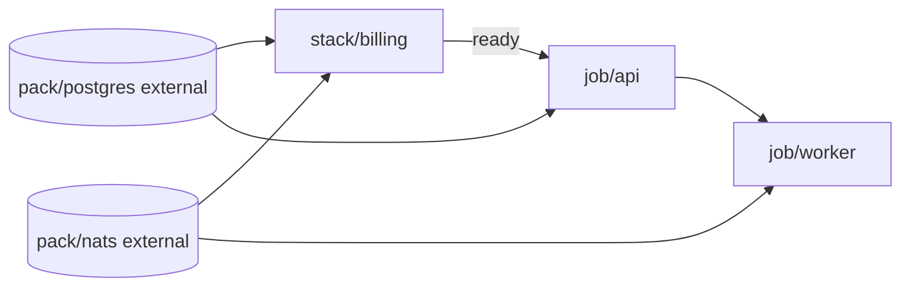

# Norca Deployer – Platform Management (Directory-Based GitOps for Norca Objects)

> **Status:** Design proposal (nothing implemented yet)
> **Component:** `norca-deployer` – new `platform` command group
> **Language:** English
> **Related:** [git-operations-design.md](git-operations-design.md) (in-memory Git engine, webhook daemon), [norca-deployer-design.md](norca-deployer-design.md) (node provisioning)

---

## 1. Goal and Non-Goals

### Goal

Manage the **objects of a running Norca platform** – namespaces, quotas, ACL policies, jobs, secrets, Variables, network rules, custom objects and so on – from **a directory tree** (usually a Git repository), across **several regions**, with one small command set: `validate`, `plan`, `apply`.

The tree is the source of truth. The tool makes the live platform match it, shows what it would change first, and never needs more state than the cluster itself holds.

### Non-goals

- **Node and cluster installation.** Installing agents, TLS, gossip keys, firewall, host packages and rolling restarts is `norca-deployer apply` and stays there. `platform` starts where it ends: a reachable cluster API.
- **Pack installation.** Pack registries and pack releases stay with the existing `packs` section and the GitOps pack bindings of the deployer (§3). `platform` only **references** them as dependencies (`external`, §7.10): it reads their version and health, it never installs, upgrades, prunes or rolls them back. This keeps the migration cost at zero; see open question 18.
- **No Terraform clone.** No provider model, no resource graph, no state file with a lock backend, no expression language, no modules, no `count`/`for_each`. Ordering is a fixed list of object kinds (§7.5) plus an **optional, package-level dependency graph** (units, §7.10): one edge type, no solver, no attribute-level references.
- **No new object schema where Norca already has one.** Files are the native Norca files (`.norca.hcl` jobs, the HCL of `norca namespace apply`, `norca quota apply`, `norca acl policy apply`, …). A file in the tree can always be applied by hand with the `norca` CLI. The deployer adds only a thin envelope (directory layout, a few small manifests, secret value forms).
- **Not one big platform.** One tree describes one platform (one or more regions of one federation). Several platforms are several trees.

### Design principles

1. **Directory = object kind × scope.** Where a file lives says what it is and where it applies; the file content is native.
2. **Idempotent and boring.** `apply` twice changes nothing the second time. Re-using the proven mechanisms of `postcluster.go` (digest markers, check-and-set, skip when unchanged).
3. **Everything shown before it happens.** `plan` is read-only and exact; `apply` re-checks.
4. **Deletion is opt-in.** Nothing is ever removed without `--prune`, and only objects the tool created (tracked in a ledger, §7).
5. **Secrets never in plaintext in Git.** Same value forms as the existing plan (`!enc:`, `!generate:`, `@file`).
6. **One binary, same configuration style.** Reuses the master key, the token handling, the Git fetcher and the webhook daemon of `norca-deployer`.
7. **HCL first, YAML second.** Every file the deployer defines is written, documented and generated in HCL, like the Norca objects themselves (§4 *File formats*). YAML is an equivalent secondary form with the same keys, for teams that want it; nothing is YAML-only.

---

## 2. What Norca Offers (Object Inventory)

Derived from the `norca` CLI (`norca/norca/command`), the example policies and the Norca documentation. **Scope** says where the object lives: `region` = stored in one region's Raft; `global` = authoritative region, replicated to the other regions of the federation (as in Nomad; the replication of each kind should be verified when implementing, see §13).

| # | Object | Norca CLI / API | Native file | Scope | Notes |
|---|---|---|---|---|---|
| 1 | **ACL policy** | `acl policy apply` | `.hcl` rules | global | optional job binding (workload identity: `job_id`, `group`, `task`) |
| 2 | **ACL role** | `acl role create` | flags → policy list | global | no file format in the CLI; deployer needs a tiny manifest |
| 3 | **ACL auth method / binding rule** | `acl auth-method create`, `acl binding-rule create` | flags / JSON | global | OIDC/JWT SSO |
| 4 | **ACL token** | `acl token create` | – | global/region | **not managed** as files: secrets by nature (§7.4) |
| 5 | **Namespace** | `namespace apply` | `.hcl` (`name`, `quota`, `meta`, capabilities) | global | `meta.environment=production` makes pack releases atomic |
| 6 | **Quota** | `quota apply` | `.hcl` with `limit { region }` per region, `task_defaults` | global | one `limit` block per region |
| 7 | **Node pool** | `node pool apply` | `.hcl` | global | scheduler config, meta |
| 8 | **Scheduler config** | `operator scheduler set-config` | JSON | region | preemption, algorithm |
| 9 | **Autopilot config** | `operator autopilot set` | flags | region | server health thresholds |
| 10 | **Admission policy (CEL)** | `admission-policy apply` | `.hcl` (`match`, `rule`) | global (to verify) | `action = deny / warn` |
| 11 | **Network policy** | `network-policy apply` | `.hcl` (`selector`, `egress`, `ingress`) | region, namespaced | level A/B |
| 12 | **Admin network policy** | `network-policy apply -admin` | `.hcl` (`priority`, `namespaces`) | cluster-wide | evaluated before namespace policies, `deny` is final |
| 13 | **Object kind** (CRD equivalent) | `object-kind apply` | `.hcl` (schema, CEL, webhooks, limits) | global | defines custom types |
| 14 | **Custom object** | `object apply` | `.hcl` (`<group>/<Kind>`) | region | spec written by users, status by controllers |
| 15 | **Job** | `job run`, `job plan` | `.norca.hcl` + vars | region (or multiregion) | the largest group; periodic, parameterized, system, batch |
| 16 | **Job scaling policy** | inside the job (`scaling` block) | in the job | region | typed, validated; autoscaler is built in |
| 17 | **Variables** | `var put` | HCL/JSON spec (`var init`) | region, namespaced | also Consul-KV replacement |
| 18 | **Secrets (built-in store)** | `secret put`, `secret import` | items (`k=v`, `k=@file`) | region, namespaced | versioned, audited; `secret` block in jobs |
| 19 | **Volumes** | `volume create/register` (host dynamic, CSI) | `.hcl` | region, namespaced | CSI plugins are jobs; snapshots are runtime, not managed |
| 20 | **Service intention** | `service intention create` | flags: source, destination, action | region | native mTLS allow/deny |
| 21 | **External service** | `service register` | flags / HCL | region | address or DNS alias with checks |
| 22 | **Pack registry** | `pack registry add` (server-side `pack-registry`) | name + URL + ref | region | **not managed by `platform`**: owned by the existing `packs.registries` |
| 23 | **Pack release** | `pack run` / `deploy-pack` | pack + values | region (`--regions` multi) | **not managed by `platform`**: owned by `packs.deploy` / GitOps; referenced as an `external` dependency (read-only) |
| 24 | **Backup schedule / S3 target** | agent config, `operator backup` | agent HCL | region | **node config → stays in `apply`** (§3) |
| 25 | **Multiregion deployment** | `deployment run` | in the job (`multiregion`) | spans regions | staged rollout, `on_failure` |
| 26 | **Keyring, snapshots, Raft ops, gossip keys, seal** | `operator …` | – | region | **operations, not objects – never managed** |
| 27 | **Consul KV entry** | Consul-compatible `/v1/kv` of a client (`consul_compat`) or a real Consul (`consul` pack) | file per key | region (not replicated; per endpoint) | value = file content; written with CAS (`ModifyIndex`), §7.12 |

Things Norca gives us for free that the design leans on:

- **`job plan`** returns a real diff and a check-and-set index → exact `plan` for jobs.
- **Check-and-set** on Variables and secrets → "create once" semantics already used by `bootstrapSecrets`.
- **Pack releases are server-side objects** with revision history, atomic upgrade, drift detection, rollback, hooks and tests → the existing pack engine drives them; `platform` only **reads** version, health and the last test result of a release, to use them as gates.
- **Admission control and quotas** run in the cluster → a bad file is rejected by the platform itself, not only by our validator.
- **Job meta, namespace meta and object labels** allow ownership tagging for jobs/namespaces/objects.

---

## 3. Boundary with the Existing Deployer Plan

| Concern | Owner | Why |
|---|---|---|
| SSH, node install, agent HCL, TLS, gossip, firewall, tuning, host packages, decommission | `apply` (`cluster-deploy.yaml`) | needs node access |
| ACL **bootstrap** (first management token) | `apply` | chicken-and-egg: needs the cluster before the API is usable |
| Backup/seal/server settings in agent config | `apply` | agent configuration |
| `consul_compat` listener of the clients (bind address, KV backend), firewall for it | `apply` (agent config, `extra_hcl`, firewall rules) | node configuration; `platform` only needs the address |
| **Pack registries, pack releases, GitOps pack bindings** | existing `packs` section and `gitops` | one owner, no migration; `platform` references the releases as externals (§7.10) |
| **Every other API object** (table in §2) | `platform` | needs only the API |

The existing post-cluster sections `security.acl.policies` and `secrets.bootstrap` keep working and can be moved into the tree step by step. **`packs` and the GitOps pack bindings are not migrated: they stay the only owner of pack registries and releases.**

- `norca-deployer platform import` (phase 4) reads the live cluster and writes the tree for the kinds `platform` manages (never pack releases), so an existing platform can be adopted.
- A policy or secret defined both in the plan (`security.acl.policies`, `secrets.bootstrap`) and in the tree is a `validate` error, so two tools never fight over one object.
- **Order when both run together** (the optional `platform:` line of the plan makes `apply` call `platform apply` as a stage): platform **foundation** first (it includes the secrets and Variables that packs may read), then the existing **packs** stage, then the platform **units**, whose gates wait for the externals. Standalone (laptop, CI, watcher) there is no such ordering: an external that is not satisfied yet makes the unit **wait** (state `pending`, not a failure, no rollback), and it is retried on the next tick (§11a).
- The same secret path must not be written by both `secrets.bootstrap` and `platform`; `validate` checks that too.
- Long-term, `security.acl.policies` and `secrets.bootstrap` can be deprecated in favour of one line in the plan: `platform { path = "./platform" }`. The pack sections are not part of that.

---

## 4. Directory Layout

One repository (or one directory) = one platform. The root has a small `platform.hcl` and three kinds of trees: `global/`, `regions/<region>/`, and – for the objects that belong to an application namespace – `namespaces/<ns>/`.

```text
platform/
├── platform.hcl                   # regions, endpoints, auth, defaults (§5)
├── README.md
│
├── global/                        # applied once, to the authoritative region
│   ├── acl/
│   │   ├── policies/              # developer.hcl, ci-deploy.hcl, readonly.hcl
│   │   ├── roles/                 # developer.hcl  (name + policies)
│   │   ├── auth-methods/          # oidc-corp.hcl
│   │   └── binding-rules/
│   ├── namespaces/                # apps.hcl, platform.hcl, monitoring.hcl
│   ├── quotas/                    # apps.hcl (one limit{} per region)
│   ├── node-pools/                # general.hcl, gpu.hcl
│   ├── admission-policies/        # baseline.hcl
│   ├── network-policies/          # admin policies (cluster-wide): no-metadata.hcl
│   └── object-kinds/              # loadbalancer.hcl, postgres-cluster.hcl
│
├── namespaces/                    # application-level objects, by namespace
│   ├── apps/
│   │   ├── jobs/
│   │   │   ├── api/
│   │   │   │   ├── api.norca.hcl          # the job
│   │   │   │   ├── unit.hcl               # optional: depends_on, tier, update order (§7.10)
│   │   │   │   └── vars/
│   │   │   │       ├── default.vars.hcl   # values for every region
│   │   │   │       ├── eu-1.vars.hcl      # region override
│   │   │   │       └── eu-2.vars.hcl
│   │   │   └── worker/worker.norca.hcl
│   │   ├── external.hcl           # things this tree depends on but does not manage: pack releases, jobs, services (§7.10)
│   │   ├── stacks/                # optional package form: unit.hcl + a job and its secrets, intentions, ...
│   │   │   └── billing/unit.hcl
│   │   ├── variables/             # nomad/jobs/api.hcl (var spec), encrypted values
│   │   ├── secrets/               # api/db.hcl  (items: !enc / !generate / @file)
│   │   ├── network-policies/      # api.hcl
│   │   ├── intentions/            # api-to-db.hcl
│   │   ├── services/              # external services
│   │   ├── volumes/               # data.hcl
│   │   └── objects/               # <group>_<Kind>_<name>.hcl custom objects
│   └── monitoring/ …
│
├── kv/                            # Consul KV: file path = key, file content = value (§7.12)
│   ├── _kv.hcl                    # managed prefixes, modes, small inline entries
│   └── app/config/db.json
│
├── actions/                       # external programs run on events (§7.11); also namespaces/<ns>/actions/, regions/<r>/actions/
│   └── notify-deploy.hcl
│
├── regions/                       # settings that exist only in one region
│   ├── eu-1/
│   │   ├── scheduler.json         # operator scheduler config
│   │   ├── autopilot.hcl
│   │   └── overrides/             # same relative path as elsewhere (§6)
│   └── eu-2/ …
│
└── .platform/                     # optional: ignore patterns, lint rules
```

### Why namespace-first for applications

An application team owns a namespace: its jobs, its secrets, its intentions and its network policies move together and are reviewed together (`CODEOWNERS` per `namespaces/<ns>/`). The platform team owns `global/` and `regions/`. That maps cleanly onto Git permissions and ACL policies, and it is the unit people actually think in.

### File formats: HCL first

| Files | Primary | Secondary |
|---|---|---|
| Native Norca objects (jobs, policies, namespaces, quotas, ...) | `.hcl`, jobs `.norca.hcl` | `.json` where `norca ... apply` accepts it |
| Deployer manifests (`platform`, `unit`, `external`, roles, intentions, services, secrets) | **`.hcl`** | `.yaml`/`.yml` with the **same keys** |
| Variable files of jobs | `.vars.hcl` | none |

Rules:

- **HCL is the reference format.** All examples, `platform init` output, `platform import` output and the documentation use HCL. A YAML file is accepted wherever a manifest is, and is never required.
- **One decode path, like the deployer plan.** `pkg/config/hcl.go` already loads HCL plans by shaping them into the YAML decoder, so both formats share keys, defaults and validation. The platform manifests reuse that mechanism; nothing can exist in one format only. Nested objects are blocks, lists of objects are repeated blocks, and a **block label is the `name`** (`region "eu-1" { ... }` is a YAML list entry with `name: eu-1`).
- **Never both for the same object.** `platform.hcl` and `platform.yaml` side by side, or `unit.hcl` and `unit.yaml` in one directory, is a validation error (ambiguous), not a merge. Mixing formats between *different* files is fine.
- **Order is explicit.** The decoder returns labelled blocks sorted by label, so anything where order matters is a list attribute (`rollout_order`, `layers`, `tiers`), never the order of blocks in the file.
- **Conversion.** `platform convert --to hcl|yaml [-d DIR]` rewrites the manifests (never the native Norca files), so a team can move either way; comments are lost when converting from YAML. `platform fmt` formats HCL.

### Naming rules

- **The object name comes from the file content**, not the filename. A lint rule warns when `filename != name` (jobs: `jobs/<job>/<job>.norca.hcl`).
- **Namespace comes from the path** (`namespaces/<ns>/…`). If the file also sets `namespace`, it must equal the path; mismatch = validation error. This prevents "copy a folder, forget the namespace".
- Extensions: `.hcl` / `.norca.hcl` for everything (native Norca files and deployer manifests); `.json` where Norca itself accepts JSON; `.yaml`/`.yml` as the secondary form of the **deployer manifests only** (see *File formats* above).
- Files and directories starting with `_` or `.` are ignored (drafts, shared snippets).

---

## 5. `platform.hcl`

The only deployer-specific manifest of the root. Deliberately short. (`platform.yaml` is accepted as the equivalent secondary form.)

```hcl
platform {
  name = "acme-prod"
}

# How this tool reaches the clusters (11b): local | proxy | node. Proxy profiles are named.
placement {
  type  = "proxy"
  proxy = "bastion"
}

proxy "bastion" {
  type              = "ssh"                  # ssh | http | socks5
  host              = "bastion.example.com"
  ssh_user          = "deploy"
  ssh_key_path      = "~/.ssh/norca_deployer"
  host_key_checking = "strict"
}

# Order in which regions are rolled out for region-scoped objects (first = canary).
# Explicit, because labelled blocks have no order.
rollout_order = ["eu-1", "eu-2"]

# Regions of the federation.
region "eu-1" {
  authoritative = true                       # receives global/ (replicates to the others)
  address       = "https://10.0.0.11:4646"
  token         = "!enc:v1:aes-gcm:..."      # management token (or token_file / NORCA_TOKEN)
  ca_cert       = "./certs/ca.pem"

  consul_kv {                                # where `kv/` is written (7.12); omit if no KV is managed
    type    = "norca-compat"                 # norca-compat | consul
    address = "http://10.0.0.21:8500"        # a client whose consul_compat.bind is reachable, or a Consul agent/server
    token   = "!enc:v1:aes-gcm:..."          # Norca ACL token (norca-compat) or Consul ACL token (consul)
    backend = "variables"                    # for the offline limit checks: variables | bus | consul
  }
}

region "eu-2" {
  address = "https://10.0.1.11:4646"
  token   = "!enc:v1:aes-gcm:..."
  ca_cert = "./certs/ca.pem"
}

# Optional: take the endpoints from an existing deployer plan instead of
# repeating them (addresses, CA, ACL token file).
# from_deploy_plan = "../cluster-deploy.hcl"

requires {                                   # versions the files were written for (7.7)
  norca = ">=0.3.0 <0.5.0"
}

state {                                      # local state files (7.9)
  dir       = ".norca-deployer/platform"     # also --state-dir / NORCA_DEPLOYER_STATE_DIR; "none" disables
  ledger    = "cluster"                      # cluster | local
  keep_runs = 20
}

graph {                                      # optional unit dependency graph (7.10)
  tiers        = ["data", "platform", "apps", "edge"]   # named waves, barriers; omit for none
  parallelism  = 3
  default_wait = "healthy"                   # applied | healthy | ready | tested
  update_order = "follow"                    # follow | reverse | independent
  derive       = ["secrets", "volumes", "namespaces"]   # reference edges found by name in the tree
}

defaults {
  prune          = false                     # deletion is opt-in; see 7
  job_apply      = "plan-then-run"           # plan-then-run | register-only
  wait           = true                      # wait for the deployment to become healthy
  on_failure     = "rollback"                # rollback | stop | continue (7.8)
  rollback_scope = "region"                  # region | run
}

actions {                                    # external programs (7.11)
  dir          = "actions"                   # relative to the folder of the deployer executable, or absolute
  max_parallel = 2
  timeout      = "60s"                       # default per program
  output_limit = "64KiB"                    # kept per stream in the log
  drain        = "60s"                       # how long a one-shot run waits for running programs at its end
}

# Which kinds `apply` may touch (default: all). Useful in CI roles.
kinds = ["acl", "namespaces", "quotas", "node-pools", "jobs", "secrets"]
```

The YAML form has the same keys (`region` becomes a list of objects with `name`, `rollout_order` stays a list); it is accepted but not used in this document.

Connection and token handling reuse `pkg/config` and the master-key vault: the same `!enc:`, `NORCA_DEPLOYER_SECRET_KEY` and token file conventions as the cluster plan, so no second secret system appears.

---

## 6. Multi-Region and Environment Handling

Three simple mechanisms. No templating language.

### 6.1 Scope by directory

| Directory | Applied to |
|---|---|
| `global/` | the authoritative region only; other regions receive it by replication. Where a kind is *not* replicated, the tool applies it to each region (a per-kind flag in the kind table, §8). |
| `namespaces/<ns>/…` | every region listed under `regions:` unless the object restricts itself (e.g. job `datacenters`, `multiregion`) |
| `regions/<r>/…` | that region only |
| `kv/` | **every** region: the key space of that region's Consul KV endpoint (not replicated; §7.12) |
| `actions/` | the scope of the directory it sits in (`namespaces/<ns>/actions/` = that namespace, `regions/<r>/actions/` = that region, root = everywhere) |

### 6.2 Per-region variation: file-level overlay

For anything that differs by region, put a file with **the same relative path** under `regions/<r>/overrides/`. It *replaces* the base file for that region; there is no value-level merging, so the result of a file is always readable by opening one file.

```text
namespaces/apps/jobs/api/api.norca.hcl                    ← base
regions/eu-2/overrides/namespaces/apps/jobs/api/api.norca.hcl   ← replaces it in eu-2
```

To avoid copying whole jobs for one changed number, jobs use **variables**, which Norca already supports (`-var-file`, `NORCA_VAR_*`):

```text
vars/default.vars.hcl     # always
vars/<region>.vars.hcl    # added for that region (wins over default)
```

The deployer passes `-var region=<region> -var datacenter…` automatically (as `NORCA_VAR_region`) plus the two var files. The job HCL stays a normal job.

### 6.3 Environments (dev/stage/prod)

Environments are **separate trees**, not a flag inside one. Reasons: different tokens, different reviewers, different promotion pace.

Two supported patterns:

1. **Repo per environment** (simplest; promotion = a pull request between repos or a cherry-pick).
2. **One repo, one directory per environment**, with shared pieces pulled in by layers:

```hcl
# envs/prod/platform.hcl
layers = [
  "../../common",         # lowest priority
  ".",                    # this directory wins
]
```

Layers resolve by **relative path, later layer wins per file** – the same file-level rule as overrides. No merging.

### 6.4 Multiregion jobs

A job with a `multiregion` block is submitted **once** (to the first region); Norca fans it out with its staged rollout. The tool detects the block, applies it once and does not repeat it for every region.

---

## 7. Reconciliation Model

### 7.1 The loop

```text
validate  →  load tree  →  resolve values  →  read live state  →  diff  →  (apply)
```

1. **Load**: walk the tree, parse files, compute the effective file set per region (base + overlays).
2. **Resolve**: `!enc:`, `!generate:`, `@file` values (§9). Secrets are only decrypted in memory.
3. **Read live**: per kind, list or get through the API (cheap kinds are compared fully; see 7.3).
4. **Diff**: `create`, `update`, `unchanged`, `delete (needs --prune)`, `drift` (changed in cluster by someone else).
5. **Apply**: kinds in the fixed order (§8), objects within a kind alphabetically; stop on the first error of a kind (`--keep-going` to continue).

### 7.2 Plan output

```text
Region eu-1 (authoritative)
  + namespace        monitoring
  ~ quota            apps            limit[eu-1].memory 4096 -> 8192
  = acl policy       developer
Region eu-1, namespace apps
  ~ job              api             image 1.4.2 -> 1.4.3 (rolling update, 3 allocs)
  + secret           api/db          (items: password=<generated>, user)
  ! variable         nomad/jobs/api  drifted in cluster (cli edit), will be overwritten
  - job              old-batch       not in tree – kept (use --prune)
Region eu-2
  ~ job              api             image 1.4.2 -> 1.4.3
Summary: 2 create, 3 update, 7 unchanged, 1 drift, 1 not pruned
```

Exit code mirrors `terraform plan -detailed-exitcode` style (0 nothing, 2 changes, 1 error), for CI use.

### 7.3 How "changed" is decided, per kind

No state file. Two reliable methods, picked per kind:

| Method | Kinds | How |
|---|---|---|
| **Read-back compare** (authoritative) | ACL policies, namespaces, quotas, node pools, admission/network policies, object kinds, custom objects, scheduler config | `GET`, normalize both sides to the fields that the file sets, compare. Detects drift. |
| **Server-side plan** | jobs | `job plan` (Norca returns a diff and the job modify index); the run is submitted with the index (check-and-set), so a concurrent change aborts instead of overwriting. |
| **Digest marker + CAS** | secrets, Variables | values can't be read back cheaply or shouldn't be logged: store a digest of what the tool wrote (as `bootstrapSecrets` already does). "Create once" (cas 0) is the default; `overwrite: true` writes a new version when the digest changes. Variable/secret **never print values** in a plan. |

### 7.4 Deletion and ownership (opt-in prune)

Without `--prune`, nothing is deleted – the plan only *lists* what would be.

With `--prune`, only **tool-created** objects can be removed. Ownership is recorded in a **ledger in the cluster**, so every operator and the daemon agree (a local state directory would diverge between laptops):

- Variable `norca-deployer/platform/ledger` in namespace `default`, one per region, items = kind → list of names, written with check-and-set.
- Where the object has `meta` (jobs, namespaces, node pools, objects), the deployer additionally sets `meta.managed-by = "norca-deployer"` and the tree id; this survives loss of the ledger and makes `import`/adoption explicit.

Hard exclusions, never pruned: the `default` namespace and node pool, the built-in `anonymous` policy, management and bootstrap tokens, anything outside the ledger. **Jobs** need an extra flag (`--prune-jobs`) because deleting a job stops a workload; **secrets and Variables** need `--prune-data`.

### 7.5 Ordering

A fixed list. This is the entire "dependency graph":

```text
 1 ACL policies  →  roles  →  auth methods  →  binding rules
 2 quotas        →  namespaces                (a namespace references its quota)
 3 node pools
 4 scheduler / autopilot config
 5 admission policies, admin network policies
 6 object kinds                                (before custom objects)
 7 (pack registries: owned by the existing `packs` section, not here)
 8 variables, secrets, Consul KV entries        (before the jobs that read them)
 9 volumes
10 network policies, service intentions, external services
11 (pack releases: owned by `packs` / GitOps; referenced as externals, §7.10)
12 jobs
13 custom objects
```

Prune runs in the **reverse** order after all applies. This list is the **foundation**; applications (jobs and stacks; pack releases only as externals) are ordered on top of it by the optional unit graph of §7.10 (dependencies, tiers, update order). `validate` checks the references that cross this order (namespace→quota exists, policy job binding→job exists, job `node_pool` exists, `secret` block path exists in `secrets/` or is marked external).

### 7.6 Safety rails

- **Dry-run first**: `apply` always computes the plan and prints it; `--yes` for non-interactive use.
- **Blast-radius guard**: if a plan would delete or update more than N objects (`defaults.max_changes`, default 50) it refuses without `--yes-really`.
- **Region staging**: regions are applied in order; with `--stop-on-region-failure` (default) a failed region stops the rollout. First region = canary.
- **Admission and quotas still apply**: a file the cluster rejects fails with the cluster's message.
- **ACL least privilege**: the tool can run with a scoped token (a `platform-deployer` policy listing only the kinds in `kinds:`) instead of management, for CI.
- **Lockless but guarded**: CAS on jobs and Variables protects individual objects; one concurrent `apply` per region is enforced with a lease Variable (`…/platform/lock`, TTL), not a lock service.

### 7.7 Version Check and Reconciliation with Norca

Every `plan`/`apply` starts with a **preflight version check**, per region, before anything is read or written. The tree must never be applied blindly to a cluster that is mid-upgrade or older than the files expect.

**What is read** (read-only calls; exact endpoints to confirm against Norca, the CLI prints `Norca v0.3.0 (Nomad API 1.6.5 compatible)`):

| Item | Source | Used for |
|---|---|---|
| Server versions, one per server | agent members / `agent self` per server | mixed-version detection |
| Client (node) versions | node list | warn when a kind needs a newer client (e.g. network rules need nftables-capable nodes) |
| Region list and leader | regions, status leader | the federation matches `platform.hcl` |
| Deployer binary version and the API level it was built against | build info | the deployer's own compatibility window |
| Installed pack releases (version, health, last test) and registry sync state | release + registry API, read-only | gates and version constraints of external dependencies, report |
| Object kind schema versions | object-kind API | custom object compatibility |

**Checks, in order:**

1. **Reachability and identity**: the region is reachable the way `placement` says (§11b; the probes are recorded in the state), and the region name returned by the cluster equals the one in `platform.hcl`.
2. **Consistency**: all servers of a region on the same `major.minor` (patch may differ). Mixed versions mean an upgrade is running → `apply` is **refused** unless `--allow-mixed-versions`; `plan` only warns. This is the same reason `apply` of the node installer rolls servers one at a time.
3. **Tree requirement**: `platform.hcl` may declare the Norca versions the files were written for:

   ```hcl
   requires {
     norca    = ">=0.3.0 <0.5.0"   # semver range, checked per region
     deployer = ">=0.9.0"
   }
   ```

   Outside the range → error (with the actual versions in the message). Inside → proceed.
4. **Kind support matrix**: the deployer carries a small table `kind → minimum Norca version` (generated from the Norca feature status: e.g. network rules, operator framework, secrets store, native mTLS intentions). A kind with files in the tree but unsupported by a region is an **error before any write**, not a late 404. An unknown newer Norca version is **not** blocked (the table is a floor, never a ceiling); it prints a note.
5. **Capability probe as safety net**: for kinds not in the table, a read call (`list`) is made first; 404/501 marks the kind unsupported for that region with a clear message.
6. **Upgrade ordering hint**: if the tree requires a newer Norca than the region runs, the message says "upgrade the cluster first with `norca-deployer apply`" – the platform tool never upgrades nodes (non-goal).

**Reconciling with the node plan.** When `from_deploy_plan` is set (§5), the platform tool also compares the **Norca version the cluster plan installs** (`artifacts`) with the **observed versions**: a difference means an `apply` of the node plan is pending or failed, and the platform run stops at preflight with that explanation. So the two tools cannot disagree silently about what version the cluster is.

**Reporting.** `platform status --versions` shows the whole picture in one table:

```text
Region  Servers (versions)     Clients            Node plan   Tree requires   State
eu-1    3 × 0.3.0              9 × 0.3.0          0.3.0       >=0.3 <0.5      ok
eu-2    2 × 0.3.0, 1 × 0.2.4   6 × 0.2.4          0.3.0       >=0.3 <0.5      MIXED – upgrade running, apply blocked

Pack releases referenced by namespace apps (read-only)
Release   Required by                 Constraint    Installed   Registry latest   State
postgres  job/api, stack/billing      >=0.1 <1.0    0.1.1       0.1.1             ok
nats      stack/billing, job/worker   >=0.6 <1.0    0.5.2       0.6.0             CONSTRAINT VIOLATED – dependents wait
```

Version drift of **workloads** (job images) is reported, not enforced: the tree is the intent, the cluster is the fact, the table shows both. **Pack releases are not reconciled by `platform`**: it only checks the constraint declared for the external and reports whether it holds. A violated constraint blocks (makes wait) the dependent units, it never installs or upgrades a pack. The registry's "latest" is informational only.

### 7.8 Validation Stages and Rollback

Two separate protections: **nothing is written if the tree is invalid**, and **a failed write is undone where Norca allows it**.

#### Stage A – all-or-nothing preflight (no cluster change)

Everything that can be known before the first write is checked for **all regions and all kinds** first. Any error aborts the run with **zero changes**.

| # | Check | Example failure |
|---|---|---|
| 1 | **Syntax**: every file parses (HCL/JSON/YAML), with file, line and column in the message | `jobs/api/api.norca.hcl:42:7: unclosed block` |
| 2 | **Shape**: required fields, name and namespace rules (§4), unique identities | namespace in path ≠ namespace in file |
| 3 | **Cross references** (§7.5) | namespace names quota `apps` that is not in the tree or live |
| 4 | **Values**: `!enc:` decrypts, `@file` exists, `!env:` set, plaintext-secret scan | master key missing |
| 5 | **Server-side validation, read-only**: `job validate` + `job plan` (this also runs admission policies and quota checks), ACL policy rule parse where the API offers a check, object against its object-kind schema and CEL | job rejected by `apps-baseline` admission policy |
| 6 | **Version preflight** (§7.7) | kind unsupported in region eu-2 |

A bad file is therefore found **before any region is touched**, including a bad file for the *last* region. This is the main defence; rollback is the second line.

`--skip-invalid` does not exist on purpose: a half-applied tree is exactly what the tool must not produce. To apply part of a broken tree, narrow it explicitly (`--kind`, `--namespace`, `--region`) – the *selected* part must be valid.

#### Stage B – journal and before-images

For every object that `apply` is about to change, the tool first saves a **before-image** and writes it into a write-ahead **journal** in the state directory (§7.9):

```text
<state>/<region>/journal/<run-id>.jsonl
{"seq":1,"kind":"quota","name":"apps","op":"update","before":"snapshots/<run-id>/quota-apps.json"}
{"seq":2,"kind":"job","ns":"apps","name":"api","op":"update","before_version":17}
{"seq":3,"kind":"namespace","name":"monitoring","op":"create"}
```

The journal is written **before** each change and marked `done`/`failed` after, so a crash of the deployer itself (or of the daemon) leaves a journal that `platform rollback` can finish.

#### Stage C – what "rollback" means per kind

| Kind | Rollback mechanism | Limits |
|---|---|---|
| **Job** | Norca's own: wait for the deployment; on failure call **`job revert`** to the version recorded in the journal (enforcing the prior version so a concurrent change is detected). If the job's `update` block has `auto_revert = true`, Norca reverts itself and the tool only reports it. A job that was *created* in this run is stopped (and purged only with `--rollback-purge`). | Stateful side effects (migrations done by the job) are not undone – that is the job's concern; documented. |
| **Read-back kinds** (ACL policy/role, namespace, quota, node pool, admission/network policy, object kind, custom object, scheduler/autopilot) | **Re-apply the before-image**; objects created in this run are deleted (they are in the journal, so ownership is certain). | A namespace/node pool that gained jobs meanwhile cannot be deleted → reported, not forced. Object kind schema changes with data migration (CEL migrations) are not reverted. |
| **Variable** | restored from an **encrypted** before-image (needs the master key; stored mode `0600`). Without a master key the before-image is *not* written and the kind is reported as "no rollback". | holds a copy of a secret on disk, hence encryption is mandatory (§9) |
| **Consul KV entry** | restore from the before-image with a CAS write (previous value and flags); keys created in this run are deleted, keys deleted are written back. The before-image holds configuration values, so it is encrypted like the Variable images. | a task that already restarted because consul-template re-rendered the changed key is not undone (the key is, the restart happened) |
| **Secret (built-in store)** | secrets are versioned by Norca: write the previous version back as the new current one; no value copy is kept by the deployer. | depends on the store exposing the previous version – open question §13 |
| **Intention, external service, volume, registry** | re-apply before-image / delete created | volume deletion is never automatic (data) → reported |
| **Prune (deletions)** | **not rolled back**; prune runs last, only when every apply of the run succeeded and every deployment is healthy (§7.5). | deletion is irreversible by nature, hence the extra flags |

#### Stage D – policy: when does it roll back

```text
--on-failure=rollback   (default for apply)   undo the current run in the failed region, newest first
--on-failure=stop                             leave the state as is, print what was applied, exit 1
--on-failure=continue                         (with --keep-going) go on with independent objects; no rollback
--rollback-scope=region (default) | run       region: only the failed region; run: also earlier regions of this run
```

- **Default `region` scope**: regions are a staged rollout (§7.6); a failure in `eu-2` rolls back `eu-2` and stops. `eu-1` stays on the new version – it was healthy – and the report says so. This is the canary meaning of the region order. `--rollback-scope=run` also reverts `eu-1` when you want all-or-nothing across regions.
- A **failure** is: an API error, a rejected object, a deployment that does not become healthy within the wait timeout. An unsatisfied **external** gate is *not* a failure (§7.10). Waiting uses the existing `wait` default (§5) and Norca's deployment status (`deployment run`/`status`), with `healthy_deadline` from the job's own `update` block.
- **Rollback failure** (a revert itself fails): the journal keeps the open entries, the run state becomes `rollback-failed`, `platform status` shows it prominently, and the next `plan` refuses to proceed until `platform rollback --run <id>` succeeds or `--ignore-open-journal` is given. No silent half states.
- **Manual**: `platform rollback [--run <id>]` (default: last run) and `platform runs` (history). Longer-term "go back" is `git revert` followed by a normal apply; the journal covers the minutes after a failed apply, Git covers everything older.

#### Invalid input in the GitOps path

For the daemon (§11) the same rules hold, with one addition: a commit that fails stage A is **never applied**, the binding stays on its **last good commit** (recorded in state), the failure goes to the ring log and (optionally) a webhook/notification, and the same commit is **not retried** until a new push arrives, so a broken commit cannot loop.

### 7.9 Local State Files and the Directory Switch

The first draft of this design leaned on cluster-side facts only. Rollback, history and offline `plan` need some local files, so the tool keeps an **optional state directory**. It is a cache and a journal, not a source of truth: deleting it loses history and rollback ability, never correctness, because live state is re-read from the cluster every run (`platform diff` shows the same result with or without it).

**Switch.** The location is chosen in this order (first wins):

1. `--state-dir DIR` on the command
2. `NORCA_DEPLOYER_STATE_DIR`
3. `state.dir` in `platform.hcl`
4. default `.norca-deployer/platform/` next to the plan/tree root (consistent with the existing `.norca-deployer/` directory: `generated/`, `nkeys/`, `acl-policies/`, `packs/`…)

`--state none` disables local state (CI containers that are thrown away; rollback then only works within the process lifetime and journal entries are kept in memory). The tree directory itself is `-d/--dir` (default `./platform`); the two are independent, so the tree can be a read-only checkout while the state lives elsewhere.

**Layout** (one subtree per platform name and region, so several platforms can share a directory):

```text
<state-dir>/<platform-name>/
├── <region>/
│   ├── applied.json        # per object: kind, name, digest, run id, commit SHA, time, rollback info
│   ├── versions.json       # last observed server/client/pack versions (for `status` offline and trend)
│   ├── ledger.json         # local copy of the ownership ledger (see below)
│   ├── journal/<run-id>.jsonl
│   ├── snapshots/<run-id>/ # before-images; values of Variables/secrets only encrypted
│   └── lock                # advisory lock of this operator machine (not a cluster lock)
└── runs.jsonl              # run history: id, time, who, commit, regions, result, rollbacks
```

Rules:

- **Permissions** `0700` directory, `0600` files. Anything containing a value is encrypted with the master key (AES-256-GCM, same vault as `pkg/crypto`); without a master key such files are not written and the affected rollback is reported as unavailable.
- **Not for Git.** `platform init` writes a `.gitignore` entry for the default state path. State files are per operator/daemon, not shared.
- **Retention**: keep the last N runs (`state.keep_runs`, default 20) and their snapshots; older journal files are pruned by `apply`.
- **Ownership ledger – two modes** (`state.ledger`):
  - `cluster` (default for teams and the daemon): the ledger Variable of §7.4 is authoritative; `ledger.json` is a copy for offline `plan`.
  - `local`: single operator, no Variable written in the cluster; prune only knows what *this* state directory created. Switching modes requires `platform import --adopt` so ownership is stated, not guessed.
  - If both exist and disagree, **the cluster ledger wins** and the tool warns.
- **Daemon**: the state directory must be on persistent storage (a volume/path that survives restarts); otherwise, after a restart, the last-good-commit and open-journal checks are lost. `status` warns when the directory is empty on a cluster that has a ledger.
- **Locking**: the local `lock` stops two runs on the same machine; the cluster-side lease (§7.6) stops two machines. Both must be taken.

### 7.10 Dependency Graph (Units) and Update Order

§7.5 orders **kinds**. That is enough for the platform base, but not for applications: `postgres` must be healthy before `api`, `nats` before `worker`, and during an update the order may have to be the opposite. This section adds an **optional, small graph at package level**. It does not replace §7.5; it sits on top of it.

#### Two levels, on purpose

```text
Level 1  FOUNDATION   fixed kind order (§7.5), no declarations
         ACL → quota → namespace → node pool → policies → object kinds → registries
         → variables/secrets → volumes → network policies/intentions
                      │  always complete (and healthy) before any unit starts
                      ▼
Level 2  UNITS        a DAG of packages, declared with depends_on (optional)
         jobs · stacks   — started as soon as their dependencies are satisfied
         (+ externals: referenced, never applied: pack releases, other teams' jobs, catalog services)
```

Level 1 needs no graph and cannot be reordered. Level 2 is where "package-level dependencies" live. A tree with no declarations behaves exactly as §7.5 describes (units are independent, applied alphabetically, up to `graph.parallelism` at a time).

#### What a unit is

| Unit | Source | Contains |
|---|---|---|
| **external** | `namespaces/<ns>/external.hcl` | something this tree **depends on but does not manage**: a pack release installed by `packs`/GitOps, a job of another team, a service of the catalog. Never applied, updated, pruned or rolled back; only **read** to evaluate gates and version constraints |
| **job** | `namespaces/<ns>/jobs/<job>/` (+ optional `unit.hcl`) | the native `.norca.hcl` and its var files |
| **stack** | `namespaces/<ns>/stacks/<name>/` with `unit.hcl` | any namespace-scoped files that belong together (in the same sub-directories as a namespace: `jobs/`, `secrets/`, `intentions/`, `kv/`, ...): a job plus its secrets, Variables, network policy, intention, volume, custom objects. Inside a stack the objects follow §7.5; the stack is one node of the graph |

Loose files of §4 (a secret or intention in its normal directory) stay valid: they belong to Level 1 and need no unit. A stack is the *package form* for people who want an application and its supporting objects to move as one thing. Naming: `job/<id>`, `stack/<name>` within a namespace; externals are named by convention `pack/<release>`, `job/<id>`, `service/<name>`; `<ns>/<name>` across namespaces.

#### Declaring dependencies

The unit manifest is small and the same for jobs and stacks (in `unit.hcl`, beside the job file or in the stack directory; externals are declared separately, below):

```hcl
# namespaces/apps/jobs/api/unit.hcl
depends_on = ["pack/postgres"]            # shorthand: wait for it to be healthy

dependency "pack/nats" {                  # a dependency with options
  version = ">=0.6 <1.0"                  # constraint on the pack version of that release
}

dependency "stack/billing" {
  wait    = "ready"                       # applied | healthy | ready | tested (below)
  timeout = "10m"
  soak    = "30s"                         # stay healthy this long before continuing
}

tier = "apps"                             # optional named wave (below)

update {
  mode   = "follow"                       # follow | reverse | independent
  before = ["job/worker"]                 # extra update-only edges
  after  = []
}
```

**External dependencies.** Packs stay installed by the existing engine, so the tree *refers* to them instead of declaring them:

```hcl
# namespaces/apps/external.hcl
external "pack/postgres" {
  type    = "pack-release"          # pack-release | job | service
  release = "postgres"              # name in the cluster (default: the part after the slash)
  version = ">=0.1 <1.0"            # default constraint, checked against the installed release
  wait    = "healthy"               # default gate for dependents
  timeout = "10m"
}

external "pack/nats" {
  type    = "pack-release"
  release = "nats"
  version = ">=0.6 <1.0"
}

external "service/auth" {
  type = "service"                  # a service of the Norca catalog (another team's job)
  name = "auth"
  wait = "ready"
}
```

- An external is **read-only**: the tool lists the release/job/service and evaluates the gate and the version constraint. A `dependency` block of a consumer may narrow the constraint, never loosen it.
- A missing or unsatisfied external is **`pending`**: the dependent unit (and everything behind it) is reported as `waiting for pack/postgres`, **no rollback**, retried on the next tick or run (a run exits with the "changes pending" code). Only an external that is satisfied at the start and turns unhealthy *during* the run, after a dependent was already applied, is a failure.
- Externals are never scheduled and have no `tier`; `update.mode` on an edge to an external has no effect, because the platform does not change it. If the pack engine updates the external at the same time, the gate simply waits for it to be healthy again.
- `platform graph` shows externals as a separate layer, so a reviewer sees what the tree assumes about the rest of the cluster.

**Gates** (`wait`), what "dependency satisfied" means, from cheap to strict:

| `wait` | Satisfied when |
|---|---|
| `applied` | the API accepted the object (no waiting) |
| `healthy` (default) | the deployment or release is healthy (jobs: successful deployment; releases: healthy revision, wait up to the release timeout) |
| `ready` | the service's **readiness** health checks pass in the Norca service catalog (health check roles: startup, readiness, liveness) |
| `tested` | the last `test` result of the release is a pass (read from the release status; the tool never runs tests) |

Optional `soak` adds a hold time after the gate. The dependency's **version constraint** is checked at plan time against the version the tree will have (or the live one if the dependency is unchanged) – a mismatch is a plan error, not a late failure.

**Derived edges** (nothing to write; `graph.derive` selects which): the validator already scans references for §7.5, so it can also add edges for what it can resolve **by name inside the tree** – a job's `secret`/Variable paths to the stack that provides them, `volume` blocks, `namespace`, `node_pool`. It cannot derive runtime service dependencies (job A calls service B), so those are always explicit. Derived edges are shown in `platform graph` with their reason; an explicit edge never needs to repeat them.

**Pack metadata.** Norca packs already carry `requires { norca, features }` (checked by the servers). The pack `dependency` block of `metadata.hcl` is **composition** (helper templates of another pack inside this pack's rendering), not install order, and is **not** used for the graph. Proposed extension in the pack repository (open question 15): `requires { packs = ["postgres >= 0.1"] }`, from which the platform would derive pack-to-pack edges automatically. Until then, pack dependencies are declared as externals.

**Tiers.** A named, coarse wave for people who think in layers, declared once in `platform.hcl`:

```hcl
graph {
  tiers = ["data", "platform", "apps", "edge"]   # applied in this order; deletes in reverse
}
```

A tier is a **barrier**: every unit of tier *n* (in the plan) has met its gates before tier *n+1* starts. Edges inside a tier work as usual; an edge from an earlier tier to a later one is a validation error (it contradicts the barrier). Units without a tier belong to the last tier. Use tiers when a layering is enough and `depends_on` when the dependency is specific; mixing is fine. No tiers declared = no barriers.

#### Build, validate, schedule

1. **Collect** units from the effective file set of **each region** (after overlays, §6.2): the graph is per region, so a region that does not contain a unit simply has no such node.
2. **Edges**: explicit + derived + tier barriers.
3. **Validate** (stage A of §7.8, before any write): unknown unit, **cycle** (the message prints the path `a → b → c → a`), edge to a unit that is absent in this region, version constraint violated, tier contradiction, `depends_on` across regions (not allowed: cross-region order is the region order and the promotion gating of §11a), edge to an `enabled = false` unit that is not live and healthy.
4. **Order** by Kahn's algorithm into levels; ties alphabetical, so the order is **stable and reviewable** (the same tree always plans the same way).
5. **Run** with a ready-queue and a worker pool (`graph.parallelism`, default 3): a unit starts as soon as **all of its dependencies** are satisfied, not when a whole level finishes. A unit whose dependency is unchanged still has its **gate checked against the live cluster**: `api` changes while `postgres` is unhealthy → `plan` shows it, `apply` refuses unless `--ignore-unhealthy-deps`.

#### Install, update and delete order

The same graph gives three orders. The rule is simple and deterministic: **the operation of the dependent unit B decides how an edge A ← B is read**; an edge only matters when both ends are in the plan.

| Operation on B | Edge "B depends on A" | Notes |
|---|---|---|
| **create** | A before B | provider first |
| **update** | by `B.update.mode` (below) | |
| **delete** | B before A | consumers go first; deleting A while B stays is an **error** ("A is required by B"), never a cascade |

`update.mode` (per unit, default from `graph.update_order`, default `follow`):

| Mode | Order on update | Typical use |
|---|---|---|
| `follow` | like create: providers (A) before consumers (B) | additive change: new column, new API field, new NATS stream |
| `reverse` | consumers (B) before providers (A) | removing or tightening something the consumers must stop using first (expand/contract) |
| `independent` | edges ignored for this unit, only tiers apply | unrelated units that merely share a tier |

Plus per-unit `update.before: [..]` / `update.after: [..]` for **update-only** edges that are not install dependencies (e.g. "when the worker changes, update it before the api, but the api does not need the worker to exist").

**Per run override**, for the case where the commit author knows the change is breaking:

```text
norca-deployer platform apply --update-order reverse            # every unit that has no explicit mode
norca-deployer platform apply --unit job/api --with-deps        # api, plus dependencies *that changed*
norca-deployer platform apply --unit job/api --only             # api alone; deps must be healthy, else error
```

Inside a unit the rolling behaviour of replicas stays Norca's own (`update` block of the job: `max_parallel`, canary, auto-revert). The graph orders **between** units, never between allocations. Ordering **inside** a job group (init/prestart tasks) stays in the job (`lifecycle`).

#### Failure of a unit

A unit that fails its gate or its apply is rolled back per §7.8 (job revert, release rollback, before-images); then:

- **its dependents are skipped** (reported as `blocked by <unit>`), never applied against a broken provider;
- by default the run **stops starting new units** and lets in-flight ones finish and verifies them (`--on-failure rollback`); with `--keep-going` independent branches continue;
- `--rollback-scope run` additionally reverts the units already completed in this run, **in reverse completion order** (consumers before providers of the same run), using the journal.

A unit already applied and healthy stays applied in the default scope; the status shows `partially applied: 4 of 6 units, failed at job/api`.

#### Seeing the graph

`platform plan` shows waves and the reason for each edge; `platform graph` prints the structure (text, Graphviz `dot`, or Mermaid for the docs and PR comments):

```text
Region eu-1, namespace apps — order for: update (3 units change, 2 unchanged)
Foundation  (1 quota update, 1 namespace unchanged)
External (read-only)
  pack/postgres       installed 0.1.1  (>=0.1 <1.0 ok)   healthy
  pack/nats           installed 0.6.0  (>=0.6 <1.0 ok)   healthy
Tier apps
  [1] stack/billing   2 objects              needs pack/postgres, pack/nats
  [2] job/api         image 1.4.2 → 1.4.3    needs pack/postgres, stack/billing (ready), secret api/db (derived)
  [2] job/worker      unchanged
Blocked: none. Waiting for externals: none.
```



The same data is available through the service API (§11a: `GET /v1/platform/graph`) and, with `--unit X --dependents`, as an **impact list**: "`pack/postgres` (external) is required by `stack/billing`, `job/api`, `job/worker`" (information only; dependents are not changed unless they have changes of their own).

#### Why this stays small

- One edge type, one meaning ("B after A, gate G"), computed on **units**, never on attributes.
- No expressions, no outputs passed between units, no `count`/`for_each`; a unit's values are its own files.
- The ordering of the foundation is fixed and needs no declarations.
- Every declaration is optional; an empty graph is valid and predictable.
- The whole engine is: parse manifests, build edges, check for cycles, topological sort, ready-queue with gates. No solver, no state refresh phase, no plan/apply graph walk of resources.

### 7.11 Actions: Running External Programs

Some things around a rollout are not Norca objects: tell a chat channel, warm a cache, call a ticket system, refresh a load balancer. `platform` can **run a program** when something happens, with parameters taken from the context (region, namespace, job ID, task name, ...). The contract is deliberately small:

- **Post-event and advisory.** The program runs *after* the event. Its result is **only logged**: a non-zero exit, a timeout or a program that cannot start never fails the run, never triggers a rollback and never counts towards the circuit breaker (§11a). Actions are not gates; for gating use dependencies (§7.10) and Norca's own health checks.
- **A program next to the deployer.** Only programs from one directory beside the `norca-deployer` executable can run (below). The tree chooses *which* of them and with *which arguments*; it cannot bring a program of its own.
- **Arguments, not a shell.** The arguments are a list of strings with `${variables}` that the tool substitutes. They become separate `argv` entries of the process; nothing is parsed by a shell.

#### Where the programs live

```text
<folder of the norca-deployer executable>/actions/
├── notify.sh              # Linux/macOS: regular file with the executable bit
├── warm-cache             # a binary
└── report.ps1             # Windows: .exe or .ps1 only
```

- **Resolution:** the directory is `actions/` beside the executable (the executable path is resolved through symlinks), or `actions.dir` in `platform.hcl`, or `--actions-dir` / `NORCA_DEPLOYER_ACTIONS_DIR` (first wins). A relative `actions.dir` is relative to the executable's folder, never to the tree.
- **`program` is a plain file name** (`[A-Za-z0-9._-]+`), never a path. After resolving symlinks the file must still be inside the directory and be a regular, executable file; otherwise it is refused.
- **The directory is the allow-list.** Whoever can write to it is the operator; whoever can only commit to the tree is not able to run anything that was not installed there. An optional `<program>.sha256` next to a program pins its content; if it exists and does not match, the program is refused.
- **Windows:** `.exe` runs directly; `.ps1` runs as `powershell -NoProfile -NonInteractive -File <script> <args>`. `.cmd` and `.bat` are **refused**: `cmd.exe` re-parses its arguments, which would turn argument data into commands.
- **As a Norca job** (§11a): the programs must be in the image or artifact, in the `actions/` folder beside the binary.
- `validate` and `plan` **warn** when a program is missing (so a CI machine without the programs can still validate); at run time a missing program is a logged action failure.

#### Defining an action

An action is a small manifest in an `actions/` directory of the tree; the directory it sits in is its default scope.

```hcl
# namespaces/apps/actions/deploy-hooks.hcl
action "notify-deploy" {
  program = "notify.sh"
  on      = ["job.finished"]             # one action for every outcome: success, failed, rolled-back
  per     = "unit"                       # run | unit | task
  modes   = ["apply"]                    # apply (default) | plan: add "plan" to run it also while only planning

  match {
    job = ["api", "worker*"]             # glob lists; the namespace is apps (from the directory)
  }

  args = [
    "--region=${region}",
    "--namespace=${namespace}",
    "--job-id=${job_id}",
    "--operation=${operation}",
    "--version=${job_version}",
    "--mode=${mode}",
    "--result=${result}",
  ]

  timeout = "30s"
}

action "warm-cache" {
  program = "warm-cache"
  on      = ["job.applied"]
  per     = "task"                       # one run for every task of the applied job

  match {
    job = ["api"]
  }

  args = [
    "--region=${region}",
    "--namespace=${namespace}",
    "--job-id=${job_id}",
    "--group=${group}",
    "--task=${task}",
  ]
}
```

Expanded, the second action runs, for a job `api` with the group `web` and the tasks `server` and `sidecar` in region `eu_east_1`:

```text
warm-cache --region=eu_east_1 --namespace=app --job-id=api --group=web --task=server
warm-cache --region=eu_east_1 --namespace=app --job-id=api --group=web --task=sidecar
```

#### Events

| Event | When | Fires if |
|---|---|---|
| `run.started` | a run begins | the run has changes (a watcher tick with nothing to do is silent) |
| `run.finished` | a run ends; `${result}` is `success`, `failed` or `rolled-back` | the run had changes or failed |
| `<kind>.applied` | an object or unit was created or updated (`${operation}`); `kind` is a kind name of §8 or `job`, `stack` | after it was applied and its gate passed |
| `<kind>.deleted` | pruned | after the delete |
| `<kind>.failed` | its apply or gate failed | before the rollback of that unit |
| `<kind>.rolled-back` | it was reverted (§7.8) | after the rollback |
| `<kind>.finished` | the **final outcome** of that object in this run, once: `${result}` is `success`, `failed`, `rolled-back`, `pending` or (plan mode) `planned` | after any of the above; use it for one action that reports every outcome |
| `drift.detected` | the drift watch found a difference (§11a) | once per object until it changes |
| `unit.pending` | a unit waits for an external dependency (§7.10) | once per wait |

**In plan mode** nothing is applied: the events that *would* fire (`*.applied`, `*.deleted`, `*.finished`) fire with `mode=plan` and `result=planned`; `*.failed` fires only if the plan itself is rejected (`result=failed`, `mode=plan`).

`per = "run"` fires once for a run event; `unit` (the default for object events) once per object; `task` only for `job.*` events, once per `group`/`task` of the job (of the new job; of the before-image for a delete). `match` filters on `region`, `namespace`, `kind`, `job`, `result` with glob lists; empty means everything in the scope.

#### Variables

Only **non-secret context** is available; no secret value, token or key is ever a variable.

| Variable | Meaning | Set for |
|---|---|---|
| `region`, `platform`, `run_id`, `event`, `trigger` (`apply`, `watch`, `webhook`, `manual`), `commit` (tree commit when known, else empty) | the run | always |
| `mode` | how the tool runs: `plan` (read-only: `platform plan`, a watcher in `plan-only`, `apply --dry-run`) or `apply` (it writes) | always |
| `result` | the outcome: `success` (applied and its gate passed), `failed`, `rolled-back`, `pending` (waits for an external), `planned` (plan mode: nothing was changed) | every event except `run.started` |
| `message` | short single-line reason of a failure (at most 200 characters; never a secret value) | `*.failed`, `*.rolled-back`, `run.finished` with `failed` |
| `kind`, `name`, `operation` (`create`, `update`, `delete`), `namespace` (empty for global kinds), `unit` (e.g. `job/api`) | the object | object events |
| `job_id`, `job_name`, `job_type`, `job_version`, `driver` | the job | `job.*` events |
| `group`, `task` | the task of the job | `per = "task"` |

Substitution is plain `${name}` replacement inside each element of `args`; `$${` writes a literal `${`. An **unknown** variable is a `validate` error; a known one that has no value for the event is the empty string. There are no expressions, no defaults, no splitting: one element in, one `argv` entry out.

#### Execution model

- **Process:** started directly (no shell), stdin closed, working directory `<state-dir>/actions/<run-id>/` (created, kept per the `keep_runs` rule), as the user of the deployer.
- **Environment:** cleared, then a minimal base (`PATH`, `HOME`/`TEMP`, `SYSTEMROOT` on Windows) plus a mirror of the variables as `NORCA_PLATFORM_REGION`, `NORCA_PLATFORM_NAMESPACE`, `NORCA_PLATFORM_JOB_ID`, ... (so a script can read them without parsing arguments). **No Norca, Consul or Git token is passed**; `actions.env_passthrough = ["HTTPS_PROXY"]` names anything else explicitly.
- **Limits:** `timeout` (default 60 s; the process tree is killed on expiry), `output_limit` per stream (stdout and stderr; the rest is dropped and marked as truncated), `max_parallel` programs at a time. No retries.
- **Order and waiting:** an action is queued when its event happens and runs concurrently with the rest of the run; events of one object run in the order they happened. A one-shot `apply` waits up to `actions.drain` for the running programs before it exits (so the log is complete); the watcher does not wait.
- **Plan mode:** by default an action runs only in `apply` mode (`modes = ["apply"]`); `platform plan` then just **prints** the actions that *would* run, with the expanded arguments. An action with `modes = ["plan", "apply"]` is also started while only planning (for instance to comment a plan on a pull request). It receives `mode=plan` and `result=planned` and must not assume that anything changed; the program decides what to do with the mode. Any argument name can carry it (`--mode=${mode}`, `--action=${mode}`, ...). `platform actions list` shows the actions and their programs (found or missing); `platform actions test <name> --event job.applied --var job_id=api --var group=web [--run]` expands (and, with `--run`, runs once) for testing.

#### What is logged

Every action produces one entry in the ring-buffer log (phase `ACTION`, §11a), in the run history and in the journal of the run:

```text
ACTION notify-deploy eu_east_1 apps job.finished job/api  program=notify.sh mode=apply result=success
  argv=[--region=eu_east_1 --namespace=apps --job-id=api --operation=update --version=18 --mode=apply --result=success]
  exit=0 duration=412ms stdout="posted to #deploys" stderr=""
ACTION warm-cache eu_east_1 apps job.applied job/api task=server  exit=1 duration=2.3s
  stderr="connection refused (truncated at 64KiB)"        <- logged only; the run is unaffected
```

A timeout is `exit=timeout`, a missing or refused program `exit=not-run` with the reason. Nothing else changes: the run result, the exit code of `apply`, the rollback decision and the circuit breaker ignore actions.

#### Trust boundary

An action turns a **Git commit into a process on the operator host**, which is why the contract is narrow: the program set is fixed by whoever installs the deployer, arguments are data, there is no shell, the environment carries no credentials, the output is capped and the result cannot influence the run. For the GitOps daemon this is added to the rules of §11: a commit that fails signature verification is not applied, so none of its actions run either; `watch { actions = "enabled" | "dry-run" | "off" }` and `--no-actions` switch the feature per service or per run (`dry-run` logs the expanded commands without starting them, the recommended first stage, as with `plan-only`). Output of a program may contain whatever the program prints; the log API is token-protected and the ring buffer is in memory only.

### 7.12 Consul KV Entries

Applications that read the Consul KV (`consul-template`'s `key`/`tree`, Traefik, Spring Cloud) get their configuration from keys. `platform` manages those keys from the tree, in the Consul-compatible KV of the clients (`consul_compat`, keys in Norca Variables or in the system bus bucket) **or** in a real Consul (the `consul` pack). Both speak the same HTTP API (`GET`/`PUT`/`DELETE /v1/kv/<key>`, `recurse`, `cas`, `flags`), so there is one implementation with two endpoint types.

#### Tree: a file per key

```text
kv/
├── _kv.hcl                      # which prefixes the tree owns, and how
├── app/config/db.json           # key  app/config/db.json   value = the file content
├── app/config/limits            # key  app/config/limits
└── feature/new-ui               # key  feature/new-ui
```

```hcl
# kv/_kv.hcl
trim_trailing_newline = true        # default: remove one final newline from files (editors add it)

prefix "app/" {
  mode  = "sync"                    # sync: the tree wins | create-only: seed once, never overwrite
  prune = true                      # delete keys under app/ that are not in the tree (needs --prune-data)
}

prefix "feature/" {
  mode = "create-only"              # applications may flip these at run time
}

entry "feature/dark-mode" {         # a small inline value instead of a file
  value = "false"
  flags = 0
}
```

Rules:

- **The path under `kv/` is the key, the file content is the value** (binary safe; keys use `[A-Za-z0-9._/-]`, no leading slash, no `..`).
- **Every key in the tree must lie under a declared `prefix`.** A key outside any prefix is a validation error: ownership is always stated, never an accident of a stray file.
- **Ownership is by prefix.** Under a `sync` prefix with `prune = true` the tree is the whole truth: other keys there are removed on `--prune-data`. Keys **outside** the declared prefixes are never read, written or deleted. Do not share a managed prefix with an application that writes its own keys; use `create-only` or a separate prefix for those.
- **Region variation** uses the overlay of §6.2: `regions/<r>/overrides/kv/app/config/db.json` replaces that key's file in that region. There is no templating of values; the file is the value.
- **Not a secret store.** Secrets belong in `secrets/` (built-in store). If a value must not be readable in Git, a file whose whole content is an `!enc:v1:...` token is decrypted with the master key when written (it then sits in the KV in clear, like any KV value). The plaintext-secret scan of §9 warns for keys that look like `*password*`, `*secret*`, `*token*`.

#### Reconcile

1. **Read:** one `GET /v1/kv/<prefix>?recurse` per declared prefix (values and `ModifyIndex`/`Flags` of every key).
2. **Diff:** by value and flags. `plan` shows key, action and a short diff; values longer than 1 KiB or from `!enc:` show size and digest only.
3. **Write:** `PUT /v1/kv/<key>?cas=<ModifyIndex>` (`cas=0` to create). A rejected CAS means someone changed the key since the plan: the key is reported and the run stops for that key unless a re-plan is allowed (`--replan-on-conflict`).
4. **Delete:** only under `prune = true` prefixes, with `--prune-data`, after all writes of the run succeeded.

`create-only` prefixes only create missing keys; an existing key is left as it is and is never reported as drift.

#### Where it runs in the order

KV entries belong to **foundation step 8** (§7.5), before the units, so a job that reads a key finds it. A **stack** may contain its own `kv/` (§7.10); those keys are written when the stack's turn comes, which orders a change such as "turn the feature flag on" *after* the rollout of the job it belongs to. Keep this in mind: a changed key can make a task restart (`consul-template` with `change_mode = "restart"`), so a KV write is a deployment event, and `kv.applied` can drive an action (§7.11).

#### Limits and checks (stage A of §7.8)

The limits depend on the backend declared in the region's `consul_kv` block:

| `backend` | Key | Value | Flags |
|---|---|---|---|
| `variables` | Variables path, at most 128 characters (other characters stored as `~XX`) | 64 KB | kept |
| `bus` | any | 512 KB | **rejected** (HTTP 400) |
| `consul` | any | 512 KB (Consul default) | kept |

An entry that breaks the declared limits, or sets `flags` on `bus`, fails validation **before any write**; the preflight (§7.7) then checks that the real endpoint is reachable and answers `/v1/kv` with the same backend. Sessions, locks (`acquire`/`release`) and transactions are not used (the compat layer answers `501` for them).

#### Access

- `type = "norca-compat"`: the `token` is a **Norca ACL token**; keys live below the Variables path `consul/kv/<key>` and the usual Variables rules apply, so the deployer's policy needs `write` on that path (and `list`/`read` for the recurse). The compat API listens on `127.0.0.1:8500` by default; the deployer must reach a client's non-loopback `bind` (node configuration through `apply`, plus a firewall rule) or run next to a client (§11a, job form). **Clients that share the same `namespace` and `path` of their `kv` block share their keys**, so any of them is the same key space; clients with another `namespace`/`path` are a different one (that is one `consul_kv` endpoint per key space).
- `type = "consul"`: the `token` is a **Consul ACL token** with `key_prefix "<prefix>" { policy = "write" }`; the `consul` pack installs the official Consul (BSL 1.1, accepted by the user at install; the platform tool ships and installs none of it).

#### Rollback, drift, events

Before-images of changed and deleted keys are stored encrypted in the run journal (§7.8, row *Consul KV entry*). The drift watch reads the prefixes with the same `recurse` call (one request per prefix); drift is **reported** by default and healed only if `watch.heal` names `kv`. Events: `kv.applied`, `kv.deleted`, `kv.failed`, `kv.rolled-back`, with `${name}` set to the key.

---

## 8. Kind Table (Implementation Contract)

Each kind is one small Go type implementing the same four methods. This keeps the program simple: adding a kind is adding a file, not changing the engine.

```go
type Kind interface {
    Name() string                       // "namespace"
    Scope() Scope                       // Global | Region | RegionNamespaced
    Load(tree Tree) ([]Object, error)   // files → desired objects
    Read(ctx, client) ([]Live, error)   // current state
    Diff(desired, live Object) Change   // create | update | unchanged | drift
    Apply(ctx, client, Change) error
    Delete(ctx, client, name) error
}
```

| Kind | Directory | Identity | Compare | Apply API |
|---|---|---|---|---|
| `acl-policy` | `global/acl/policies/*.hcl` | name | read-back | `POST /v1/acl/policy/<name>` |
| `acl-role` | `global/acl/roles/*.hcl` | name | read-back | `POST /v1/acl/role` |
| `acl-auth-method`, `acl-binding-rule` | `global/acl/…` | name / id | read-back | `/v1/acl/auth-method`, `/v1/acl/binding-rule` |
| `quota` | `global/quotas/*.hcl` | name | read-back | quota API |
| `namespace` | `global/namespaces/*.hcl` | name | read-back | `POST /v1/namespace/<name>` |
| `node-pool` | `global/node-pools/*.hcl` | name | read-back | `POST /v1/node/pool/<name>` |
| `admission-policy` | `global/admission-policies/*.hcl` | name | read-back | admission API |
| `admin-network-policy` | `global/network-policies/*.hcl` | name | read-back | network-policy API (`-admin`) |
| `object-kind` | `global/object-kinds/*.hcl` | `<group>/<Kind>` | read-back | object-kind API |
| `scheduler-config`, `autopilot` | `regions/<r>/…` | singleton | read-back | operator APIs |
| `variable` | `namespaces/<ns>/variables/**` | path | digest + CAS | `PUT /v1/var/<path>` |
| `secret` | `namespaces/<ns>/secrets/**` | path | digest + CAS | `PUT /v1/secret/<path>` |
| `volume` | `namespaces/<ns>/volumes/*.hcl` | id | read-back | volume API |
| `kv` | `kv/**` (+ `regions/<r>/overrides/kv/**`) | key | read-back (recurse per prefix) | `PUT`/`DELETE /v1/kv/<key>?cas=` |
| `network-policy` | `namespaces/<ns>/network-policies/*.hcl` | name | read-back | network-policy API |
| `intention` | `namespaces/<ns>/intentions/*.hcl` | source→destination | read-back | intention API |
| `external-service` | `namespaces/<ns>/services/*.hcl` | service + id | read-back | external-service API |
| `external` | `namespaces/<ns>/external.hcl` | name | **read-only** (never written) | release / job / catalog read APIs |
| `job` | `namespaces/<ns>/jobs/<job>/*.norca.hcl` | job id | server `job plan` | `job plan` + register with index |
| `object` | `namespaces/<ns>/objects/*.hcl` | `<group>/<Kind>/<name>` | read-back | object API |

Small manifests: the only formats the deployer defines itself, kept to a few fields and written in HCL (the YAML form has the same keys):

```hcl
# global/acl/roles/developer.hcl
name        = "developer"
description = "Developers of the apps namespace"
policies    = ["app-developer", "catalog-read"]
```

```hcl
# namespaces/apps/external.hcl                 (see 7.10)
external "pack/postgres" {
  type    = "pack-release"
  release = "postgres"
  version = ">=0.1 <1.0"
}
```

```hcl
# namespaces/apps/intentions/api-to-db.hcl
source      = "api"
destination = "db"
action      = "allow"
```

```hcl
# namespaces/apps/secrets/api/db.hcl          -> secret path  api/db
items = {
  user     = "api"
  password = "!generate:api-db-password"      # created once, kept
  ca       = "@../../../certs/db-ca.pem"      # file outside Git (see 9)
}

overwrite = false
```

---

## 9. Secrets and Sensitive Values

Reuse the value forms already implemented in `pkg/engine/postcluster.go` (`resolveValue`); no new secret machinery.

| Form | Where | Meaning |
|---|---|---|
| `!enc:v1:aes-gcm:…` | any string | encrypted with the deployer master key – safe to commit |
| `!generate:<name>[:<bytes>]` | secrets, variables | random value created once, stored in `.norca-deployer/generated/` |
| `!nkey-seed:` / `!nkey-public:` | same | NATS NKeys |
| `@path` | secret / variable items | file content from the operator machine (outside the repo, CI secret mount) |
| `!env:NAME` *(new)* | same | environment variable – the natural fit for CI secret injection |

Rules:

1. **Plaintext secret values in the tree are a validation error** for files under `secrets/` and for Variables, unless the item is explicitly marked `plain: [name]` (non-secret config). This catches accidents.
2. **Values never appear in `plan` output or logs**; they print as `<hidden>`/digest prefix only.
3. **ACL tokens are not managed.** They are issued secrets. Instead the tree manages policies and roles; workload identity covers jobs. Operator tokens are created by hand/auth methods (OIDC) and stored outside Git. (If really needed later: `acl token` declared with `store_to: <file or Variable>` and create-once.)
4. **`!generate:` values are stable across regions** only if the same state directory/master key is used; for per-region generation use `!generate:<name>-${region}` (the single supported substitution: `${region}`, `${namespace}`).

---

## 10. CLI

New command group, same global flags (`--secret-key`, `--secret-key-file`) and same style as `apply`.

```text
norca-deployer platform validate [-d DIR]                      # offline checks + cross references
norca-deployer platform plan     [-d DIR] [--region R] [--kind K] [--namespace NS] [--detailed-exitcode]
norca-deployer platform apply    [-d DIR] [--region R] [--kind K] [--namespace NS]
                                 [--prune] [--prune-jobs] [--prune-data]
                                 [--yes] [--keep-going]
                                 [--on-failure rollback|stop|continue] [--rollback-scope region|run]
                                 [--allow-mixed-versions] [--ignore-open-journal]
                                 [--unit U [--with-deps | --only]] [--update-order follow|reverse|independent]
                                 [--ignore-unhealthy-deps]
norca-deployer platform connect  test [--region R]            # read-only probes through the configured path (§11b)
norca-deployer platform actions  list | test <name> [--event E] [--var key=value ...] [--run]   # external programs (§7.11)
norca-deployer platform graph    [--region R] [--namespace NS] [--op create|update|delete]
                                 [--unit U [--dependents]] [--format text|dot|mermaid]   # dependency graph / impact (§7.10)
norca-deployer platform diff     [-d DIR]                      # drift only: cluster vs tree, no pending changes
norca-deployer platform rollback [--run ID] [--region R]       # undo a run from its journal (default: last run)
norca-deployer platform runs                                   # run history from the state directory
norca-deployer platform import   [-d DIR] --region R [--kind K] [--adopt]  # live cluster → tree; --adopt records ownership
norca-deployer platform watch    [-d DIR | --repo …] [--listen :9096] [--mode plan-only|apply]   # service mode (§11a)
norca-deployer platform service  install|uninstall|status [--name N]                         # systemd / Windows service
norca-deployer platform sync | pause | resume [--addr URL]                                    # control a running watcher
norca-deployer platform status   [--versions]                  # last applied commit, ledger, lock, open journals; versions table
norca-deployer platform convert  --to hcl|yaml [-d DIR]      # manifests only; `platform fmt` formats HCL
norca-deployer platform init     [-d DIR]                      # skeleton tree + platform.hcl + .gitignore for the state dir
```

Common flags: `-d/--dir` (tree, default `./platform`), `--state-dir DIR` or `--state none` (§7.9), `--actions-dir DIR` and `--no-actions` (§7.11), `--placement local|proxy|node` and `--proxy NAME` (§11b).

`-d` defaults to `./platform`. `--region`, `--kind`, `--namespace` narrow a run, e.g. a hot fix to one job in one region:

```text
norca-deployer platform apply --region eu-2 --namespace apps --kind job
```

`validate` has two levels:

1. **Offline** (no cluster): parse all files (HCL parser already in `pkg/config/hcl.go`), name/path rules, duplicate identities, cross references (§7.5), plaintext-secret scan, region/overlay consistency.
2. **Online** (with `plan`): server-side validation – `job validate`, admission policies, quotas, ACL – because only Norca knows those rules.

---

## 11. GitOps Integration

The Git engine of [git-operations-design.md](git-operations-design.md) already fetches a repository into memory, verifies HMAC webhooks and signed commits/tags, debounces, and logs to a ring buffer. `platform` rides on it:

```hcl
gitops {
  enabled = true

  binding "platform" {
    type = "platform"                         # new: alongside the existing pack bindings

    forgejo {
      url         = "https://git.example.com/acme/platform"
      branch      = "main"
      auth_secret = "!enc:v1:aes-gcm:..."
    }

    verify {
      public_keys = ["!file:keys/ops.asc"]    # require signed commits
    }

    webhook {
      secret_key      = "!enc:v1:aes-gcm:..."
      filter_branches = ["main"]
    }

    platform {
      path       = "platform"                 # subpath of the repo
      auto_apply = ["namespaces", "jobs"]   # kinds applied on push
      prune      = false                      # the daemon never prunes unless told to
    }
  }
}
```

Behaviour:

- **Push to the branch** → fetch in memory → `validate` → `plan` → `apply` for the allowed kinds → ring-log entry with the commit SHA.
- **Kinds not in `auto_apply`** (e.g. ACL, quotas) are planned and reported but need a manual `platform apply` – a sane default for sensitive objects.
- **Pull-request validation** (the common CI win): `norca-deployer platform validate` and `plan --detailed-exitcode` in CI on the PR; merge triggers the daemon.
- **Provenance**: the commit SHA is written into `meta.platform-commit` of jobs/namespaces, so "what is running and from which commit" has an answer inside Norca.
- **Failure handling** is §7.8: invalid commit → not applied, stays on the last good commit, no retry loop; failed apply → rollback of the failed region per policy, journal kept.
- **Rollback** = the journal for the minutes after a failed apply (`on_failure: rollback`), `git revert` + normal apply for anything older. Jobs additionally have `job revert`.

Without GitOps (laptop, CI job) the same tree is simply a local directory: nothing in the model requires Git.

---

## 11a. Service Mode: Continuous Watching

`plan`/`apply` are one-shot. The same engine can also run as a **long-lived service** that keeps watching and keeps the platform on the tree. There is no second engine: the service is a loop around the exact `validate → plan → apply` path of §7, including the version preflight, journal and rollback.

```text
norca-deployer platform watch [-d DIR | --repo …] [--state-dir DIR] [--listen :9096]
```

It extends the process of the existing `gitops daemon` (webhook listener, HMAC verification, debounce, ring log, `:9095` API) rather than adding a new kind of daemon: one binary, one HTTP server, bindings of type `pack` and `platform` side by side. `norca-deployer gitops daemon` keeps working unchanged.

### Two watch loops

| Loop | Watches | Default | Cost |
|---|---|---|---|
| **Source watch** | the tree: Git commit of the branch (provider API/`ls-remote` returns the SHA) or the mtime/hash of a local directory | every `interval` (60 s) **and** on webhook push | cheap; the tree is fetched only when the SHA changed |
| **Drift watch** | the cluster: live objects against the last applied digests, plus versions (§7.7) | every `drift_interval` (5 min) | read-only API calls, no tree fetch |

Triggers that start a run, all funnelled into one **coalescing queue** (never more than one run per region at a time, bursts merge into one run):

1. Source change (poll or webhook, after the `debounce` window).
2. Drift found by the drift watch, if the kind's drift policy says `heal` (below).
3. Manual: `POST /v1/platform/sync`, `norca-deployer platform sync`, or `SIGHUP`.
4. *(Later, optional)* cluster event stream: subscribe to the topics of the managed kinds so drift is noticed in seconds instead of minutes; polling stays as the safety net.

### What the watcher does with what it finds

```text
tick ─► source changed?  ──yes──► fetch in memory ─► validate (stage A) ─► plan ─► apply allowed kinds ─► record
   │                                     │ invalid                                   │ failure
   │                                     └► report, stay on last good commit         └► rollback per §7.8, report
   └► no ─► drift watch due? ─► compare ─► per-kind drift policy: report | heal | ignore
```

Per-kind policy keeps the dangerous things manual:

```hcl
watch {
  mode           = "apply"       # apply | plan-only  (plan-only: watch, report, never write)
  interval       = "60s"
  jitter         = "10s"         # spreads the polls of many watchers
  drift_interval = "5m"
  debounce       = "10s"
  auto_apply     = ["namespace", "quota", "acl-policy", "network-policy", "job"]   # section 11
  heal           = ["acl-policy", "namespace", "quota", "network-policy", "admission-policy"]      # drift is re-applied
  # everything else: drift is only reported (variables, secrets, Consul KV, volumes, object kinds, ...)
  prune          = false         # the watcher never prunes unless this is set explicitly
  window         = "Mon-Fri 07:00-19:00"   # optional change window for auto_apply; outside it runs queue up
  actions        = "enabled"     # enabled | dry-run | off  (7.11)
}
```

- **`plan-only` is the recommended first stage** of rolling the service out: it shows what *would* happen on every commit and on every manual edit in the cluster, with no write access needed (a read-only token is enough).
- **`heal`** re-applies the tree over out-of-band edits. Reasonable for access and guard-rail objects (policies, quotas, admission, network rules), where drift is a security problem; **not** for jobs by default, where an operator's emergency `job scale` or `job stop` should not be undone within five minutes. A job drift is reported with the diff; the next commit or a manual `sync` resolves it.
- **Secrets and Variables are never healed** unless the entry says `overwrite: true` (§8).
- **Freeze / pause**: `platform pause [--reason …]` (or a `freeze` file in the tree root, or a window) stops *applies* but keeps watching and reporting. Needed during incidents and upgrades; the version preflight also pauses it automatically while a region is on mixed versions (§7.7).

### Failure behaviour of the loop

- **Waiting for externals** (§7.10): a unit blocked by an unsatisfied external is `pending`, not failed; it does not count towards the circuit breaker, and the status lists what it waits for (typically a pack release the GitOps pack binding is still installing).
- **Backoff**: a failed run is retried with exponential backoff (1 min → 30 min cap) – only for transient causes (API unreachable, no leader). A rejected object or an invalid tree is **not retried**; it waits for a new commit (same rule as §7.8).
- **Circuit breaker**: after `max_failures` (default 3) consecutive failed runs, the state becomes `degraded`: auto-apply stops, the watcher keeps reporting, `platform resume` or a new green commit clears it. This is what prevents a flapping rollout loop.
- **Open journal** (a rollback that failed) blocks further applies, as in §7.8, and is the loudest item in the status.
- **Restart**: state (last good commit, open journals, drift digests) is read from the state directory and the cluster ledger. The service resumes without re-applying an unchanged commit.

### Forms the service can take

The *form* (OS service or job) is independent of the *placement* (local, proxy, client node, §11b); §11b lists which combinations make sense.

#### 1. Operating system service (systemd, Windows)

The simplest form, and the right one for the **break-glass watcher**: it lives outside the cluster it manages, so it still runs when Norca is down and can be used to fix it.

```text
norca-deployer platform service install   --name norca-platform [--user norca-deployer] [--state-dir /var/lib/norca-platform]
norca-deployer platform service uninstall --name norca-platform
norca-deployer platform service status
```

Generates and enables a unit (not started automatically the first time, so the first run is `--mode plan-only`): a dedicated user, `StateDirectory=`, `EnvironmentFile=` for the master key and the API token (`0600`), `Restart=on-failure`, standard hardening (`NoNewPrivileges`, `ProtectSystem=strict`, `ReadWritePaths=` the state dir). The existing deployer already runs on Linux, macOS and Windows; the Windows form is a native service registration (details: open question 11).

Good for: a single central watcher over all regions (preserves the staged region order of §7.6 and the canary meaning of the first region), a small platform, the bootstrap period.

#### 2. A Norca job (the platform watches itself from inside)

The watcher as a **service job** on the cluster it manages: scheduled, restarted and updated by Norca like any workload, registered in the built-in service catalog with a health check, so it is also visible in the Norca UI.

```hcl
# illustrative; adjust to the Norca job specification
job "norca-platform" {
  namespace   = "platform"
  datacenters = ["*"]
  type        = "service"

  group "watch" {
    count = 1                      # 2 for HA (leader lease, below)

    network {
      port "http" {
        to = 9096
      }
    }

    service {
      name = "norca-platform"
      port = "http"
      check {
        type     = "http"
        path     = "/healthz"
        interval = "10s"
        timeout  = "2s"
      }
    }

    task "watch" {
      driver = "docker"            # or exec2 with the single static binary
      config {
        image = "registry.example.com/norca-deployer:0.9"
        args  = ["platform", "watch", "-d", "/repo", "--state-dir", "/state", "--listen", ":9096"]
      }
      identity {
        env = true                 # workload identity: no static management token
      }
      # master key and Git credentials come from the built-in secret store (`secret` block),
      # delivered as files/env – never in the job file
      resources {
        cpu    = 200
        memory = 256
      }
    }
  }
}
```

Design points for this form:

- **Authentication by workload identity.** An ACL policy bound to this job (`job_id`, `group`, `task` binding of ACL policies) gives it exactly the capabilities of the kinds in `watch.auto_apply`; no long-lived management token exists. `plan-only` needs only read capabilities.
- **Secrets from the built-in store** (`secret` block) for the master key, Git token and webhook secret; the job file in Git contains only references.
- **State**: `--state-dir` on a Norca volume / host volume or sticky ephemeral disk. With `--state none` the watcher still works (cluster ledger, last-good-commit stored in the ledger Variable), but a failed rollback after a *watcher restart* can only be completed from the ledger's record, not from before-images; the status says so. Persistent state is recommended.
- **HA**: with `count = 2` both instances watch the source, but only the holder of the **leader lease** (Variable `…/platform/leader`, CAS + TTL renewal) runs applies; a standby takes over within the TTL. One lease for the whole watch loop; the per-run lock of §7.6 still protects against a manual `apply` from a laptop at the same time.
- **Network**: the webhook endpoint is exposed through the service catalog / a load balancer; mTLS through Norca's native mTLS if the Git server is inside the platform. Polling works with no inbound port at all, so a webhook is optional.

#### Self-management and failure domains

Two traps with form 2, each with a fixed rule:

1. **The tree contains the watcher's own job.** The watcher **never auto-applies, heals or prunes its own job** (identified by `job_id` + the `self` guard); a change to it is *planned and reported*, and applied only by a human `platform apply` or by a standby instance during a hand-over. Otherwise a bad commit could stop the only thing able to repair it.
2. **The watcher dies with its cluster.** A watcher in Norca cannot repair Norca. Recommended topology: **an OS-service watcher outside the cluster (or in the authoritative region's management network) as the break-glass path, and/or the in-cluster job for convenience.** Both can run at the same time: they share the cluster ledger and the leader lease, so only one applies.

#### Topology across regions

| Topology | Order of regions | Failure domain | Choose when |
|---|---|---|---|
| **One central watcher** (service or job in the authoritative region) | the rollout order of `platform.hcl` is applied by one process | a region outage that takes the watcher down stops everything | few regions, one operating team |
| **One watcher per region** (job in each region, `--region <r>`) | no central order: a region applies `global/` only if authoritative, and region-scoped objects only after **promotion gating** | each region keeps reconciling during an outage of another | many regions, regional autonomy |

Promotion gating for per-region watchers keeps the canary idea without a central process: the ledger of each region records the `last_ok_commit`; a watcher in region *N* applies commit *C* only after region *N-1* shows `last_ok_commit == C` (configurable `promote_after: eu-1`, `soak: 10m`). The ledger is a Variable of each region, readable across regions through federation with the replication token the platform already uses.

### Interface of the running service

The existing `:9095` surface (HMAC webhook, token-protected logs and status, TLS option, loopback-only without a token) is reused:

| Endpoint | Purpose |
|---|---|
| `POST /v1/platform/webhook` | push notification (same HMAC providers as GitOps) |
| `GET  /healthz` | liveness for the Norca service check / systemd watchdog |
| `GET  /v1/platform/status` | state per region: `idle`, `running`, `paused`, `degraded`, `rollback-failed`; last good commit; versions (§7.7); pending plan summary; open journals; leader |
| `GET  /v1/platform/runs`, `/logs` | run history, ring-buffer log (the one in `pkg/gitops`) |
| `GET  /v1/platform/drift` | current drift list with diffs (values hidden) |
| `GET  /v1/platform/graph` | the unit graph and the order of the pending run (§7.10) |
| `POST /v1/platform/sync`, `/pause`, `/resume` | manual control (token required) |
| `GET  /metrics` | Prometheus: `runs_total{result}`, `last_success_timestamp`, `drift_objects{kind}`, `pending_changes`, `version_skew`, `state` |

CLI clients use the same API: `platform status`, `platform sync`, `platform pause|resume` talk to a running service when `--addr` is given, and fall back to the state directory otherwise.

**Visibility inside Norca.** After every run the watcher writes a small status Variable (`…/platform/status`: commit, result, time, drift count) so it shows in the Norca UI and can be read by jobs; and, if the system bus is enabled, publishes a run event (subject naming to be agreed with the system-bus design) for alert routing. Optional `notify.webhook` posts failures and `degraded` transitions to a chat/alert endpoint.

### What stays the same

- The tree is the only input; the service has no extra configuration language.
- Every apply goes through Stage A validation, the version preflight and the journal: the service gets no shortcuts a human `apply` does not have.
- Deletion is opt-in; the watcher defaults to `prune: false` and `plan-only` until explicitly raised.
- Layers: reads (drift watch) < plan (`plan-only`) < apply of selected kinds < heal < prune. Each raise is a config line, reviewed in Git like everything else.

---

## 11b. Placement: Where the Tool Runs and How It Reaches the Cluster

The tool talks to the Norca HTTP API (and the KV endpoint, the Git provider, and receives webhooks). *Where it runs* decides what is reachable, how, and which design of the rest makes sense. There are **three placements**:

| Placement | Where the tool runs | How it reaches the cluster |
|---|---|---|
| **`local`** | on the machine where a Norca agent runs (a local installation: dev box, single node, a server used for break-glass) | the local agent, `127.0.0.1` |
| **`proxy`** | on an operator workstation, a CI runner or a management host, **outside** the cluster network | over a network path with **zero or more hops**: direct, HTTP `CONNECT` proxy, SOCKS5, SSH bastion, or a reverse proxy/load balancer in front of the API |
| **`node`** | **on a Norca client node** of the cluster: an OS service there, or a Norca job constrained to client nodes (§11a, job form) | the node's own agent at `127.0.0.1` (the client agent forwards API calls to the servers) |

`local` is the existing meaning of the deployer's `connection.mode: local` (the tool and the agent share the host), seen from the API side. A **direct** remote connection is simply `proxy` with no hop.

### What the placement fixes

| | `local` | `proxy` | `node` |
|---|---|---|---|
| Norca API | `http(s)://127.0.0.1:4646` | the address of a server or of a load balancer, through the hops | `http(s)://127.0.0.1:4646` (client agent) |
| Other regions | `?region=` forwarded by the local agent over federation, or their own address | their own address through the hops, **or** forwarded through one region's API (federation) | `?region=` forwarded, or per-region watchers (§11a) |
| Consul-compatible KV (§7.12) | `127.0.0.1:8500` of the local client (if this is a client) | a client's **non-loopback** `bind`, through the hops; or a Consul | `127.0.0.1:8500`, no node change needed |
| Token | the local file written by the deployer's ACL bootstrap (`management_token_output`) | `!enc:` in `platform.hcl`, a token file or an environment variable | **workload identity** (job form) or a local token file |
| Inbound webhooks (§11) | loopback bind, or a reverse proxy on the same host (token required) | only if an inbound path exists (public address, reverse proxy, tunnel); otherwise **polling only** | through the node's address or a service/load balancer; polling works with no inbound port |
| Actions (§7.11) run on | the local host | the management host/runner | the client node (programs must be in the image or on the node) |
| State directory | local disk | persistent disk of the management host | a node volume (job form) or the node's disk |
| Failure domain | the host | the management host; survives a cluster outage | the cluster; dies with it (§11a *self-management*) |
| Typical use | development, single node | operations, CI, central watcher over all regions, break-glass | in-cluster convenience watcher, one per region |

### Configuration

A default placement for the tree and an optional override per region. **Proxy profiles** are named and referenced, so the settings are written once and remembered by name:

```hcl
# platform.hcl
placement {
  type  = "proxy"                       # local | proxy | node   (default: auto, see below)
  proxy = "bastion"                     # a proxy profile below; omit for a direct connection
  inbound = "none"                      # can a webhook reach the watcher? direct | none (none = polling only)
}

proxy "bastion" {
  type              = "ssh"             # ssh | http | socks5
  host              = "bastion.example.com"
  ssh_port          = 22
  ssh_user          = "deploy"
  ssh_key_path      = "~/.ssh/norca_deployer"
  host_key_checking = "strict"          # tofu | strict | off, as in the deployer plan
  known_hosts_file  = "./known_hosts"
}

proxy "corp" {
  type         = "http"                 # HTTP CONNECT
  url          = "http://proxy.corp.example:3128"
  username     = "svc-norca"
  password     = "!enc:v1:aes-gcm:..."
  no_proxy     = ["127.0.0.1", "*.internal"]
  ca_cert      = "./certs/proxy-ca.pem" # only for a TLS-inspecting proxy
  idle_timeout = "60s"                  # what the proxy is known to cut; omit to have it probed
  max_body     = "1MiB"                 # the proxy's request size limit, if any
}

region "eu-1" {
  address = "https://10.0.0.11:4646"
  # ...

  placement {                           # per-region override
    type            = "proxy"
    proxy           = "corp"
    tls_server_name = "server.eu-1.norca"   # when the address is a load balancer or a tunnel end
  }

  consul_kv {
    address = "http://10.0.0.21:8500"
    proxy   = "corp"                    # the KV flow may use another hop (or "none")
  }
}
```

- **`auto` (default):** inside a Norca task (`NORCA_ALLOC_ID` set) → `node`; the address is loopback and a local agent answers → `local`; anything else → `proxy` (with the profile if one is configured). `validate` rejects a contradiction: `local` with a non-loopback address, or `node` where the local agent is not a client (`/v1/agent/self`).
- **Per flow:** every outbound flow can name its own hop: the Norca API of a region, the KV endpoint, and the Git provider of a GitOps binding (`proxy = "..."` or `"none"`); the Git server is often outside the proxy that the cluster needs. Without a name the flow inherits the placement of its region.
- **`use_env = true`** on a profile reads `HTTPS_PROXY`/`NO_PROXY` of the process instead of fixed values; the default is **off**, so a run does not change behaviour with the shell it was started from.
- **Credentials** (`password`, private keys) follow §9: `!enc:`, `@file` or `!env:`; they are never logged and never put into an action's environment.
- **Not supported:** NTLM/Kerberos proxy authentication and PAC scripts (Basic only; use an SSH bastion or a reverse proxy instead).

### Proxy types and what they mean for the design

| Hop | Wire | Consequences to design around |
|---|---|---|
| **none (direct)** | TLS to the server/LB | the server certificate names `server.<region>.norca`; by IP or LB name set `tls_server_name` |
| **`http` (CONNECT)** | TLS stays end-to-end through the tunnel; the proxy sees only `host:port` | many proxies allow `CONNECT` to **443 only**: the API must then be exposed on 443 (a load balancer), and the KV endpoint likewise; long-poll limits of the proxy (`idle_timeout`) apply; no inbound path |
| **`socks5`** | TCP tunnel, optional remote DNS | as `http`, but any port; set whether names resolve at the proxy (`remote_dns`) |
| **`ssh` (bastion)** | an SSH `direct-tcpip` channel to `address` as the bastion sees it | the existing connector and host-key policy are reused; no extra ports; each request multiplexes on one SSH session (keepalive configured); the API address is the one **from the bastion's network**; no inbound path |
| **reverse proxy / LB in front of the API** (not a hop: a different `address`) | TLS terminated or passed through | passthrough keeps `server.<region>.norca`; termination needs the LB certificate and `tls_server_name`; blocking queries and the event stream need long timeouts and **no response buffering**; the token header must be forwarded; request size limits cap job and KV values |

### Probes and remembered settings

`platform connect test [--region R]` (and step 1 of the preflight, §7.7) runs **read-only probes** through the configured path and records what it finds:

| Probe | Why it matters | Effect |
|---|---|---|
| TLS name check | wrong `tls_server_name` is the most common failure behind an LB | error with the exact fix |
| API identity and version | the region is who `platform.hcl` says (§7.7) | as in §7.7 |
| **Blocking query** (`?index=...&wait=...` for a few seconds beyond `idle_timeout`) | proxies cut idle responses | the watcher uses `wait` below the observed cut, or plain polling at `drift_interval` |
| **Event stream** (long-lived chunked response) | buffering proxies swallow it | event-triggered drift (§11a, later) only if it works; otherwise polling |
| **Federation forwarding** (`?region=<other>` on a read call) | one entry point can manage several regions | if it works, one address suffices; otherwise each region needs its own |
| KV endpoint | key space and backend (§7.12) | as in §7.12 |
| Inbound path | cannot be probed from inside; set `placement.inbound` to `direct` or `none` | `none` forces polling for source changes |

The results are **remembered** in the state directory (`placement.json`: type, hops, the effective values above and the time) and in every run record, so `platform status` shows *how* the last run reached each region, and the watcher re-reads them at start instead of guessing. A changed `placement` block or a failing probe invalidates the record and the next run probes again. Probes never write (no test keys, no test objects).

### Design by placement

| Decision | `local` | `proxy` | `node` |
|---|---|---|---|
| Service form (§11a) | OS service or none (CLI use) | OS service on the management host (the break-glass watcher) | Norca job, or an OS service on that node |
| Topology (§11a) | single region | **central watcher** (staged region order), or per-region over each address | **per-region watcher** with promotion gating |
| Source changes | webhook on loopback / reverse proxy, or polling | **polling** unless an inbound path exists | polling, or webhook through the node/LB |
| HA | not applicable | two management hosts with the leader lease | two nodes with the leader lease |
| Secrets | local token file | `!enc:` and an encrypted state directory on the host | workload identity, secrets from the built-in store |
| What to record | token file path | the full `proxy` profiles and `placement` | the node constraint (`node_pool`, class) of the job |
| Main risk | the host is the single point | proxy limits (timeouts, body, ports) | the watcher dies with the cluster |

### The watcher's own API behind a proxy

The watcher's API (`/v1/platform/...`, §11a) answers only on loopback without a token, and a client behind a reverse proxy on the same host *looks* local. So with `proxy` or `node` placement behind any reverse proxy, **a token is mandatory** (`NORCA_GITOPS_API_TOKEN`-style, the setting of the GitOps daemon): `validate` refuses a non-loopback `watch.listen` without it.

---

## 12. Implementation Plan

Code layout, following the existing package style:

```text
pkg/platform/                 # NOTE: pkg/platform/ already holds node-level helpers (firewall, packages…);
                              # use pkg/platformmgmt/ or pkg/psync/ for this to avoid confusing the two
├── tree/        loader.go (walk, ignore rules), layers.go (overlay), paths.go (naming rules)
├── kinds/       acl.go, namespace.go, quota.go, nodepool.go, job.go, external.go, secret.go, …
├── reconcile/   plan.go, apply.go, prune.go, ledger.go, order.go
├── client/      thin HTTP client (reuse engine target.cli/api) + per-region config
├── values/      resolve.go (reuses engine.resolveValue: !enc, !generate, @file, !env)
└── manifest/    decode.go (HCL first; YAML through the shared shape-then-decode path of pkg/config/hcl.go), convert.go, fmt.go
cmd/norca-deployer/platform_cmd.go
```

Phases (each shippable on its own):

| Phase | Content | Done when |
|---|---|---|
| **1 – Core** | tree loader, `validate` (stage A), `plan`, `apply` for the *read-back* kinds: ACL policies, namespaces, quotas, node pools, admission/network policies; regions list; fixed ordering; placement and proxy profiles with `platform connect test` (§11b); version preflight (§7.7); state directory with journal and before-images; rollback of read-back kinds; no prune | a tree creates, updates and rolls back the platform base in two regions; an invalid file changes nothing |
| **2 – Workloads** | jobs (`job plan`, CAS, `job revert` rollback), vars files with region overlay, Variables, secrets (digest + CAS), `${region}`, `status --versions` | an application namespace deploys end to end and a failed deployment is reverted |
| **2b – Unit graph** | unit manifests (`depends_on`, `tier`, `update`), `external.hcl` references with version constraints and read-only gates, graph build and cycle detection, ready-queue with gates (`applied`, `healthy`, `ready`, `tested`, `soak`), install/update/delete orders, `platform graph`, derived reference edges, unit-level rollback and `blocked by` reporting | a tree with `postgres → billing → api → worker` installs in order, updates in `follow` and `reverse` mode, and a failed `api` skips `worker` and is reverted |
| **3 – Rest + prune** | volumes, intentions, external services, object kinds + objects, scheduler/autopilot, ledger (cluster/local), `--prune*`, lock lease, `rollback` / `runs` commands | whole inventory of §2 covered, deletion safe |
| **3b – Actions and KV** | `actions/` manifests, template variables, the allow-list directory next to the deployer, a no-shell executor with timeout and output limit, `ACTION` log entries, `platform actions list/test`, dry run in `plan`; Consul KV: `kv/` tree, prefixes and modes, CAS writes, backend limits, before-images | an apply logs expanded program runs and keeps a KV prefix in sync; both are invisible to the run result |
| **4 – Adoption and Git** | `import`, `diff`, `gitops` binding type `platform`, PR validation docs, commit provenance meta | existing cluster adopted; push-to-apply works |
| **5 – Service mode** | `platform watch` (source + drift loops, coalescing queue, `plan-only` first, backoff, circuit breaker, pause/freeze), HTTP API and metrics, `platform service install`, leader lease, example Norca job with workload identity, self-management guard, per-region promotion gating | the watcher runs as a systemd service and as a Norca job, reports drift, applies a commit after a push or a poll, and survives a restart and a failover |

Testing: **every ` ```hcl ` example of this document is parsed by a Go test** (the existing HCL v1 loader for the deployer manifests; HCL2 for the Norca job example, since Norca jobs are HCL2 and stricter) so the design cannot drift from what the loader accepts; the same is done for `examples/platform/`. Each kind gets a table test against the in-process fake from `pkg/connector` / a recorded API fixture; one end-to-end test against `norca agent -dev` (the repo already has `pkg/e2e`).

---

## 13. Open Questions (to settle before Phase 1)

1. **Replication per kind.** Which kinds replicate from the authoritative region in Norca (policies, roles, namespaces, quotas, node pools are replicated in Nomad 1.6; admission policies, object kinds, admin network policies must be checked in the Norca source). Wrong assumption = applying to the wrong region set. The kind table gets a `Replicated bool` taken from the source.
2. **Ledger location.** A Variable per region (proposed) vs one global. Variables are regional and namespaced; the ledger must be readable with the deployer's token – needs a policy line in the documented `platform-deployer` ACL policy.
3. **Role and auth-method file format.** The CLI has no file input for them; the small HCL manifests (§8) are the proposal. Alternatively add `norca acl role apply <file>` to Norca itself – cleaner, but a change in the other repository.
4. **Secret reads for compare.** Whether the secret store exposes a version/modify index we can compare instead of keeping a digest in `.norca-deployer/`; that would make secrets stateless on the operator side, like everything else.
5. **Daemon location.** Run the platform binding in the same `gitops daemon` process (proposed) or as the server task already planned for packs.
6. **Job var handling.** Confirm that `norca job plan` accepts the var files and HCL variables through the API form we use (the API takes the parsed job; parsing with var files happens in the CLI/library). If the deployer must parse the jobspec itself, we need the Norca `jobspec2` parser as a library dependency – a licensing and module-version question for the Go dependency.
7. **Delete semantics of namespaces.** A namespace with jobs cannot be deleted; `--prune` must stop on that with a clear message instead of cascading.
8. **Version endpoints.** Confirm which Norca endpoints expose per-server and per-client versions and the API level (agent self/members, node list) and whether Norca publishes a machine-readable feature list. If not, the `kind → minimum version` table is maintained in the deployer and has to be updated with every Norca release (a CI check against the Norca repo's feature status would keep it honest).
9. **Previous version of secrets and Variables.** Whether the secret store can return or re-promote an older version (needed for stateless secret rollback), and whether Variables keep any history. If not, rollback of values relies on encrypted local before-images (§7.8) and is unavailable without a master key.
10. **Auto-revert interplay.** A job with `auto_revert = true` is reverted by Norca before the deployer decides; the tool must treat "reverted by Norca" as a failed run (non-zero exit) and not re-run the revert, so the journal needs to read the deployment's final state, not assume.
11. **Windows service.** The deployer runs on Windows; decide between a native service registration inside the binary (`golang.org/x/sys/windows/svc`) and documenting a wrapper. Linux systemd units can simply be generated.
12. **Event stream for drift.** Which event topics cover each managed kind (the Variables topic exists; policies, namespaces, quotas and jobs must be checked) and whether the stream resumes reliably after a watcher restart. Until confirmed, polling is the only drift mechanism.
13. **Workload identity scope.** Confirm that an ACL policy bound to a job (`job_id`/`group`/`task`) can carry the management-like capabilities the watcher needs (namespace write, ACL policy write, Variables) without a management token, or whether some kinds (ACL, quotas, namespaces) need a token held by the OS-service watcher only.
14. **System bus subject** for run events, and whether a job may publish to it from a task (credentials and subject namespace of the embedded NATS).
15. **Pack-to-pack requirements.** Propose to the pack repository a `requires { packs = ["postgres >= 0.1"] }` entry in `metadata.hcl` (the `dependency` block is composition, not ordering) so edges between pack releases can be derived; until then they are declared as externals.
16. **Readiness gate source.** Confirm that the service catalog exposes the readiness role of the health check roles per service/alloc so `wait: ready` can be evaluated through the API, and that the last test result of a release (`status.lastTest`) can be read for `wait = "tested"`.
17. **Unit identity across stacks.** Decide whether a job may be declared both loose and inside a stack (the validator should reject it) and whether `stack/` needs its own prune ownership entry in the ledger (proposal: ledger records the objects of a stack individually, the stack only groups them).
18. **Pack ownership (decided, revisit later).** `platform` does not own pack registries or releases: zero migration, one implementation. A later step could be a *shared engine*: `packs/*.hcl` as an additional **source** for the existing pack deploy code (same digest markers), with per-release adoption and conflict detection against `packs.deploy`. Signing and trust policy, `pack.lock`, multi-region installs and uninstall semantics stay with the pack documentation and are not designed here.
19. **Reaching the Consul-compatible KV** (the placements of §11b decide: `local` and `node` use loopback, `proxy` needs the client's `bind` through the hop). The `consul_compat` listener is on loopback by default and belongs to a client. Decide how `platform` reaches it (a reachable `bind` on the cluster address through `apply`, or the watcher as a job next to a client), and check that `/v1/kv` with `recurse` and `cas` behaves identically on the `variables` and the `bus` backend (including ModifyIndex semantics).
20. **Backend discovery.** Whether the active KV backend (`auto` resolves at the first request) can be read from the API, so `consul_kv.backend` can be verified by the preflight instead of only declared.
21. **Action runner details.** Confirm the Windows rules (`.ps1` through an explicit PowerShell, `.cmd`/`.bat` refused) and decide how programs get into the image or artifact when the watcher runs as a Norca job. Whether `<program>.sha256` pinning is enough or a signed manifest is wanted.
22. **Action events for pruning and drift.** Whether `*.deleted` and `drift.detected` should fire in `plan-only` watcher mode (proposed: yes, as plain notifications, since nothing is written).
23. **CONNECT and ports.** Whether the proxy profiles must support a fixed port allow-list (`CONNECT` to 4646/8500) or whether the documented answer is always "expose the API and the KV on 443 behind a load balancer".
24. **Federation forwarding for KV and for writes.** Confirm that `?region=` forwarding works for every call the tool makes (reads and writes) and that the Consul-compatible `?dc=` forwards KV requests too, so one entry point can serve several regions.
25. **Node placement detection.** The reliable test that the local agent is a client (and which region/node pool it is in) and what a Norca job may call on `127.0.0.1:4646` with workload identity.
26. **SSH tunnel behaviour.** Keepalive, reconnect and the number of concurrent channels for long blocking queries over one SSH session; whether the existing connector can expose a `direct-tcpip` dialer.

---

## 14. Summary

| Question | Answer |
|---|---|
| What does it manage? | API objects of a running Norca platform – ACL, namespaces, quotas, node pools, policies, jobs, Variables, secrets, intentions, volumes, custom objects. Pack releases only as read-only references |
| What does it not do? | Install nodes (that is `apply`), manage tokens, operate keyrings/Raft |
| File format | **HCL first**: native Norca files and HCL deployer manifests; YAML is an equivalent secondary form of the manifests (same keys, same decoder), `.json` only where Norca accepts it |
| Layout | `global/` (cluster-wide), `namespaces/<ns>/` (application objects), `regions/<r>/` (per-region) |
| Multi-region | Scope by directory, file-level overlay, `vars/<region>.vars.hcl`, ordered region rollout |
| State | Live state is always re-read from the cluster; optional local state directory (`--state-dir`, default `.norca-deployer/platform/`) holds journal, before-images, history; ownership ledger in the cluster (or local for single operators) |
| Versions | Preflight per region: servers consistent, tree `requires` range, kind support matrix, node-plan version match; `status --versions` shows cluster, node plan and the status of the pack constraints |
| Dependencies | Foundation in fixed kind order; optional unit graph (`depends_on`, gates `applied/healthy/ready/tested`, tiers) over jobs and stacks, with external references (pack releases, services) as gates; install, update (`follow`/`reverse`/`independent`, `before`/`after`) and delete orders; cycles rejected before any write |
| Placement | Three placements: `local` (agent on the same host), `proxy` (outside the cluster, zero or more hops: direct, HTTP CONNECT, SOCKS5, SSH bastion, reverse proxy/LB), `node` (on a client node). Named proxy profiles, per-region and per-flow overrides; read-only probes record the effective limits (TLS name, blocking queries, event stream, federation forwarding) in the state, and the service topology, webhook-or-polling and token choices follow from them |
| Consul KV | `kv/` file per key under declared prefixes (`sync` or `create-only`, opt-in prune); CAS writes through the Consul-compatible API of a client or a real Consul; before-images for rollback; checked against the backend's limits before any write |
| Actions | Programs from a folder next to the deployer, started without a shell with `--region=${region}` style arguments (region, namespace, job ID, group, task, ...); only logged: they never change the run result, rollback or exit code |
| Packs | Not managed: registries and releases stay with the existing `packs` section and GitOps bindings; the tree references them as `external` (version constraint + health gate). No migration |
| Service mode | `platform watch` as a systemd/Windows service or a Norca job: source and drift loops, `plan-only` first, per-kind `auto_apply` and `heal`, backoff and circuit breaker, leader lease for HA, self-management guard, HTTP API and metrics |
| Failure | Invalid input stops before any write (all regions); a failed apply rolls back the failed region from a journal (`job revert`, release rollback, before-images), policy `--on-failure` / `--rollback-scope` |
| Deletion | Opt-in (`--prune`, `--prune-jobs`, `--prune-data`), only ledger-owned objects |
| GitOps | A new `platform` binding type on the existing in-memory Git engine and webhook daemon |
| Not Terraform because | Fixed kind order instead of a graph, no state backend, no expressions, no providers, native files stay usable with the plain `norca` CLI |
