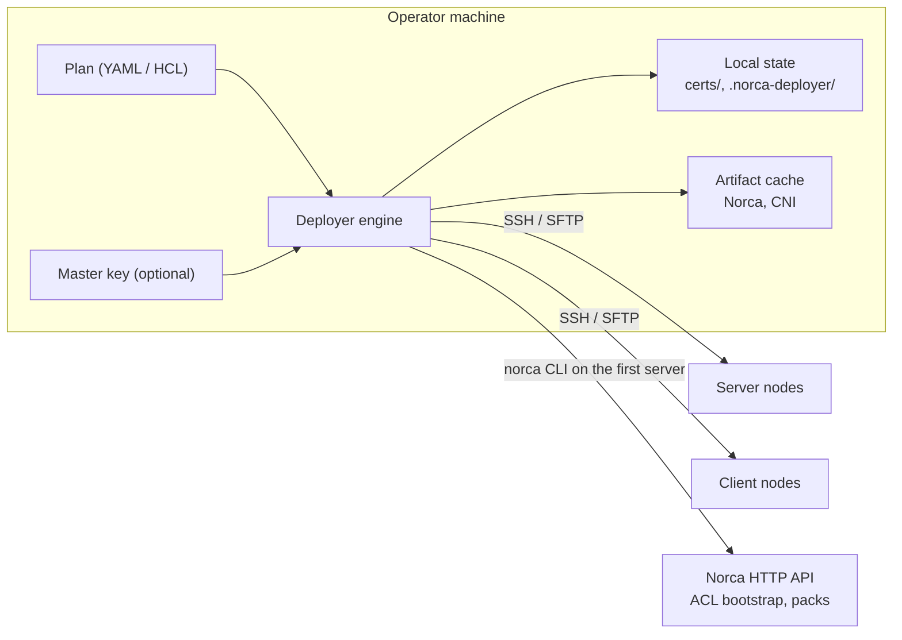

# Norca Deployer Documentation

Norca Deployer installs and maintains [Norca](https://github.com/bacanoo-io/norca) clusters from a declarative plan. It is a single binary that runs on an operator machine (Linux, macOS or Windows) and reaches the nodes over SSH. The nodes need no agent, no Python and no internet access.

## Contents

| Document | Topic |
| --- | --- |
| [Getting started](getting-started.md) | Install the tool, write a first plan, deploy, update |
| [How apply works](how-apply-works.md) | Stages, change detection, rolling restarts, idempotency, local state |
| [Configuration reference](configuration.md) | Every key of the plan with defaults, YAML and HCL |
| [Security](security.md) | CA and certificates, gossip encryption, ACLs, secrets, SSH host keys |
| [Host packages and scripts](host-packages-and-scripts.md) | APT repositories, local `.deb` files, pins, holds, bash scripts |
| [Networking and tuning](networking-and-tuning.md) | Advertise addresses, ports, firewall, sysctl, CNI, volumes |
| [Node labels, pools and resources](node-labels-and-pools.md) | Meta and node class, client defaults, node pools, host networks, reserved resources, drain on shutdown, dynamic ports |
| [Adding and removing nodes](adding-and-removing-nodes.md) | New nodes, decommissioning, the list of installed nodes |
| [Bootstrap secrets and ACL policies](secrets-and-policies.md) | Secrets and Variables after the cluster is up, generated values, job-bound ACL policies, NATS example |
| [Packs](packs.md) | Pack registries and pack releases deployed by `apply` |
| [Multi-region](multi-region.md) | Federated regions with ACL replication |
| [Windows nodes](windows.md) | What differs on Windows clients and servers |

Complete, commented plans are in [../examples](../examples): a single node and a production-style cluster (YAML and HCL), a local development node, and adding and decommissioning nodes.

## Architecture in one picture

- **Plan:** one file per region. YAML and HCL use the same keys.
- **Engine:** validates the plan, prepares every node in parallel, restarts what changed in a safe order and finishes with ACL bootstrap and packs.
- **Transport:** native Go SSH and SFTP. On Linux, `become` runs commands through `sudo`; on Windows, commands run as PowerShell.
- **Local state:** the CA, the gossip key, the ACL management token, trusted host keys and downloaded artifacts live next to the plan file.
