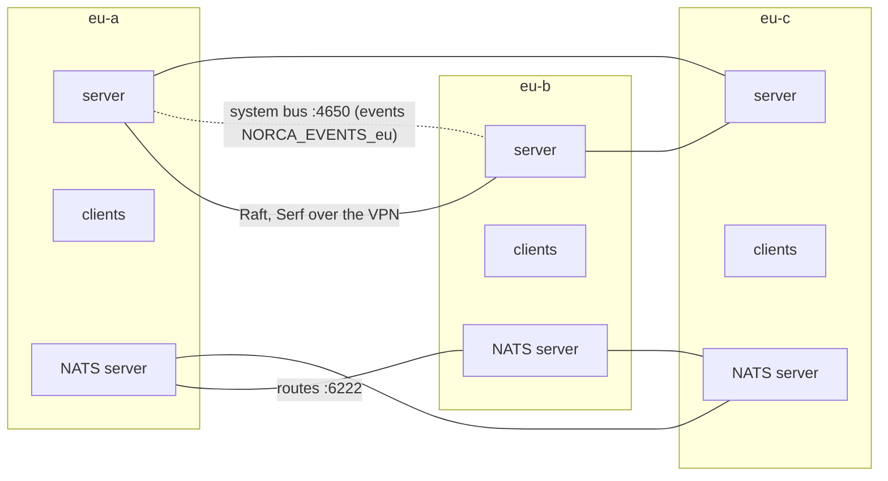

# One Region over Several Datacenters

A region can span several datacenters: availability zones of a cloud region, or buildings of a campus. The servers form one Raft cluster across them, the clients of every datacenter run jobs, the native service catalog knows the datacenter of every instance and can prefer the caller's own, and the system bus of the servers (the event stream, the Consul KV, the usage reports of the autoscaler, the pack push notices) is replicated over the datacenters. The example plan also runs a NATS cluster with one server per datacenter, as an example of a stateful service spread over the datacenters. Example: [multi-datacenter.yaml](../examples/nodes/multi-datacenter.yaml).



## Datacenters or regions

| | Datacenters of one region | Regions |
| --- | --- | --- |
| Distance | Low latency (a few ms round trip) | Any (other cities, clouds) |
| Servers | One Raft cluster over all datacenters | One Raft cluster per region |
| Jobs | One job places over the datacenters (`datacenters = [...]`, `spread`) | A job per region, or a multiregion job |
| Failure of a site | The region keeps running while a majority of the servers is up | Only that region stops |
| Service discovery | One catalog; lookups can prefer the caller's datacenter | One catalog per region; lookups fall back to other regions in a given order |
| NATS | One cluster, routes between the datacenters | One cluster per region, gateways (supercluster) |

Raft needs a majority of the servers to answer quickly; across long distances use [regions](multi-region.md).

## Servers and clients

- **One server per datacenter** (three datacenters, three servers): the Raft quorum is 2 of 3, so the region survives the loss of a whole datacenter. With two datacenters, a datacenter loss can take the majority with it; use a third site (even a small one with only a server) as a tie-breaker.
- Every node names its datacenter (`datacenter: eu-b`). `metadata.datacenter` is the default for nodes without one.
- `cluster_address` is the node's address on the network between the datacenters (usually a VPN); `network.interface_prefix: wg` makes the agents listen on and advertise the VPN interface. All servers join each other over it.
- `raft_multiplier` above 1 relaxes the Raft timing when the datacenters are farther apart than a LAN.
- **`heartbeat_grace`** on the servers (`server_settings.extra_hcl: heartbeat_grace = "60s"`): when a datacenter is lost with its server, the clients that talked to that server wait for the RPC timeout (about 30s) before they heartbeat to another one. Without a grace longer than that, these healthy nodes are marked down and their allocations replaced; a NATS server replaced this way starts with an empty store. The price is that a really failed node is noticed later.
- Common client settings go into `client_defaults`; per-node labels such as the rack into the node's `client_settings.meta` ([node labels](node-labels-and-pools.md)).

## Firewall

`cluster_cidrs` must cover the cluster network of every datacenter (e.g. the VPN `10.10.0.0/16`): RPC and Serf between the servers, the clients to the servers, and the allocation ports between the datacenters. Static ports of workloads that are reached across datacenters go into `extra_ports`, for NATS the client port 4222 and the route port 6222 ([networking](networking-and-tuning.md#firewall)).

## Placing jobs over the datacenters

```hcl
job "web" {
  datacenters = ["eu-a", "eu-b", "eu-c"]

  group "web" {
    count = 6

    # Even spread over the datacenters.
    spread {
      attribute = "${node.datacenter}"
    }
  }
}
```

For stateful services with one instance per datacenter, Norca's `separate` block keeps the instances apart by a node attribute:

```hcl
separate {
  scope    = "${node.datacenter}"
  required = true      # false: a preference
}
```

## Service discovery across the datacenters

The datacenter is the failure domain: model every availability zone, rack or site as one datacenter. Every service registration carries the datacenter of the node that made it, and the native service catalog works without Consul, so the instances of a service that run in several datacenters are found through one catalog.

A consumer should not send every request to any instance. A `discovery` block on the service tells the catalog to answer with the healthy instances of the caller's datacenter first:

```hcl
service {
  name     = "api"
  port     = "http"
  provider = "nomad"

  discovery {
    prefer            = "datacenter"   # the caller's datacenter first, then the rest of the region
    min_local         = 2              # take the rest of the region while fewer than 2 are local
    overflow_fraction = 0.2            # ... or fewer than 20% of all instances are local
  }
}
```

The built-in DNS, the templates and the Task API of a workload, `GET /v1/service/:name?near=self`, the Consul-compatible API with `?near=_agent`, and the sidecar upstreams of native mTLS apply it. Tools that read the whole catalog (the Traefik `nomad` provider, Prometheus service discovery) receive every instance; run one Traefik per datacenter, with `datacenters` set to that datacenter. [Topology-aware routing](https://bacanoo-io.github.io/norca-doc/docs/features/service-discovery/topology/) has the rules, the regional failover, and the default of the overflow fraction.

[External services](https://bacanoo-io.github.io/norca-doc/docs/features/service-discovery/external-services/) declared in a file can choose the node that runs their health checks by datacenter: `checked_by { datacenters = ["eu-a*"] }` picks a client of a matching datacenter (and node pool), and another one takes over when it fails.

## NATS across the datacenters (an example)

NATS is an example of a stateful service with one instance per datacenter, and the one the example plan runs. The `nats` pack of the Norca pack registry runs one NATS server per datacenter:

| Pack value | Meaning |
| --- | --- |
| `datacenters: [eu-a, eu-b, eu-c]`, `count: 3` | Three servers |
| `separate_scope: "${node.datacenter}"`, `separate_required: true` | One per datacenter (and `distinct_hosts`: one per node) |
| `jetstream_enabled: true` | Streams and KV buckets; with 3 replicas they keep a majority without one datacenter |
| `jetstream_unique_tag: dc` | Every server is tagged `dc:<datacenter>`; the replicas of every stream go to different datacenters (also with more servers than datacenters) |
| `cluster_compression: s2_auto` | Routes compressed by their round trip time: more between datacenters, little inside one |
| `auth_mode: userpass`, `users` | Users in accounts; their passwords are secrets `nats/users/<user>` |

The servers find each other through the native service catalog (`<job>-cluster`) and connect with routes on port 6222. Clients connect to any server on port 4222; the service `nats` lists them.

The deployer prepares everything the pack reads:

```yaml
secrets:
  bootstrap:
    - path: nats/users/app
      items: {password: "!generate:nats-app"}       # generated once, kept locally
```

The passwords of the users are in `.norca-deployer/generated/<name>` on the operator machine, for the applications that connect.

## The system bus

The servers embed NATS with JetStream, and the servers of a region form one NATS cluster: the system bus. It carries Norca's own traffic:

| What | Where on the bus |
| --- | --- |
| The event stream of the region | stream `NORCA_EVENTS_<region>`, 72 hours by default |
| The Consul KV of the Consul-compatible API (backend `auto`) | key-value bucket `consul-kv`, shared by every node of the region |
| The task group usage that the clients report to the autoscaler and the metrics store | stream `NORCA_TELEMETRY_<region>`, 1 hour |
| The pack push notices that make the leader sync the registries at once | stream `NORCA_PACK_PUSHES`, 24 hours |

Every stream and the bucket have one replica per server, up to three. With one server per datacenter every datacenter holds a copy, and the loss of one leaves a majority. The bus is not a broker for applications (they keep their own NATS, as in the example above); [System bus](https://bacanoo-io.github.io/norca-doc/docs/features/system-bus/) describes each of the four.

### The event stream

The leader publishes the event stream of the region (jobs, deployments, evaluations, allocations, nodes, services, scaling, ...) on the bus:

- **Subjects:** `nomad.<region>.<namespace>.<topic>`, e.g. `nomad.eu.default.Allocation` (`_` for events without a namespace, such as `nomad.eu._.Node`).
- **Stream:** `NORCA_EVENTS_<region>` with one replica per server (up to three), so the event history survives the loss of a datacenter. Delivery is at least once, with a stable message id for deduplication; a new leader continues after the newest event of the stream.
- **Limits:** 72 hours and 1 GiB by default, oldest events dropped first, S2 compressed (the `bus` block of the servers; set it with `extra_hcl`).
- **Ports:** the routes between the servers use `network.ports.bus_cluster` (4650), consumers connect to `network.ports.bus` (4649); with `apply_firewall_rules` both are opened to `cluster_cidrs`.
- **Access:** a consumer needs an ACL token whose policy has a `bus` rule, for example [events-reader.hcl](../examples/nodes/policies/events-reader.hcl).

```sh
nats --server tls://10.10.1.11:4649 --tlsca .norca-deployer/certs/ca.pem --user "$TOKEN" \
  sub 'nomad.eu.>'
norca operator bus status               # streams, routes and JetStream state of a server
```

## When a datacenter fails

| Component | Behavior with eu-b down |
| --- | --- |
| Norca servers | Two of three remain: leader election and scheduling continue. If the lost server was the leader, the new one waits up to 5 minutes (failover heartbeat TTL) before it marks the nodes of eu-b down |
| Clients in eu-a, eu-c | Those connected to the lost server switch to another one; `heartbeat_grace` keeps them from being marked down meanwhile |
| Jobs | Allocations of eu-b are rescheduled to eu-a and eu-c (within the limits of `datacenters`, `spread` and `separate`) |
| Service lookups | The instances of eu-b stop being returned when their health checks fail or their nodes are marked down; consumers in eu-a and eu-c with `prefer = "datacenter"` keep using the instances of their own datacenter, and the others are served from the rest of the region |
| NATS | Two servers remain; JetStream streams with 3 replicas keep their majority |
| System bus | Two of three replicas of every stream and of the Consul KV bucket remain: events, usage reports, push notices and the Consul KV keep working, and the leader (or a new one) keeps publishing |

`separate_required: true` keeps the third NATS server pending while eu-b is down, instead of putting two NATS servers into one datacenter; it is placed again when eu-b comes back.

## Operations

- **Rollouts:** servers restart one at a time, so every datacenter keeps its quorum share; `upgrade.max_parallel_clients` limits the clients restarted together across all datacenters.
- **Adding a datacenter:** add its nodes with their `datacenter`, extend `cluster_cidrs` if needed, and add it to the `datacenters` of the jobs and packs. Keep the number of servers odd (3 or 5).
- **Removing nodes:** move them to `inventory.decommission` ([adding and removing nodes](adding-and-removing-nodes.md)).

## Tested in the lab

The `multidc` case of the `norca-lab` repository runs this plan on three VMs, one per datacenter: three Raft peers, NATS with one server per datacenter, the system bus clustered over the three servers with the event stream in three replicas; then one datacenter is powered off, and a leader remains, a job is scheduled, and its events reach the stream on the other two servers; it is started again and everything is back.
